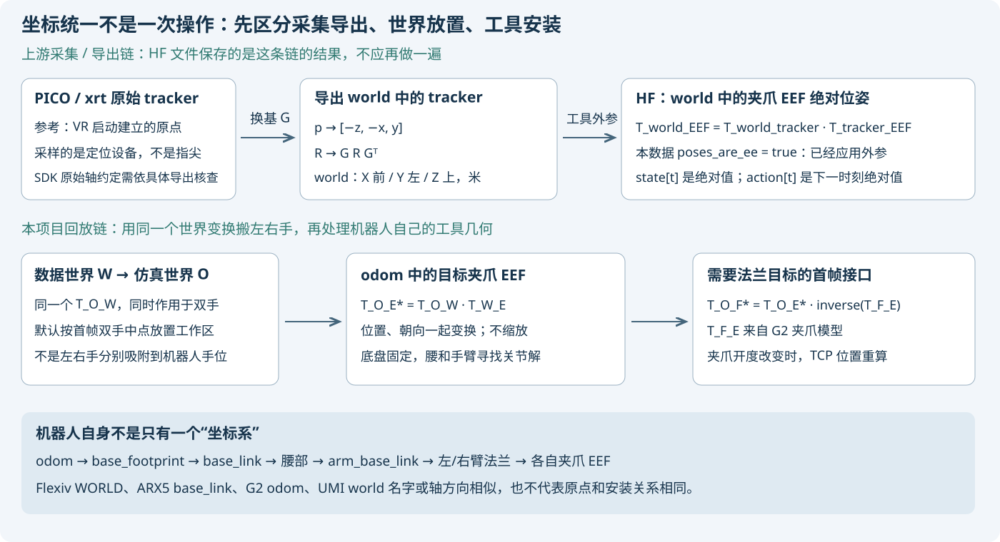
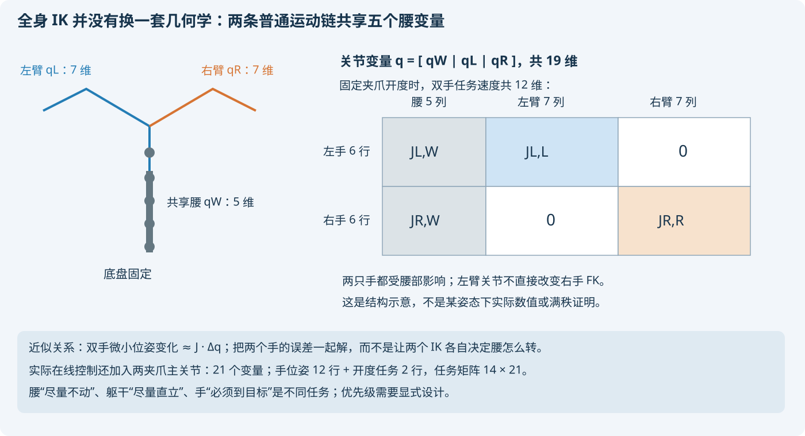
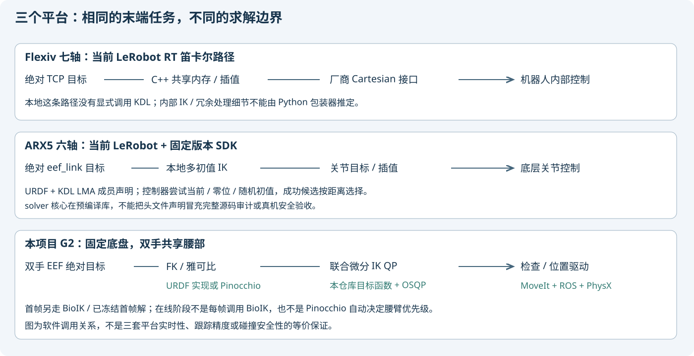

# 项目统一总览：G2 全身 IK、UMI 回放与 WBC 学习手册

> **唯一总结入口：仓库根目录 `PROJECT_GUIDE_ZH.md`。**
> 所有本工程复现、坐标、IK 原理、机械臂对照、实验结果、问题与下一阶段总结在这里收口。
> 原有专项文档不删除；它们是历史参考和证据，不再作为并列的“最新总览”。
> 本页配图、视频和报告仍引用原媒体目录，不移动历史文件或修改其证据哈希。

## 先看结果，再选阅读路线


[播放实际四分屏视频](wbc_demo/umi_replay/media/episode-000-v6/head_left.mp4) · [打开带指标的验收页](wbc_demo/umi_replay/media/episode-000-v6/index.html)

**这张图和视频来自已完成的 v6 单次真实仿真，不是本轮新运行，更不是所有问题已修复的证明。**
最新诊断仍包含控制长尾、保护停止和腰臂优先级未实现的限制。

| 想先看什么 | 从这里进入 |
|---|---|
| UMI 绝对 / 增量、world、tracker 与 EEF | [第 1 节](#chapter-1) → [完整变换与首帧](#chapter-3) |
| DH / URDF / KDL 与真实连杆参数 | [第 4 节](#chapter-4) → [三平台参数表](#chapter-5) |
| 全身 IK / 雅可比 / QP / 腰臂优先级 | [第 6 节](#chapter-6) → [求解与优先级](#chapter-7) |
| 本地 Flexiv 七轴与 ARX5 六轴实现 | [第 8 节](#chapter-8) |
| 从零动手计算，不连接机器人 | [第 9 节](#chapter-9) |
| 做过什么、成功 / 失败与验收资料 | [第 10 节](#chapter-10) → [图视频](#chapter-11) |
| 接下来开发 / 验证 / 学习什么 | [第 12 节](#chapter-12) |
| 所有专项总结的历史索引 | [第 13 节](#chapter-13) → [源码来源](#chapter-14) |

## 当前状态：不要只看“跑起来了”

| 项目 | 当前结论 |
|---|---|
| 平台范围 | 固定底盘、固定头部，腰 5 + 双臂 14；在线另控制两夹爪主关节 |
| UMI 契约 | HF 保存 world 中的绝对 EEF 位姿，tracker 外参已应用；开度 0 闭合 / 1 开启 |
| 求解器 | 在线是仓库微分 IK + OSQP；模型可选 URDF / Pinocchio；首帧另用 BioIK / 冻结目标 |
| 原速回放 | 已有 41.667 s 源片段的真实 1× 完成记录；不是全部 episode、所有负载都通过 |
| 腰臂优先级 | 仍为加权协同，不保证手臂优先；roll 关节限幅不能约束前后弯腰 |
| 已知风险 | 控制长尾、制动可行域、HOLD 连续性、部分夹爪跟踪保护停机 |
| 不应宣称 | 硬实时、真机安全控制器、真实抓取任务成功、已完成力矩 / 接触力 WBC |

## 文档维护约定

- 本工程新增总结只更新本文件，不再在子目录创建新的总结入口或“最新指南”。
- README 和旧手册入口都指向本文件；构建、包级接口和源码规范仍按各模块原技术文档查阅。
- 图文说明必须区分真实视频 / 浏览器截图、URDF FK 图、结构示意；不得用示意图冒充实测。
- 成功、失败、未执行分开记录；指标注明模型残差、反馈跟踪误差或显示交付的层次。
- 原始数据和大日志仍在 `wbc_demo/data/`、`wbc_demo/logs/`，不假装它们全部随 Git 上传。

## 工程地图

```text
PROJECT_GUIDE_ZH.md                 唯一维护的图文总结、学习与工作入口
README.md                          指向本总览；保留上游平台说明
AGENTS.md                          固化后续总结必须收口到根目录的规则
wbc_demo/                          复现、控制、转换与实验代码
  umi_replay/media/                已有图片、视频和证据；不重复搬运
  data/、logs/                     本机数据 / 原始过程日志，不随 Git 全量上传
  *.md、umi_replay/*.md            保留专项历史；旧手册只作根目录跳转
source/                            Genie Sim 原有模块和技术文档
```

---

> 正文资料整理于 **2026-10-20**，本页现为仓库根目录的唯一项目总结入口。
> 当前控制代码基线：`5015ce3`。本文新增讲解与源码对照，不代表又完成了一轮机器人运动验收。
> 原有子文档、视频、失败记录均保留；本页负责解释概念、串起证据，并区分当前能力和历史方案。
>
> 一句话：**先把“哪个刚体在谁的坐标系下”说清，再用机器人几何模型求关节；全身 IK 是把共享身体变量一起求，不是换一套神秘的连杆公式。**

## 阅读导航

| 你想解决什么 | 阅读位置 |
|---|---|
| UMI 是绝对还是增量？是 tracker 还是 EEF？ | 第 1～3 节 |
| `odom`、底座、法兰、TCP 怎么联系？ | 第 2～3 节 |
| DH / URDF / KDL、连杆长度与 FK | 第 4～5 节 |
| 全身 IK 最简公式与雅可比 | 第 6～7 节 |
| 本地 Flexiv 七轴、ARX5 六轴到底怎么做？ | 第 8 节 |
| 可以自己动手算的简易教程 | 第 9 节 |
| 目前做过什么、能看哪些视频、还缺什么 | 第 10～12 节 |
| 散落子文档的分类索引与源码来源 | 第 13～14 节 |

---

<a id="chapter-1"></a>

## 1. 先直接回答你的坐标与数据问题

以下结论针对固定 revision 的 **`TacVerse/xtac-umi-g1-block-to-box`**，不是所有叫 UMI 的数据。

| 问题 | 本项目核对后的结论 |
|---|---|
| 原始定位设备是什么？ | PICO tracker / 头显；手持 XTac 夹爪。数据里的 G1 不是 Unitree G1 机器人 |
| 训练数据保存的是哪个参考系？ | 已导出的共同 `world`：X 前、Y 左、Z 上，单位米 |
| 原点在哪里？ | 邻近采集驱动说明 VR Unity app 启动时建立原点；HF 没提供每次采集原点的实测标定，不可假装它就是机器人底座 |
| 是绝对量还是增量？ | `observation.state[t]` 保存该时刻的**绝对位姿**，不是逐帧位移 / 角度差 |
| 是 tracker link 还是 EEF link？ | HF 逐段元数据为 `poses_are_ee: true`，保存的是**夹爪 EEF**；tracker→EEF 外参已应用 |
| `action[t]` 是什么？ | 非末帧逐元素核对等于 `observation.state[t+1]`，也是下一时刻的绝对值，不是增量；末帧单独按文件核查，不凭规则外推 |
| `r1…r6` 是六个关节吗？ | 不是，是旋转矩阵前两列的 6D 旋转表示，实际只代表三维朝向 |
| 机器人的参考系是什么？ | 当前 G2 目标和误差都用仿真的 `odom`，机器人几何沿 `base_link → 腰 → 双臂 → 夹爪 EEF` 展开 |
| 怎么统一？ | 一个共同的 `T_odom_world` 左乘左右手所有位姿；工具几何则单独处理，不将两只手分别“贴到”机器人初始手位 |
| 已完成真实标定了吗？ | 没有。当前是显式的世界放置与模型工具几何，不是硬件世界 / TCP / 相机标定 |



### 1.1 不要混淆三层“原始”

1. **PICO SDK 原始输出**：定位设备 link 的位置 / 朝向。
2. **采集 MCAP 中的 topic**：随录制版本不同，可能已做坐标换基、甚至已经合成 EEF。
3. **本次 HF Parquet**：已经导出成共同 world 下的 EEF 绝对位姿。

因此“传感器叫 PICO”不能推出“HF 每一行还是 PICO tracker pose”；
“topic 名字叫 `/pico/pose`”也不能单独证明里面没有应用工具外参。
要看逐段 metadata 和真实导出分支。本数据应从第 3 层直接进入机器人世界放置，**不能再执行一遍前两层转换**。

### 1.2 “绝对”不代表地球上的绝对定位

这里的绝对，是“相对于同一个采集 world 的位姿”。VR app 重启，原点可能变化。
它不表示 GPS 坐标、不表示相对于机器人底座，也不表示不同 session 已经共用一个经过标定的世界。

例如同一段的左手位置依次为：

```text
state[0].x = 0.300 m
state[1].x = 0.310 m
state[2].x = 0.320 m
```

每一行可以直接解释为这个世界中的手位；对应的位移增量才是 `+0.010 m、+0.010 m`。
把绝对值当增量累加，会得到错误的 `0.300 → 0.610 → 0.930 m`。

**训练时另外采用 delta action，不会反过来改变原始数据文件的语义。**
模型预处理、动作表示、机器人驱动协议必须分开核查。

### 1.3 以后若改成增量动作，必须再说明增量写在哪个系里

对完整位姿，至少有两种常用定义：

$$
\Delta T_{spatial}=T_{t+1}T_t^{-1},\quad T_{t+1}=\Delta T_{spatial}T_t;
\qquad
\Delta T_{body}=T_t^{-1}T_{t+1},\quad T_{t+1}=T_t\Delta T_{body}.
$$

一个相对外部参考表达，一个相对当前刚体表达；一般不相等。
例如“往前 1 cm”是世界前方还是夹爪朝向的前方，机器人转过身后效果完全不同。
不能直接对两个 4×4 位姿矩阵或四元数逐元素相减，就宣称得到可直接执行的 SE(3) 增量。
本次回放没有使用这些增量定义，而是每时刻从绝对目标构造误差。

---

<a id="chapter-2"></a>

## 2. 坐标变换的最低必备知识

### 2.1 一个统一记号

本文用 `T_A_B` 表示“**B 坐标系在 A 中的位姿**”，也把 B 中的点变换到 A。

$$
{}^A T_B =
\begin{bmatrix}
{}^A R_B & {}^A p_B \\
0 & 1
\end{bmatrix},
\qquad
{}^A p = {}^A R_B\,{}^B p + {}^A p_B.
$$

- `R` 是 3×3 旋转矩阵，描述轴的朝向。
- `p` 是 3×1 平移，描述原点的位置。
- 位姿 = 位置 + 朝向；说“EEF 坐标”时最好明确指完整位姿还是只有 XYZ。
- 长度统一用米、角度计算用弧度；界面显示的度需要转换。

像连续换地铁站：`C → B → A`，相邻下标接起来：

$$
{}^A T_C = {}^A T_B\,{}^B T_C.
$$

不是把平移向量直接相加，因为后一个平移通常写在正在转动的局部坐标系里。

### 2.2 世界变换左乘，局部工具偏置右乘

已知 `T_world_tracker` 和 tracker 安装到 EEF 的外参 `T_tracker_EEF`：

$$
{}^{world}T_{EEF}
= {}^{world}T_{tracker}\,{}^{tracker}T_{EEF}.
$$

其中：

$$
p_{EEF}=p_{tracker}+R_{tracker}\,p_{tracker\rightarrow EEF}.
$$

生动的例子：tracker 装在一根长杆的根部，EEF 在杆尖。转动手柄，杆尖会绕根部走弧线。
如果把局部偏移直接加到 world 的 XYZ 而不乘旋转，杆尖就不会随杆转动，显然不对。

### 2.3 机器人上这些 frame 不是一回事

| frame / 概念 | 机械含义 | 本项目中的角色 |
|---|---|---|
| 仿真 world / `odom` | 固定外部参考 | G2 的目标、跟踪误差和世界放置使用 `odom`；物理渲染侧的 world 放置另有显式配置 |
| `base_footprint` | 底盘地面参考 | ROS 平面根关节的参考；并不是手的参考系 |
| `base_link` | 机器人底座刚体 | URDF 腰臂运动链起点 |
| `body_link1…5` | 腰 / 躯干各刚体 | 腰的运动改变两侧手臂根部的位置和方向 |
| `arm_base_link` | 两臂公共安装参考 | 本模型由躯干通过一个固定变换连接 |
| `arm_l_end_link / arm_r_end_link` | 机械臂末端法兰参考 | 不是夹爪指尖；旧 MoveIt IK 接口使用它们 |
| `gripper_l_eef / gripper_r_eef` | 本项目定义的夹爪 TCP / EEF | 动态指尖面中点，用于当前回放与误差检查 |
| 相机 optical frame | 成像坐标系 | 不能与 EEF 或头部 tracking frame 混为一谈 |

坐标系名相同也不保证位置相同：Flexiv 的 WORLD、ARX 的 base、G2 的 odom 是三套平台各自定义的参考。
固定支架上的左右臂，各自 base 也不天然相同，需要安装外参才能在同一个世界里比较双手。

---

<a id="chapter-3"></a>

## 3. 本次 UMI 的完整坐标契约与首帧对齐

### 3.1 PICO → 导出 world：这是上游已做的换基

本地 TacCap-core 真源：`crates/taccap-mcap/src/lib.rs:pico_pose_to_world`。

$$
G=\begin{bmatrix}0&0&-1\\-1&0&0\\0&1&0\end{bmatrix},
\qquad p_W=G p_P=[-z_P,-x_P,y_P]^T,
\qquad R_W=G R_P G^T.
$$

这是实际导出代码的契约，不是根据 PICO 品牌印象猜一套镜像变换。
注意旋转用了共轭 `G R Gᵀ`：它是在采用一致的新坐标基约定，不是后面搬整个轨迹时只换 world 的操作。
不能把这里的旋转共轭与下一节 `R_odom_hand = R_odom_world R_world_hand` 混用。

SDK 原生轴 / 手性的上游文档存在不一致，邻近驱动明确要求真机核验；
当前可确认的是**导出程序执行了什么，以及 HF 文件已经处于哪一层**，不是本轮又做了设备坐标实测。

### 3.2 tracker → EEF：外参只应用一次

本地导出分支 `bi_taccap.rs:ee_pose` 的逻辑是：

```text
若 poses_are_ee = true：直接使用采样位姿。
否则：T_world_EEF = T_world_tracker × T_tracker_EEF。
```

HF 逐段外参文件记录左右 tracker→EEF，平移约为：

```text
left : [−0.160769, −0.105859, +0.024897] m
right: [−0.161934, +0.106110, +0.025323] m
```

这是完整刚体外参中的平移部分，还有旋转，不能只加这三个数。
本数据的 `poses_are_ee=true` 表示它们已处理，**不是要求回放时再乘一次**。

元数据外参四元数为 `wxyz`；转换后的回放 JSON 使用 `xyzw`。
两者只有排列不同也足以让姿态完全错乱，不能直接互填。

### 3.3 29 维状态怎样拆？

```text
左手：x y z r1 r2 r3 r4 r5 r6 opening    10 维
右手：x y z r1 r2 r3 r4 r5 r6 opening    10 维
头部：x y z r1 r2 r3 r4 r5 r6             9 维
总计：29 个存储数值，不是 29 个独立机械自由度。
```

旋转 6D 用前两列 `a,b` 重建矩阵：

$$
u=\frac{a}{\|a\|},\quad
v=\frac{b-(u^Tb)u}{\|b-(u^Tb)u\|},\quad
R=[u\ v\ u\times v].
$$

开度已经归一化：0 闭合、1 开启。G2 映射到自己的夹爪主关节，再由 mimic 跟随指关节运动。
这不是把 UMI 原始电机弧度直接发给 G2。

### 3.4 导出 world → G2 odom：本项目选定工作区

令第一帧双手中点为 `m0`，希望放在机器人 odom 中的 `c`：

$$
m_0=\frac{p_{L,0}+p_{R,0}}{2},\qquad
R_{OW}=R_z(\psi),\qquad
t_{OW}=c-R_{OW}m_0.
$$

以后每一帧、每一只手都用同一个变换：

$$
{}^OT_{E,s}^*(t)={}^OT_W\,{}^WT_{E,s}(t),\qquad s\in\{L,R\}.
$$

本段真实数值：

| 量 | 值，单位 m |
|---|---|
| 原始首帧双手中点 `m0` | `[0.213688, −0.013737, −0.704932]` |
| 选择的工作区中点 `c` | `[0.300000, 0, 1.050000]` |
| `yaw` | `0°`，所以这次只发生共同平移 |
| 共同平移 `t` | `[0.086312, 0.013737, 1.754932]` |
| 映射后左手 EEF | `[0.320198, 0.120068, 1.064040]` |
| 映射后右手 EEF | `[0.279802, −0.120068, 1.035960]` |

保持了双手的相对几何：

$$
p'_L-p'_R=R_{OW}(p_L-p_R),\qquad
(T'_{E,L})^{-1}T'_{E,R}=T_{E,L}^{-1}T_{E,R}.
$$

这才是“同一坐标系下放置整个双手动作”，而不是对左右手分别找不同平移。
人和机器人臂展不同不在这个刚体变换里解决；缩放 / 重定向需要另立任务，不能偷偷改变比例。

**`c.x=0.30` 是 odom 的 X，不是底座前方 30 cm。**
记录中的 G2 `base_link` 约在 odom `[-0.25,0,0.04] m`，目标中点因此在底座前方约 55 cm。

当前在线对照还会冻结已经选好的 `T_odom_world`，不让每个 episode 各自重定位。
配置名 `calibrated` 在这里仅表示显式给定矩阵，**不是硬件世界标定已经完成**。

### 3.5 EEF 目标怎样变成法兰目标？

如果接口解的是法兰 F，但数据给的是夹爪 EEF E：

$$
{}^OT_F^*={}^OT_E^*\,({}^FT_E(g))^{-1}.
$$

其中 `g` 是当前开度。当前 G2 EEF 来自夹爪 URDF / 指尖面几何，开合时重新计算，
轴约定为 X 指向指尖、Z 朝腕部相机侧、Y 补成右手系。
开度改变不意味着每个夹爪的中点一定移动很多，而是**不能不经核查就假设固定不变**。

EEF 是共同任务语义，不是两种机械夹爪天然具有同样的 CAD 轴和硬件 TCP。
本项目采用模型约定对齐，尚无实际工具 / 相机安装标定；不能把这个结果等同于硬件接触点完全吻合。

### 3.6 首帧不是机器人瞬移，也不是复制 UMI 关节

```text
读取机器人实际初始关节 q_home
→ 固定上面的双手 EEF 目标和开度
→ 求 / 读取首帧关节候选 q0
→ 验证模型残差、原生限位、耦合、碰撞与接近路径
→ 平滑就位到 q0
→ 源视频相位从 0 开始，进行在线 IK。
```

早期 `q0` 由 MoveIt / GenieBioIK 求解；当前对照启动命令的 `--approach-reference`
读取历史已验证的首帧关节目标并重新核查。源数据本来没有 G2 关节角可供复制。

一个共同刚体变换也不能把任意两组初始双手姿态都完美重合：如果机器人 home 双手间距与源首帧不同，
仅旋转 / 平移整个世界不会改变这个间距。要么机器人先移动到合适首帧，要么显式做运动重定向，
不能一边分别吸附两只手，一边声称原双手几何完全未变。

---

<a id="chapter-4"></a>

## 4. 从普通机械臂开始：连杆参数、DH、URDF、KDL

### 4.1 只有“连杆长度”为什么不够？

两台机器人即使都写着“上臂 30 cm、前臂 30 cm”，仍可能完全不同：

- 相邻转轴是平行、相交，还是有偏置？
- 每根轴绕局部 X、Y 还是 Z 转？
- 零位怎么定义？父子坐标系有无固定 90° / 180° 旋转？
- 法兰到夹爪指尖还有多长、装了什么方向？
- 正负限位、机械耦合、工具开度是否影响末端？

**完整模型至少需要每级固定变换、关节类型 / 轴、关节变量，以及最终工具变换。**

### 4.2 DH 是建模约定，KDL 是库，两者不在同一分类层

| 名称 | 它是什么 | 你需要提供什么 |
|---|---|---|
| 标准 DH | 每级用 4 个参数描述几何的一种坐标约定 | `a, α, d, θ` 以及选轴 / 零位约定 |
| URDF | 机器人树结构与几何 / 运动属性文件格式 | `parent / child / origin xyz,rpy / axis / type / limit` 等 |
| KDL | 运动学 / 动力学算法库 | Chain / Tree 中的 Segment、Joint、Frame；可以从 URDF 解析 |
| Pinocchio | 刚体运动学 / 动力学算法库 | 模型和状态，常从 URDF 建树 |
| IK 求解器 | 寻找满足末端目标的关节变量的算法 | 几何模型、目标、初值、限位和任务偏好 |

所以不应说“这个机器人采用 KDL 长度而另一个采用 Pinocchio 长度”。
它们可以使用同一份 URDF 的同一套几何，只是实现和上层求解方法不同。

### 4.3 标准 DH 的一节公式

采用标准 DH，而不是改进 DH：

| 参数 | 在此约定下的意义 | 常见单位 |
|---|---|---|
| `θ_i` | 绕上一根 Z 轴转动，建立本节角度 | rad |
| `d_i` | 沿上一根 Z 轴的偏移 | m |
| `a_i` | 沿本节 X 轴、连接两根 Z 轴的公法线距离 | m |
| `α_i` | 绕本节 X 轴的扭转，使前后两根 Z 轴方向匹配 | rad |

$$
A_i(q_i)=R_z(\theta_i)T_z(d_i)T_x(a_i)R_x(\alpha_i),
$$

$$
A_i=
\begin{bmatrix}
\cos\theta_i&-\sin\theta_i\cos\alpha_i&\sin\theta_i\sin\alpha_i&a_i\cos\theta_i\\
\sin\theta_i&\cos\theta_i\cos\alpha_i&-\cos\theta_i\sin\alpha_i&a_i\sin\theta_i\\
0&\sin\alpha_i&\cos\alpha_i&d_i\\
0&0&0&1
\end{bmatrix}.
$$

对于转动关节，通常 `θ_i=q_i+θ_offset,i`；`a, α, d` 来自模型。
`a` 不是“这一节外壳的总长度”，而是按 DH 选轴得到的几何参数。
标准 DH、改进 DH、不同零位的参数表不能直接混抄。

### 4.4 本项目更实用的 URDF 一节公式

对于普通转动关节：

$$
A_i(q_i)=
\underbrace{T(x_i,y_i,z_i)R_z(yaw_i)R_y(pitch_i)R_x(roll_i)}_{\text{URDF origin，固定}}
\underbrace{R(\hat a_i,q_i)}_{\text{绕 joint 局部 axis 转动}}.
$$

对移动关节，把最后一项换成沿 `axis` 的平移；固定关节没有变量项，但它的固定变换仍然不能漏掉。
URDF 的 `axis` 写在关节局部系中，受前面的 origin 旋转影响。

例如 G2 左臂各转轴在文件里大多都写 `(0,0,1)`，**不表示它们在世界里全是平行的 Z 轴**；
相邻的 `origin rpy=±π/2` 已经把这些局部轴转到不同方向。

### 4.5 KDL 的典型链路是什么？

概念流程，而不是本仓库可以直接复制编译的完整程序：

```text
URDF → kdl_parser → KDL::Tree
     → getChain(base_link, eef_link)
     → ChainFkSolverPos_recursive：给 q 算末端
     → ChainIkSolverPos_LMA：给目标和 q_seed 找 q。
```

KDL 的 Segment / Joint / Frame 组合负责保留原点和轴的关系。
不要把 URDF 的 origin 简单塞进一个任意 `RotZ + 固定长度` 就以为完成转换；
特别是旋转与平移顺序、局部转轴位置很容易出错。
库可以帮助解析，但它不会猜出你忘掉的工具安装或世界外参。

---

<a id="chapter-5"></a>

## 5. 三个具体模型的几何参数

下面是**实际本地文件里的 URDF 参数**，不是为机器人编造的 DH 表。
统一单位：`xyz` 为 m，`rpy` 为 rad，axis 为局部单位向量。
`π` / `π/2` 是易读近似；原文件中一些角度使用截断值，例如 ARX 的 `−3.1416`，复算应读取原文件。

### 5.1 ARX5 / X5：六轴 + 固定末端

来源：本地 LeRobot 固定的 ARX5_SDK commit `4dcc490dd1fddefa96240bd153a0718f8d57b5a8`，`models/X5.urdf`。

| joint | origin xyz | origin rpy | axis |
|---|---|---|---|
| joint1 | `(0,0,0.0603)` | `(0,0,0)` | Z |
| joint2 | `(0.020,0,0.0402)` | `(0,0,0)` | Y |
| joint3 | `(−0.264,0,0)` | `(−3.1416,0,0)` | Y |
| joint4 | `(0.245,0,−0.056)` | `(0,0,0)` | Y |
| joint5 | `(0.06575,−0.001,−0.0825)` | `(0,0,0)` | Z |
| joint6 | `(0.02845,0,0.0825)` | `(−3.1416,0,0)` | X |
| gripper_fixed_joint | `(0.145,0,0)` | `(0,0,0)` | 固定到 `eef_link` |

能直观看到约 264 mm 和 245 mm 两段主要偏置，但腕部还有偏置和固定工具段。
“ARX5”是产品名，这里的 X5 配置 `joint_dof=6`，不是五轴。
`X5`、`X5_umi` 是不同配置，不能只看同属 ARX 就混用 URDF / 工具长度。

该固定版 `X5` 配置的关节范围为：

```text
q_min = [−3.14, −0.05, −0.20, −1.60, −1.57, −2.00] rad
q_max = [+2.618,+3.50, +3.20, +1.55, +1.57, +2.00] rad
```

范围来自 SDK `config.h`，不是通过外壳长度推出来的。
`eef_link` 对应这个具体模型末端，**不保证等于你另外安装的任意夹爪的真实 TCP**。

### 5.2 Flexiv / Rizon4：七轴 + 法兰，TCP 另算

来源：libpyflexiv 固定依赖的 RDK `a2dcedc637dc413b0e51c1b6442a614874d60f33`，
`resources/flexiv_Rizon4_kinematics.urdf`。
**这是 Rizon4 模板，不是所有 Rizon4R / 4s / 历史硬件型号的通用标定表。**

| joint | origin xyz | origin rpy | axis |
|---|---|---|---|
| joint1 | `(0,0,0.155)` | `(0,0,−π)` | Z |
| joint2 | `(0,0.030,0.210)` | `(0,0,0)` | Y |
| joint3 | `(0,0.035,0.205)` | `(0,0,0)` | Z |
| joint4 | `(−0.020,−0.030,0.190)` | `(0,0,−π)` | Y |
| joint5 | `(−0.020,0.025,0.195)` | `(0,0,−π)` | Z |
| joint6 | `(0,0.030,0.190)` | `(0,0,0)` | Y |
| joint7 | `(−0.015,0.073,0.110)` | `(0,−π/2,0)` | Z |
| link7_to_flange | `(0,0,0.081)` | `(0,0,−π)` | 固定到 `flange` |

这张表可以教你如何计算标称 FK / 雅可比，**不能证明 LeRobot 实际用这张表执行 IK**。
当前 Flexiv 路径使用厂商笛卡尔接口；实际控制器模型与安装 TCP 以连接机器人和工具配置为准。
本地 RDK `Model::SyncURDF` 文档明确说模板参数可能与旧硬件不同，需要从所连接机器人同步。
本轮没有连接硬件、调用同步或修改它的工具配置。

### 5.3 G2：共享腰部五轴，再接两条七轴链

来源：本仓库 `source/geniesim_ros/src/ros_ws/src/genie_sim_robot_model/urdf/genie_g2_crsB_swiftpicker.urdf`。

腰部和两臂公共安装：

| joint | origin xyz | origin rpy | axis |
|---|---|---|---|
| idx01_body_joint1 | `(0.102,0,0.144)` | `(0,0,0)` | Y |
| idx02_body_joint2 | `(0,0,0.360)` | `(0,0,0)` | Y |
| idx03_body_joint3 | `(0,0,0.380)` | `(0,0,0)` | Y |
| idx04_body_joint4 | `(0,0,0)` | `(0,0,0)` | X |
| idx05_body_joint5 | `(0,0,0.149)` | `(0,0,0)` | Z |
| idx20_arm_base_joint | `(0,0,0.3085)` | `(−π/2,0,0)` | 固定到 `arm_base_link` |

左臂接在这个安装坐标系后：

| joint | origin xyz | origin rpy | axis |
|---|---|---|---|
| idx21_arm_l_joint1 | `(0,0,0.069)` | `(0,0,0)` | Z |
| idx22_arm_l_joint2 | `(0,0,0.1745)` | `(+1.5708,0,0)` | Z |
| idx23_arm_l_joint3 | `(0,0,0)` | `(−1.5708,0,0)` | Z |
| idx24_arm_l_joint4 | `(0.0105,0,0.332)` | `(+1.5708,0,0)` | Z |
| idx25_arm_l_joint5 | `(−0.0105,0,0)` | `(−1.5708,0,0)` | Z |
| idx26_arm_l_joint6 | `(0,0,0.278)` | `(+1.5708,0,0)` | Z |
| idx27_arm_l_joint7 | `(0,0,0)` | `(+1.5708,0,+1.5708)` | Z |
| arm_l_end_joint | `(0.090,0,0)` | `(π,−π/2,0)` | 固定到法兰 |

右臂主要尺寸类似，但安装不同：第一节 xyz 为 `(0,0,−0.069)`、rpy 为 `(π,0,0)`，
其余固定旋转使用对应右侧 URDF 值，不能仅将左手所有坐标取负来代替。
法兰到指尖 EEF 还要继续经过夹爪的机构几何，不能在这张表最后一行停止。

**沿链各平移长度之和只能作某些可达性分析的保守上界，不等于真实工作空间球半径。**
限位、固定旋转、目标朝向、碰撞、耦合都会改变可达集合。
与之相反，若目标到固定臂根的距离已经超过严谨计算的臂长上界，可以构成不可达证明，
比“局部 IK 试了一次失败”强得多。

---

<a id="chapter-6"></a>

## 6. 从单臂公式走到全身 IK

### 6.1 六轴、七轴的 FK 都是同样的连乘

$$
{}^WT_E(q)=
{}^WT_B
\left(\prod_{i=1}^{n}A_i(q_i)\right)
{}^FT_E,
\qquad n=6\ \text{或}\ 7.
$$

`T_W_B` 是底座安装，`A_i` 来自前面的真实模型参数，`T_F_E` 是工具安装。
FK 输入关节 q，输出末端；IK 反过来给定目标，寻找 q：

$$
\text{find }q\quad\text{such that}\quad FK(q)\approx T_E^*,
\qquad q_{min}\le q\le q_{max}.
$$

“6 个关节 → 6 维位姿”也不代表总有唯一解：可能多个肘 / 腕分支、限位无解或奇异。
“7 个关节 → 6 维位姿”在通常满任务秩附近有一个局部冗余方向，但并非所有姿态下都恰好如此。

### 6.2 G2 只是在前面多了一段共享运动链

固定夹爪开度、暂不考虑头和轮子，令：

$$
q=[q_W^T,q_L^T,q_R^T]^T\in\mathbb R^{19},
\qquad q_W\in\mathbb R^5,\ q_L,q_R\in\mathbb R^7.
$$

两只手分别是：

$$
\begin{aligned}
T_{E,L}(q)&=T_{O,B}\,T_{waist}(q_W)\,T_{mount}\,T_{arm,L}(q_L)\,T_{tool,L}(g_L),\\
T_{E,R}(q)&=T_{O,B}\,T_{waist}(q_W)\,T_{mount}\,T_{arm,R}(q_R)\,T_{tool,R}(g_R).
\end{aligned}
$$

**最简全身 IK：找同一个 `q_W`，同时让两只手满足目标。**
不能左手解出一套腰角、右手再解另一套，然后直接拼在一起。

当前底盘 `T_O_B` 固定；未来若底盘可动，它也成为变量。
轮式底盘的非完整运动约束、速度与避障不能因为“写进 FK”就自动解决。

### 6.3 把“差多少”写成一个可以优化的误差

以末端当前位姿 `T(q)=(R,p)`、目标 `(R*,p*)` 为例：

$$
e(q)=
\begin{bmatrix}
p^*-p(q)\\
\operatorname{Log}(R^*R(q)^T)^\vee
\end{bmatrix}\in\mathbb R^6.
$$

旋转部分是 SO(3) 的旋转向量误差，不是随意减欧拉角，也不是减四元数四个分量。
这里采用世界系表达，与本项目 `matrix_error` 一致；换成 body / LOCAL 表达时，雅可比也必须一致。

静态 / 位姿级简化目标：

$$
\min_q\quad
\|W_Le_L(q)\|^2+\|W_Re_R(q)\|^2+
\lambda_W\|q_W-q_{W,ref}\|^2+
\lambda_A\|q_A-q_{A,ref}\|^2
$$

同时加入限位、耦合、碰撞等约束。这是教学模型，**不是说当前首帧 BioIK 的内部实现恰好就是这个公式**。
其中 `q_A` 合并两条机械臂的关节变量，`q_ref` 是希望靠近的参考姿态。
米和弧度不能不考虑尺度地混加；可以用特征长度把旋转误差换算成有意义的权重尺度。

### 6.4 雅可比的中文与每一列如何从连杆算出来

Jacobian 通常译为**雅可比矩阵**，也叫速度雅可比；工程交流一般直接说“雅可比”。

$$
\begin{bmatrix}\dot p\\\omega\end{bmatrix}=J(q)\dot q,
\qquad \Delta x\approx J(q)\Delta q.
$$

对于转动关节 i，把它的轴和轴上原点换到与末端同一个参考系：

$$
J_i=
\begin{bmatrix}
\hat z_i\times(p_E-o_i)\\
\hat z_i
\end{bmatrix}.
$$

`z_i` 这里泛指转换后的实际关节轴，不是说每一轴必须是 URDF Z。
移动关节列则为 `[axis;0]`。这就是“连杆参数 → 每级 FK → 每级轴和原点 → 雅可比”的计算链。

几何直觉：同样转 1°，远离关节轴的手移动得更多；叉乘正好给出这种杠杆关系。
若末端恰在某根转轴线上，这一列的平移部分可以为零，但朝向部分仍有贡献。

### 6.5 双手联合雅可比为什么长成这样？

$$
\begin{bmatrix}v_L\\v_R\end{bmatrix}=
\underbrace{\begin{bmatrix}
J_{L,W}&J_{L,L}&0\\
J_{R,W}&0&J_{R,R}
\end{bmatrix}}_{12\times19}
\begin{bmatrix}\dot q_W\\\dot q_L\\\dot q_R\end{bmatrix}.
$$



两个腰部块通常都有贡献；左臂关节不直接改变右手 FK，因此右上 / 左下对应臂块为零。
几何导数为零不等于两个手臂可以忽略碰撞、相对任务等额外耦合。

实际在线还控制两夹爪主关节，因此为 21 个命令变量；12 行手位姿任务加 2 行开度任务，
生产任务矩阵为 **14×21**。mimic 跟随指关节不是再次独立优化的自由度。

---

<a id="chapter-7"></a>

## 7. 数值 IK、在线 QP 与腰臂优先级

### 7.1 为什么“有连杆公式”还不等于有解析 IK？

FK 连乘容易；给定矩阵乘积去反求所有角度是非线性方程，可能多解、无解或奇异。

- **解析解**：针对适合的机构推导出直接求角度的表达式 / 有限分支。
- **数值解**：从初值出发，反复利用 FK 和导数缩小目标误差。
- 六轴不自动意味着解析，七轴不自动意味着只能数值；是否有方便的解析形式取决于机构和冗余参数化。
- KDL LMA 属于数值求解；Pinocchio 是模型计算基础，**不是一个与“数值解”对立的解析 IK 算法**。

### 7.2 最简单的阻尼迭代式

在小步近似和合适误差 / 雅可比约定下：

$$
\Delta q=(J^TW^TWJ+\lambda^2I)^{-1}J^TW^TW e,
\qquad q\leftarrow q+\Delta q.
$$

实际程序应解线性方程，而不是显式求逆。还需要步长、限位、收敛 / 失败判据。
LMA 会调整阻尼 / 步长策略，上式只帮助理解其相关思想，不能当作本地预编译 LMA 核心的逐行还原。

### 7.3 当前在线微分 IK 的简化公式

定义本周期的期望任务速度 `b`，求关节速度 `v`：

$$
\min_v\quad
\frac12\|Av-b\|^2+
\frac12(v-v_{pref})^TD(v-v_{pref}).
$$

`A` 由双手加权雅可比和夹爪任务堆叠。当前双手位置 / 朝向行的权重为
`[1,1,1,0.18,0.18,0.18]`，夹爪任务权重另设；这些是当前工程尺度选择，不是机器人学常数。
当前 `b` 主要由一帧前瞻目标与上次命令构型的误差除以 `Δt` 得到，不能冒充另有精确目标速度前馈。

边界的核心形式是：

$$
\max\left(-v_{max},\frac{q_{min}-q}{\Delta t},v_{prev}-a_{max}\Delta t\right)
\le v\le
\min\left(v_{max},\frac{q_{max}-q}{\Delta t},v_{prev}+a_{max}\Delta t\right).
$$

机械耦合 `Cq≤d` 转成 `Cv≤(d−Cq)/Δt`。
求得 `v` 后积分 `q_next=q+Δt·v`，再做发布前状态 / 路径采样检查。
当前碰撞是对中点和终点的外部检查，**不是已实现了 QP 内连续距离避障或完整扫掠体积证明**。

上述边界只管下一步，并不自动保证未来能在关节边界前刹住；本项目已经遇到这种不可行状态。
速度变零的 HOLD 也不能自动证明加速度连续；它是当前未完全解决的控制问题之一。

### 7.4 什么时候手臂优先、什么时候腰帮忙？

**当前实现没有严格判断。** 19 个腰臂变量共同参与加权优化，
多数关节正则都是 `2e-5`，仅 `idx04` 侧倾关节额外提高到 `0.04` 并偏向回零。
通用参考姿态又取首帧就位后的姿态，因此初始后仰可能被后续连续性偏好保留。

`roll ±0.5°` 选项仅限制侧倾关节 `idx04`，不限制前三个俯仰轴，也不等于严格限制世界系躯干 roll。
现已更正界面命名，避免继续把它叫成完整“直腰”。

合理的下一版优先级应明确分层：

1. 安全可行集合：原生限位、耦合、制动 / 速度 / 加速度、碰撞、固定底盘。
2. 满足双手 EEF / 夹爪任务及明示容差。
3. 在不损伤上一级的条件下，最小化腰参与，优先用手臂。
4. 再优化回正、肘姿、避限位、平滑。

“腰尽量不动”和“腰尽量直立”是不同目标。已经弯腰 25° 时，单纯少动可能让它一直弯着。
而腰正在运动时突然硬锁，又可能与加速度限制冲突，需要连续过渡、滞回和制动裕量。

本项目新的只读探针已找到：**episode-000 同一个首帧目标，五个腰关节固定零，双臂仍有通过模型状态检查的解。**
这支持“不必从后仰首帧开始”，但还未验证到它的安全就位路径、整段轨迹或自动腰臂分层策略。


图中的骨架是 URDF FK，不是真机 / 新策略仿真录像；右图来自历史 run-002 关节命令。

---

### 7.5 其他 IK 库放在什么位置？

下面收口此前调研中有价值的分类，重点是职责，不是新的跨库性能排名。
部署版本、维护状态、模型特性仍需按实际环境核对，不能把旧调研日期当作永久结论。

| 层次 | 代表工具 | 本工程应该怎样理解 |
|---|---|---|
| 模型、FK、雅可比、动力学 | KDL、Pinocchio | 提供计算基础，不自动决定全身任务优先级 |
| 单链迭代 IK | KDL LMA、TRAC-IK | 与传统机械臂问题接近；需核查限位、mimic、多末端与插件适配 |
| 解析 IK 生成 | IKFast | 针对支持的机构生成解析求解；不是任意 19/21 维双手全身问题的现成闭式解 |
| 多目标 / 冗余位姿搜索 | BioIK、pick_ik | 可理解首帧和多解选择；版本及维护情况见专项调研，不能将搜索失败当全局不可达 |
| 任务化微分 IK | Pink、Mink、PlaCo | 借鉴任务 / 限制组织；加权任务不自动等于严格分层；Mink 基于 MuJoCo，不是当前 PhysX 的即插即用替代 |
| 流式伺服 / 运动生成系统 | MoveIt Servo、cuRobo | 系统职责不止 IK 公式；共享腰、多目标、碰撞、时序与接口仍需适配 |
| 优化逆动力学 | TSID、PlaCo 相关接口 | 面向加速度、力矩、接触等，不能直接把现有位置驱动接口称为已打通力控 |

MoveIt 2 可以类比工作台，IK 插件是求解工具，GenieBioIK 是本机器人已有适配。
**选择原则是先保住模型、EEF、mimic、机械耦合和安全检查，再单因素比较；不是先换库名字。**
历史完整库表与当时的一手参考保存在 [详细学习指南](wbc_demo/umi_replay/IK_LEARNING_GUIDE_ZH.md)。

<a id="chapter-8"></a>

## 8. 本地 lerobot-xense：Flexiv 七轴与 ARX5 六轴对照



### 8.1 本轮究竟核对了哪个版本？

| 对象 | 固定版本 / 来源 |
|---|---|
| 指定的 `src/lerobot-xense` 工作树 | `1de0dc8bd9c94a0046b52fe6677f87d6e7b93809` |
| 该工作树 ARX5_SDK gitlink | `4dcc490dd1fddefa96240bd153a0718f8d57b5a8` |
| 该工作树 libpyflexiv gitlink | `baa532b5ffdc639fc66cbb4efae8919b328ca2e8` |
| libpyflexiv 的 Flexiv RDK gitlink | `a2dcedc637dc413b0e51c1b6442a614874d60f33` |
| TacCap-core 导出源码证据 | `40255689fd44c3b66310dfb3e63d686e30ddc737` |
| HF 数据 revision | `8ad651578fda4724514387e2d3d3551c3c9631f9` |

指定 LeRobot 工作树的 SDK 子模块目录尚未初始化。
本机 `lerobot-xense-0514-fza/third_party/` 中存在相同固定版本的 Git 对象；
ARX5 该副本工作树 HEAD 并非上述 gitlink，因此读取的是 **`git show <指定commit>:<文件>`**，
没有把另一个工作树的新版本误当成本地指定版本。
本轮没有初始化 / 更改 LeRobot 子模块，没有连接 CAN、Flexiv 控制器或改变真机设置。

### 8.2 Flexiv：你在 Python 中看不到 IK，不等于没有笛卡尔求解与控制

实际路径：

```text
FlexivRizon4RT.send_action
→ tcp.xyz + tcp.r1…r6 转成 [x,y,z,qw,qx,qy,qz]
→ CartesianMotionForceControl.set_target_pose
→ C++ 共享内存 / RT 插值和保护
→ robot.StreamCartesianMotionForce
→ 厂商机器人控制系统。
```

位置是该接口 WORLD 中的绝对 TCP 目标；不是 Python 每帧传一个关节增量。
力控制参考系另有接口，不能因为配置了 TCP 力参考系就把运动目标也当成 TCP 局部增量。

当前包装器没有显式调用 KDL，也没有在 `send_action` 内从一张 Python DH 表算出七个关节角。
厂商内部如何完成运动学、冗余、伺服与力控，不能由这段包装器反推成某一种公开算法。
“Flexiv 用的就是某个 KDL / 解析 IK”在本地证据下不成立。

本地 RDK 另外有 `Model::reachable(pose, seed_positions, free_orientation)`，
并提供 `SetNullSpacePosture` 等冗余姿态接口；**接口存在不代表当前 LeRobot 路径调用了它**。
当前在线厂商文档的模型接口命名可能与这个固定版不同，查版本时以本地头文件为准。

七轴冗余的直观效果：在保持手位不变时，还可能调整肘的姿态。
这也是“我以前只给 TCP，机器人自己动得挺好”的原因之一：许多协调工作被厂商控制器封装了，
不是连杆和冗余问题不存在。

### 8.3 ARX5：本地显式求出关节目标，再交给底层控制

LeRobot 初始化 `_solver=Arx5Solver(...)`，读取 `models/<arm_model>.urdf`，
用它计算 home / start 的 FK。
真正笛卡尔命令路径是：

```text
ARX5Follower.send_action
→ EEFState(x,y,z,roll,pitch,yaw,gripper)
→ Arx5CartesianController.set_eef_cmd
→ multi_trial_ik
→ solver_->inverse_kinematics(target_pose, q_seed)
→ target_joint_state / 轨迹插值
→ 关节控制与 CAN。
```

固定版 `include/app/solver.h` 声明 KDL `ChainIkSolverPos_LMA`、递归 FK 与逆动力学成员。
核心 solver 实现以预编译 `libsolver.so` 提供；头文件可确认所选算法类别和接口，
不能据此声称已经审计了二进制内部的每个限位 / 权重处理步骤。

控制器 `multi_trial_ik` 的公开源码可以确认：

- 从当前关节、零关节以及随机范围内的初值尝试；默认额外随机初值数为 5。
- 调用底层 `inverse_kinematics`，对成功候选另查 SDK 关节范围。
- 成功候选按与当前关节的 L2 距离选择，目的是倾向较近的解，而不是全身姿态最优。
- 这是数值多初值搜索，不是证明“搜索失败就全局不可达”。

还发现一个应保留的静态审计提醒：该固定版 `set_eef_cmd` 在检查失败状态并输出警告前，
已经调用 `interpolator_.override_waypoint`。因此**“调用没有抛异常”不能直接当作 IK 成功或安全停止的证据**。
本轮没有在真机重现它，也没有修改另一个仓库的 SDK；用于控制前应独立确认所部署版本的失败策略。

ARX 的这条 SDK 接口用 RPY，不是 Flexiv 包装器的 6D 旋转列，也不是 G2 JSON 的 xyzw 四元数。
输入 / 输出都叫 pose，格式仍不能直接互传。

### 8.4 三者横向对照

| 项目 | Flexiv 七轴 RT 路径 | ARX5 / X5 六轴 | 当前 G2 固定底盘 |
|---|---|---|---|
| 构型变量 | 单臂 7 轴 | 单臂 6 轴 | 腰 5 + 双臂 14；在线另含 2 夹爪主关节 |
| 上层任务 | 单 TCP | 单 `eef_link` | 同一腰下的双 EEF 与夹爪 |
| 模型放在哪里？ | 实际控制依厂商模型；资源 URDF 是模板 | SDK URDF → KDL | 同一 G2 URDF → 本地几何 / Pinocchio |
| 显式 IK 在哪里？ | 当前 Python 路径没有显式本地 IK 调用 | SDK 本地 LMA 相关数值求解 / 多初值 | 本仓库微分 QP；首帧另走 BioIK / 冻结解 |
| 目标参考 | 厂商 WORLD / 当前工具 TCP | 配置的 base 到 eef_link | 仿真 odom 到夹爪 EEF |
| 姿态格式 | Python 6D 列 → SDK wxyz | SDK RPY | 源 6D 列 → 回放 xyzw → 矩阵 |
| 冗余 / 姿态选择 | 厂商提供零空间 API；是否使用依调用路径 | 一般不具备七轴那种连续冗余，仍有离散分支 | 多冗余，但当前加权协同不等于严格腰臂优先 |
| 低层驱动 | 厂商笛卡尔运动 / 力控 | SDK 关节 / 电机控制 | ROS 关节位置目标 + PhysX 驱动 |
| 本轮是否真机测试？ | 否 | 否 | 本轮文档工作未新增仿真运动；历史证据见后文 |

这不是“谁的 IK 更准更快”的性能排名。没有同模型、同初值、同任务、同容差的基准，
就不能拿三套不同硬件 / 控制器的日志直接排行。

---

<a id="chapter-9"></a>

## 9. 简易教程：先算得清，再接机器人

以下均是**离线学习示例**，不需要启动仿真或连接真机。
这些片段不调用控制器或 SDK；其运行校验状态在本页文档验收说明中单独列出，不与历史机器人验收混为一谈。

### 9.1 第一天：亲自验算一个外参为什么必须随 tracker 旋转

在仓库根目录、`xense-wbc` 环境下：

```python
import numpy as np
from scipy.spatial.transform import Rotation

tracker_position = np.array([0.3, 0.0, 1.0])
tracker_rotation = Rotation.from_euler("z", 90, degrees=True).as_matrix()
local_eef_offset = np.array([0.2, 0.0, 0.0])
eef_position = tracker_position + tracker_rotation @ local_eef_offset
np.testing.assert_allclose(eef_position, [0.3, 0.2, 1.0], atol=1e-12)
print(eef_position)
```

0.2 m 偏置原本沿 tracker 的 X；tracker 转 90° 后，它应沿世界 Y。
这个例子不是本数据实际外参数值，只用于隔离理解变换顺序。
本轮离线复核得到 `[0.3,0.2,1.0] m`，断言通过。

### 9.2 第二天：用已有两连杆例子理解 FK、两支解析解和数值收敛

两根平面连杆长度 `l1=0.5 m、l2=0.4 m`：

$$
x=l_1\cos q_1+l_2\cos(q_1+q_2),\qquad
y=l_1\sin q_1+l_2\sin(q_1+q_2).
$$

解析式先求：

$$
\cos q_2=\frac{x^2+y^2-l_1^2-l_2^2}{2l_1l_2},\quad
q_2=\pm\arccos(\cdot),\quad
q_1=\operatorname{atan2}(y,x)-\operatorname{atan2}(l_2\sin q_2,l_1+l_2\cos q_2).
$$

`±` 对应不同肘姿；目标过远时余弦超出 `[-1,1]`，可以在这个简化模型中证明不可达。


```bash
mamba activate xense-wbc
export PYTHONPATH="$PWD/wbc_demo:$PYTHONPATH"
python - <<'PY'
import numpy as np
from umi_replay.learning_materials import planar_analytic, planar_fk, planar_iterative

target = np.array([0.6, 0.4])
solutions = planar_analytic(target)
for joints in solutions:
    print("analytic degrees:", np.degrees(joints), "FK:", planar_fk(joints))
    np.testing.assert_allclose(planar_fk(joints), target, atol=1e-9)
history = planar_iterative(target, np.radians([-20.0, 80.0]))
print("numeric steps:", len(history) - 1, "final error m:", np.linalg.norm(planar_fk(history[-1]) - target))
PY
```

这是 2D、只管位置、没有碰撞 / 关节限位的教学模型，不是 G2 的解析 IK。
先用它理解“多解、初值、迭代”，再迁移到 6D 刚体位姿。
本轮离线复核得到约 `[1.4605°,74.0380°]` 与 `[65.9197°,−74.0380°]` 两支解，FK 都为 `[0.6,0.4] m`；
数值迭代 6 步，模型位置残差约 `5.4e−10 m`。这仍是教学模型，不是实际机器人跟踪精度。

### 9.3 第三天：从 G2 URDF 亲手看到 12×19 雅可比

这一段使用当前项目自己的模型计算接口；固定夹爪开度，故只列 19 个腰臂变量。
不创建 ROS 节点，不发布命令，不要求安装 Pinocchio。

```bash
python - <<'PY'
from pathlib import Path
import numpy as np
from umi_replay.gripper_eef import SwiftpickerEEF
from umi_replay.differential_ik import URDFKinematics

package = Path("source/geniesim_ros/src/ros_ws/src/genie_sim_robot_model")
eef = SwiftpickerEEF(package / "urdf/genie_g2_crsB_swiftpicker.urdf", package)
names = [name for name in eef.joints if any(part in name for part in ("_body_joint", "_arm_l_joint", "_arm_r_joint"))]
positions = {name: 0.0 for name in eef.joints}
positions.update(eef.opening_positions([0.5, 0.5]))
model = URDFKinematics(eef, np.eye(4), names)
poses, derivatives = model.evaluate(positions)
jacobian = np.vstack(derivatives)
assert jacobian.shape == (12, 19)
right_columns = [index for index, name in enumerate(names) if "_arm_r_joint" in name]
left_columns = [index for index, name in enumerate(names) if "_arm_l_joint" in name]
np.testing.assert_allclose(jacobian[:6, right_columns], 0.0, atol=1e-12)
np.testing.assert_allclose(jacobian[6:, left_columns], 0.0, atol=1e-12)
print("shape:", jacobian.shape, "rank at this pose:", np.linalg.matrix_rank(jacobian))
print("left EEF in base frame:", poses[0][:3, 3])
PY
```

这里把根变换设成单位阵，因此结果相对于 base，而不是历史仿真的 odom。
零关节姿态可能奇异；不要预设打印的秩一定是 12。
比较不同姿态的秩、奇异值、各关节列，比单纯背“19−12=7”更有用。
本轮该片段实际输出形状 `(12,19)`、秩 `11`，并通过左右臂交叉零块断言。

### 9.4 第四天：理解腰为什么可能乱帮忙

做一个一维思想实验：手总共要前移 10 cm，手臂贡献 `a`，腰贡献 `w`。

$$
a+w=0.10,\qquad \min(a^2+w^2).
$$

它会均分成 `a=w=0.05`，即使手臂独自能前移 10 cm。
这就是“目标满足了，但身体动得不合你心意”。
若明确要求优先最小化腰参与，且手臂有足够裕量，就可以选 `w=0`。
若手臂在其他约束下最多贡献 7 cm，则至少需要腰辅助 3 cm，或报告任务不满足。

这里只是归一化的一维类比，真实腰是转角，末端贡献要乘真实雅可比；
静态手能够到也不保证能在当前速度 / 加速度限制下及时到。

### 9.5 第五天：把学习带回实际回放，不急着上动力学

建议检查顺序：

1. 画数据首帧双手和头部坐标轴；检查单位、旋转格式、左右绑定。
2. 打印 `T_odom_world`，手算一次双手中点；确认不是分别对齐双手。
3. 用 FK 检查法兰→EEF，分别测试开度 0 / 0.5 / 1。
4. 在无运动探针中求首帧；同时看腰、肘、限位和碰撞，而不是只看误差数值小。
5. 验证安全就位路径，再做整段在线回放；不要直接把候选 q 发送到驱动。
6. 将模型残差、实际跟踪误差、控制周期、图像延迟分别记录。

已有只读探针及其限制见 [最近核查](wbc_demo/umi_replay/PLAYBACK_ALIGNMENT_AND_WAIST_ZH.md)，
不要在未阅读安全约束的情况下把它改成真机执行脚本。

---

<a id="chapter-10"></a>

## 10. 当前项目已经开展的工作：统一收口

### 10.1 软件职责与来源

| 层 | 来源 | 本项目新增 / 适配内容 |
|---|---|---|
| G2 模型、PhysX / 渲染、ROS / MoveIt 基础 | 原 Genie Sim 仓库与相关依赖 | 固定底盘实验场景、启动编排、复现与日志 |
| GenieBioIK / MoveIt 适配 | 仓库已有插件及 BioIK 上游思想 | 调用、首帧 / 腰部实验、路径与原生约束检查；不是重写官方求解器 |
| XTac 数据 | HF 固定 revision；本地采集 / 导出代码用于核对契约 | 下载清单、转换、共同世界映射、EEF / 夹爪适配 |
| 在线微分 IK | 本项目编写 | 双手 / 夹爪任务、OSQP、限值、检查、时钟、快照 |
| FK / 雅可比 | 本项目 URDF 实现，可选 Pinocchio | 两后端核查与实际在线对照；不是“换库自动解决控制误差” |
| Web 与证据 | 本项目编写 | 原生源视频、三路机器人视图、外部镜头操作、四分屏离线资料 |

当前执行目录和私人远端对应 `xense-genie_sim`；不再依赖旧 `xense-genie_sim-demo` 工作目录。
环境名 `xense-wbc`。Pinocchio 的对照安装在本机日志下的隔离 venv，
不要误以为在基本 mamba 环境里必然可以直接 `import pinocchio`。

### 10.2 阶段与结果，成功 / 失败分开

| 阶段 | 已实际做的事 | 结论 / 边界 |
|---|---|---|
| 环境与原始 demo | ROS / MoveIt / PhysX 编译启动，小范围三轮 12 目标 | 跑通固定底盘腰臂位置控制；不是完整动力学 WBC |
| 扩大运动范围 | 18 个挑战 + 18 次回家；下降、前伸、不对称、扭转等 | 原生限位回归完成，历史 TCP 最大跟踪误差约 12.54 mm；不是当前动态夹爪 EEF 原速 UMI 精度 |
| 锁腰 / 解锁对照 | 找到下降 75 cm 的例子，固定臂根到目标距离超过臂长上界 | 有几何不可达证据，解锁腰后完成；不能推广为所有局部求解失败都等于不可达 |
| UMI 下载 / 转换 | 固定 revision、11 段、13,500 帧、30 Hz、29 维 | 契约、绝对量、EEF、开度都核查；未重建原采集场景 |
| EEF 与相机侧修正 | 从法兰 / 历史虚拟工具转为模型夹爪 EEF，修正轴方向 | 旧录像和旧误差保留历史身份，不与修正后版本混合 |
| v3 / v4 Web 四视图与开合 | 四视图、外部拖动、夹爪映射与 UI 输入验收 | 旧全量预检 / 重定时可能慢放，不代表实时回放 |
| v5 原速在线 | 1250 命令，活动段 41.670 s，对应源 41.667 s | 某次整段通过；左 / 右最大 EEF 跟踪误差 21.410 / 18.359 mm，不冒充模型数值残差 |
| Pinocchio 模型核查 | 同状态 FK / 雅可比、mimic、动态 TCP 对照 | 模型几何一致；差约 1e−15 是模型一致性，不是真机精度 |
| 固定首帧在线 A/B | 000/001/002 × 两后端，6 次完成运动及回零 | 有一次超时 / HOLD 名义加速度超限；整体未全部通过，不以完成运动掩盖审计失败 |
| v6 Pinocchio Web 视频 | 单独一段实际运行，1250 命令、零超时、41.669 s | 有真实四分屏；这一片成功不代表所有场景 / 负载都成功 |
| 最近卡顿 / 姿态核查 | 修复二次图像限帧；新只读直腰首帧；发现长周期保护停止 | 平均交付可接近 30 fps，但仍有长尾；严格手臂优先尚未实现 |
| 统一手册与根目录收口 | 核对本地两臂 SDK、URDF，汇总理论、教程、图文与全部专项索引 | 本页唯一维护；旧手册路径仅保留跳转，不产生新的硬件或运动验收 |

### 10.3 只看三个数时，务必问它属于哪一层

| 数字 | 实际意义 | 不是 |
|---|---|---|
| FK / 雅可比 P95 `2.614 → 0.230 ms` | 离线同模型计算段对照 | 整个 IK / 控制 / 视频都快 11 倍 |
| 同状态模型位置差约 `1.913e−15 m` | 两个模型实现数值一致 | 实际夹爪只有 1e−15 m 误差 |
| v5 左 / 右最大 `21.410 / 18.359 mm` | 原速运行的反馈 EEF 相对目标差 | 同状态 FK 实现之间的差 |

固定首帧在线对照中，episode-000 的 IK P95 `4.917 → 2.450 ms`，
完整周期 P95 `14.506 → 10.793 ms`，体现模型加速只是整条链的一部分。
更完整数字、失败及初始姿态公平性见 [在线 A/B 记录](wbc_demo/umi_replay/ONLINE_AB_RESULTS_ZH.md)。

### 10.4 最近已知的问题，没有因为写了总览而自动关闭

- 当前正则只特别抑制侧倾，没有严格“手臂优先、腰最后介入”。
- 首帧历史解后仰；新直腰候选只通过状态检查，接近路径 / 整段尚未验收。
- 一步限位约束缺少完整制动可行域；某些状态会出现下一步加速度与位置边界冲突。
- 超时 HOLD 的速度 / 加速度连续性尚不完备，已记录一次名义加速度超限。
- 新回放出现 **875.830 ms** 周期，IK 段仅 **1.843 ms**；随后触发跟踪保护，阻塞细分仍待定位。
- 图像重复限帧已修复，但均值 30 fps 不等于所有帧都均匀到达；浏览器 / 网络 / 渲染链仍有长尾。
- 当前是命令空间热启动微分 IK，实际反馈用于误差与保护；不是已经完成测量状态的完整笛卡尔反馈伺服设计。
- 未重建桌子、箱子、方块接触任务，未校准真实头部相机，未完成力矩 / 接触力 WBC。

---

### 10.5 代码审计与排障：哪些已修，哪些还没修？

这是此前专项总结的有效结论汇总，不要求先翻完所有子文档才能了解当前风险。

| 类别 | 已确认问题 / 机制 | 当前状态 |
|---|---|---|
| 审计可信度 | 有超时便可能关闭部分命令审计；非有限值也可能漏报 | 已加入 fail-closed / 非有限值检查；不因此推定全部旧轨迹违法 |
| 输入配置 | 初始配置检查太晚，可能在就位后才发现异常 | 已前移至 ROS 初始化 / 运动前验证 |
| 动态夹爪导数 | 有限差分扰动点与基准点对实测 mimic 偏差的处理不一致，造成伪大导数 | 已按 mimic 比例做增量扰动并保留实测偏差，有针对性回归 |
| 预检状态 | 只检查首帧却容易被理解为整段通过 | 已明确 `initial_pose_only` / 无执行状态；不把首帧通过当整段安全 |
| 碰撞服务预算 | 到期仍可能提交无效新请求 | 已在提交前检查 deadline；取消已超时 future，保留状态有效性检查 |
| 图像 ROS QoS | BEST_EFFORT 原始 RGB 丢帧，不能把旧图片视为实时渲染 | 已改匹配的 RELIABLE 深度 3，并检测新帧时效；不等于所有显示长尾已消除 |
| Web 二次限帧 | 已限速相机又被独立 30 Hz 门槛重采样，额外丢帧 | 已改为新 ROS 帧驱动 JPEG，增加接收 / 编码计数 |
| 状态显示 | 回放失败时超时数和错误可能丢失 | 已转发实际超时数 / 错误，避免失败界面误显示零超时 |
| 下一步可行性 | 一步位置 / 速度 / 加速度约束不能保证有足够制动距离 | 已复现，未完成根因修复 |
| 超时后连续性 | HOLD 使名义速度突变，可能违反加速度边界 | 已用 HOLD 感知审计和位置序列复算检出；未完成平滑降级 |
| 全身姿态 | 现有代价不能保证手臂优先，且首帧可能不够中立 | 已找到直腰首帧模型候选；未完成安全就位与新策略整段验收 |
| 控制长尾 | 875.830 ms 周期并非 1.843 ms 的 IK 求解段造成 | 新增分段计时；旧日志不足以归因具体阻塞模块，仍待定位 |

更详细的复现、测试来源和失败原文保留在 [代码审计](wbc_demo/umi_replay/CODE_AUDIT_ZH.md)、
[在线 A/B](wbc_demo/umi_replay/ONLINE_AB_RESULTS_ZH.md)、[最近卡顿核查](wbc_demo/umi_replay/PLAYBACK_ALIGNMENT_AND_WAIST_ZH.md)。
**新增总结不以“移到根目录”为由删除失败、覆盖原始报告或提高验收阈值。**

### 10.6 怎样解释实际误差，而不把模型精度当跟踪精度？

对同一次观测，位置向量满足：

$$
p_{target}-p_{measured}
=(p_{target}-p_{last\ command})+(p_{last\ command}-p_{measured}).
$$

第一项反映目标与最后发布命令的模型位姿之差，第二项是该命令与观测反馈的相对位置差。
这是向量恒等式，**三个误差范数或 P95 不能直接相加，也不能以两项范数比例认定因果贡献**。
旋转不能套用这条普通三维位置向量加法，应按 SO(3) / 位姿的正确约定分析。


`last_publication` 是最后发出的命令，不是执行器已应用该命令的确认；反馈也可能比命令更早。
因此“following 差”不是已独立识别的纯机械伺服误差，回调帧龄也不是完整传感—控制—驱动时延。
同步快照保存实测关节、最后命令关节、目标、时间戳与模型结果，才能复算而不是靠截图猜测。

<a id="chapter-11"></a>

## 11. 看哪些图和视频最有效？

**先按证据类型看，不按文件名里的 v 数字猜“最新版必然全面更好”。**

| 材料 | 入口 | 用来检查什么 |
|---|---|---|
| v6 自包含真实四分屏 | [打开页面](wbc_demo/umi_replay/media/episode-000-v6/index.html) / [MP4](wbc_demo/umi_replay/media/episode-000-v6/head_left.mp4) | 实际 PhysX 原速动作、双手、ego 与两个外部视角 |
| v5 自包含基线 | [打开页面](wbc_demo/umi_replay/media/episode-000-v5/index.html) | 原生视频 / 实时 IK 基线、浏览器与同步验收 |
| 最新卡顿 / 直腰诊断 | [证据说明](wbc_demo/umi_replay/media/playback-waist-v1/README.md) | 帧率、极大间隔、首帧候选、失败记录；不是新策略整段通过 |
| 固定首帧 A/B | [结果页面](wbc_demo/umi_replay/media/online-ab-v1/index.html) | 两模型对照与补充审计，整体未全部通过 |
| 探索批次 | [结果页面](wbc_demo/umi_replay/media/online-ab-pilot-v1/index.html) | 不同 IK 初始分支、失败和未执行项 |
| v3 紧凑证据目录 | [说明](wbc_demo/umi_replay/media/episode-000-v3/README.md) | 用户喜欢的平铺布局与历史四视图；并非原速验收版本 |

源视频来自前述 HF 数据，含源画面的衍生素材保留原证据中的 CC-BY-SA-4.0 归属与变换说明。
本页新增 SVG 是结构教学图，不是 AI 伪造的仿真截图；链接到的历史骨架图也明确是 FK 图而非现场照片。

### 11.1 在线查看与离线视频分别做什么？

- Web 在线：原源视频 + 当前机器人渲染，可拖下方两个外部视角；拖镜头不改机器人目标。
- 离线 MP4：按时间戳 / 源相位匹配，便于统一验收；不能再拖动它的镜头。
- 右上虚拟 ego：根据头部源轨迹生成同向观察，不是已经标定的 G2 头部硬件相机画面。
- 首帧接近、暂停、回零要与正式源片段分开计时，不能拿总录制时长判断原速。

标准启动入口仍从仓库根目录：

```bash
mamba activate xense-wbc
export OMNI_KIT_ACCEPT_EULA=YES
bash wbc_demo/run.sh umi-web
```

这是启动入口，不代表任何时刻都可以再启动一套后端：先确认没有本项目已有控制器和仿真占用。
端口由本次启动输出决定，不把历史 8765 / 8780 当作永远在线的服务保证。
此命令不保证默认就启用了隔离环境的 Pinocchio；精确后端与参考配置看报告和启动参数。

---

<a id="chapter-12"></a>

## 12. 下一阶段应该验证、开发、学习什么？

### 12.1 先把当前运动学控制做可靠

按优先级推进：

1. **控制长尾与停止策略**：利用新增观察 / 碰撞 / 发布计时定位长周期；验证丢 tick、HOLD、保护停止的命令连续性。
2. **制动可行域**：接近位置边界要能在加速度约束下刹住，而不只是下一步不越界。
3. **中立首帧与手臂优先**：验证新候选完整接近路径，再做分层腰臂任务；保留原协同策略作对照。
4. **误差与反馈**：区分目标误差、命令误差、反馈跟随差、观测时延；谨慎引入实测状态反馈，不直接加大增益。
5. **显示交付**：分别测源视频呈现、ROS 接收、编码、HTTP 到达和浏览器呈现；不要只报均值。
6. **多 episode 回归**：近处、远处、朝向困难、双手相互约束、不可达、故障等案例都要有预期行为与失败记录。

### 12.2 再从 IK 走向动力学 WBC

动力学控制需要考虑：

$$
M(q)\ddot q+h(q,\dot q)=S^T\tau+J_c(q)^T f_c.
$$

这里有惯量、重力 / 科氏等项、驱动力矩、接触力，不只是“手到了哪里”。
固定底盘被焊住能保持不倒，不代表算法已经学会平衡。
未来释放轮式底盘，还需要底盘运动学、驱动 / 非完整约束、重心 / 支撑与动态安全。

建议学习路线：

```text
SE(3) / FK / 工具与世界外参
→ 几何雅可比、奇异值、阻尼数值 IK
→ 关节限位、QP、双手共享腰与任务优先级
→ 反馈伺服、采样 / 时延、制动与安全停止
→ 逆动力学、力矩 / 接触约束
→ 释放底盘后的移动操作 WBC。
```

Pinocchio 可以作为模型计算底座；Pink 等组织微分 IK；TSID 等面向优化逆动力学。
这些不是互斥的“谁替代谁”，也不意味着本项目已经接入了所有库。

---

<a id="chapter-13"></a>

## 13. 原有子文档统一索引：不删除，按用途查

### 入门与概念

- [最初的全身 IK 入门](wbc_demo/WHOLE_BODY_IK_GUIDE_ZH.md)：保留早期 demo / 目录说明，当前以本手册状态为准。
- [详细 IK 学习指南](wbc_demo/umi_replay/IK_LEARNING_GUIDE_ZH.md)：解析 / 数值、雅可比、各库、误差与图解。
- [坐标原始核查](wbc_demo/umi_replay/COORDINATES_ZH.md)：包含旧虚拟工具历史；不能把旧限制当当前功能。
- [最近卡顿、首帧与腰臂优先级](wbc_demo/umi_replay/PLAYBACK_ALIGNMENT_AND_WAIST_ZH.md)：最新机制与失败证据。

### 复现与基础实验

- [最初复现日志](wbc_demo/REPRODUCTION_LOG.md)、[初始结果](wbc_demo/RESULTS.md)、[目录迁移](wbc_demo/MIGRATION.md)。
- [大范围压力 / 锁腰对照结果](wbc_demo/EXPERIMENT_RESULTS.md)、[旧实验台操作](wbc_demo/LAB_USAGE.md)。
- [UMI 原始使用入口](wbc_demo/umi_replay/README.md)、[累计工作日志](wbc_demo/umi_replay/WORK_LOG.md)。

### EEF、夹爪、相机与 Web

- [UMI 入门与早期工作](wbc_demo/umi_replay/UMI_REPLAY_GUIDE_ZH.md)。
- [夹爪 EEF 修正](wbc_demo/umi_replay/GRIPPER_EEF_CORRECTION_ZH.md)、[用户反馈核查](wbc_demo/umi_replay/USER_FEEDBACK_REVIEW_ZH.md)。
- [夹爪 / Web 操作修复](wbc_demo/umi_replay/GRIPPER_AND_WEB_FIX_ZH.md)。
- [在线 IK 与视角说明](wbc_demo/umi_replay/ONLINE_IK_AND_VIEWS_ZH.md)、[多视角历史验收](wbc_demo/umi_replay/MULTIVIEW_RESULTS_ZH.md)。

### 在线、模型对照与下一步

- [原速回放演进](wbc_demo/umi_replay/REALTIME_REPLAY_ZH.md)。
- [Pinocchio 核查](wbc_demo/umi_replay/PINOCCHIO_STUDY_ZH.md)、[在线 A/B 与同步快照](wbc_demo/umi_replay/ONLINE_AB_RESULTS_ZH.md)。
- [代码审计](wbc_demo/umi_replay/CODE_AUDIT_ZH.md)、[此前下一阶段路线](wbc_demo/umi_replay/WBC_NEXT_STAGE_ZH.md)。
- [早期 UMI 结果](wbc_demo/umi_replay/RESULTS_ZH.md)：历史记录，不与当前模型 / 原速结果拼接汇报。

看旧文档时先问：当时用的是法兰还是 EEF？预计算慢放还是在线 1×？URDF 还是 Pinocchio？
是否使用相同世界变换和初始关节解？指标是模型残差还是实际反馈？

---

<a id="chapter-14"></a>

## 14. 可追溯来源与核查边界

### 14.1 本地源码入口

路径以同级源码根目录中的 `lerobot-xense`、`TacCap-core`，以及本仓库为相对起点：

| 主题 | 源码 |
|---|---|
| PICO 换基 / tracker→EEF | `TacCap-core/crates/taccap-mcap/src/lib.rs`：`pico_pose_to_world`、`compose_tracker_to_ee` |
| 已经是 EEF 的透传分支 | `TacCap-core/crates/taccap-lerobot/src/bi_taccap.rs`：`ee_pose` |
| 6D 旋转与 action 时移 | 同文件 `rotation_6d_xyzw`，及 `taccap-lerobot/src/lib.rs` 的 state/action 构造 |
| VR 原点说明 | `lerobot-xense/src/lerobot/teleoperators/pico4/tracker.py` |
| Flexiv Python 调用 | `lerobot-xense/src/lerobot/robots/flexiv_rizon4_rt/flexiv_rizon4_rt.py`：`send_action` |
| Flexiv RT 转发 | libpyflexiv 固定版 `src/cartesian_control.cpp`：`StreamCartesianMotionForce` 调用 |
| Flexiv 标称参数 | RDK 固定版 `resources/flexiv_Rizon4_kinematics.urdf`；不是实机 Sync 后的参数 |
| ARX Python 调用 | `lerobot-xense/src/lerobot/robots/arx5_follower/arx5_follower.py`：`_solver`、`set_eef_cmd` |
| ARX IK 路径 | SDK 固定版 `src/app/cartesian_controller.cpp`：`multi_trial_ik`、`set_eef_cmd` |
| ARX 模型 / 声明 | SDK 固定版 `models/X5.urdf`、`include/app/solver.h`、`include/app/config.h` |
| G2 共同世界放置 | `wbc_demo/umi_replay/execution.py:alignment` |
| G2 动态夹爪 EEF | `wbc_demo/umi_replay/gripper_eef.py:SwiftpickerEEF` |
| 当前 QP 与本地几何 | `wbc_demo/umi_replay/differential_ik.py` |
| Pinocchio 对接 | `wbc_demo/umi_replay/pinocchio_backend.py`、`kinematics.py` |
| 在线时钟 / 保护 | `wbc_demo/umi_replay/realtime_execution.py` |
| 同步快照与审计 | `wbc_demo/umi_replay/tick_analysis.py`、`batch.py` |
| 现有离线教学函数 | `wbc_demo/umi_replay/learning_materials.py` |

HF 没有公布精确导出程序 commit，所列 TacCap-core 是本地核查机制的证据，
不能因此声称它必然就是这份历史数据的导出版本。数据自身的逐段 metadata 与实际数值检查优先。

### 14.2 外部一手参考

- [固定版 ARX5 SDK](https://github.com/XenseRobotics-AI/ARX5_SDK/tree/4dcc490dd1fddefa96240bd153a0718f8d57b5a8)：与本地 gitlink 对应，不用浮动主分支替代固定版结论。
- [固定版 libpyflexiv](https://github.com/XenseRobotics-AI/libpyflexiv/tree/baa532b5ffdc639fc66cbb4efae8919b328ca2e8)：RT 包装器来源。
- [Flexiv RDK](https://github.com/flexivrobotics/flexiv_rdk/tree/a2dcedc637dc413b0e51c1b6442a614874d60f33)：本地固定版资源和头文件。
- [KDL LMA 官方头文件](https://github.com/orocos/orocos_kinematics_dynamics/blob/master/orocos_kdl/src/chainiksolverpos_lma.hpp)：算法类别的参考；与实际部署版本区分。
- [Flexiv Robot 官方接口](https://www.flexiv.com/software/rdk/api/classflexiv_1_1rdk_1_1_robot.html)：WORLD 笛卡尔目标、零空间等 API；版本差异以本地头文件核对。
- [Flexiv Model 官方接口](https://www.flexiv.com/software/rdk/api/classflexiv_1_1rdk_1_1_model.html)：模型与 IK 相关 API；不声称当前包装器逐帧调用它。
- [Pinocchio 官方项目](https://github.com/stack-of-tasks/pinocchio)、[Pink 官方项目](https://github.com/pink-kinematics/pink)、[TSID 官方项目](https://github.com/stack-of-tasks/TSID)：分别对应模型、微分 IK 组织、优化逆动力学等角色。

### 14.3 本次整理没有做什么？

- 固定版本外链来自已读取的本地仓库地址和 Git 对象；本轮浏览器请求这些 commit 页面缓存未命中，未声称网络打开核验通过。
- 没有删除旧文档、重写控制器或改动 LeRobot / 两个 SDK。
- 没有真机连接、标定、CAN 动作、修改 Flexiv TCP 或启动新机器人运动。
- 没有把模型数值一致性当实测精度，也没有把先前失败的回放改写成成功。
- 上一轮曾因终端自动审核超时未能运行校验；本轮目录收口的实际校验结果另记，不能把文档测试当成机器人运动验收。

### 14.4 本轮根目录收口验收

| 检查 | 实际结果与范围 |
|---|---|
| 内容收口 | 完整手册、状态、审计结论、误差解释、资料与计划集中在根目录；不只建立一个空链接索引 |
| 旧入口 | 根 README 和原实验 / 手册入口直接指向根总览；旧手册只留兼容跳转，无第二份正文 |
| 本地链接与锚点 | 根总览引用文件和章节锚点逐项检查；不把外网可达性等同于本地路径有效性 |
| SVG | 三张新图通过 XML 解析，并经真实 Chromium 加载与截图人工查看 |
| 根总览配图 | 七张引用图像均实际加载，无浏览器页面错误；未声称验收了所有 Markdown 阅读器的公式排版 |
| 离线教程 | 第 9.1 / 9.2 / 9.3 三个片段均实际运行并通过断言，不创建机器人控制节点 |
| 历史证据 | 最近诊断包中的 19 项媒体 / 源码哈希保持不变，没有覆盖旧录像或重写失败报告 |
| 本轮未做 | 无真机连接、无新仿真运动、无控制算法修改；文档验证不能替代控制器回归与运动验收 |

本机校验与图片预览在 `wbc_demo/logs/docs-root-consolidation-20261020/`；
静态总览和配图随代码保存，较大过程日志不作为另一个需要用户维护的入口。

**后续唯一总结入口为根目录 `PROJECT_GUIDE_ZH.md`。** README 仅作跳转；原有子文档保留历史证据与专项细节。
新增有价值的结论、教程、结果和计划先更新本页，不再另建平行的总结入口。
