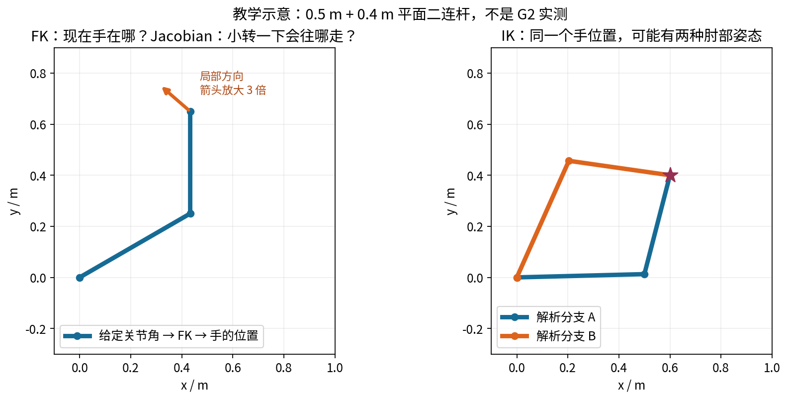
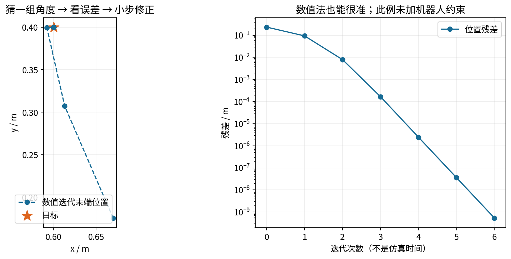
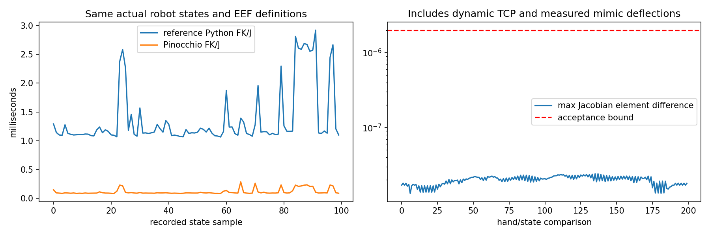
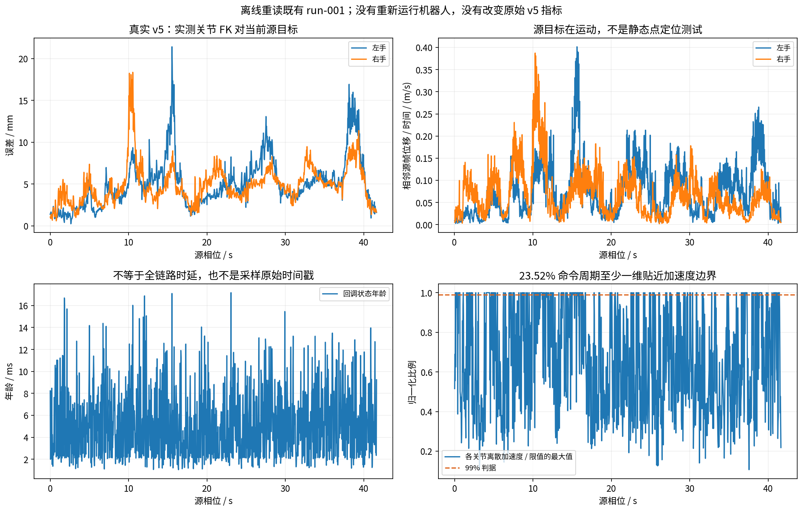
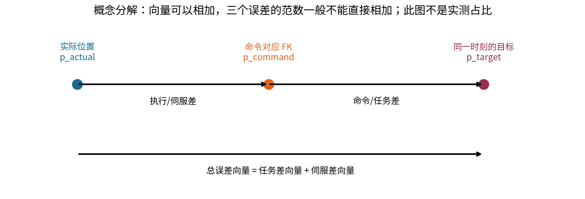
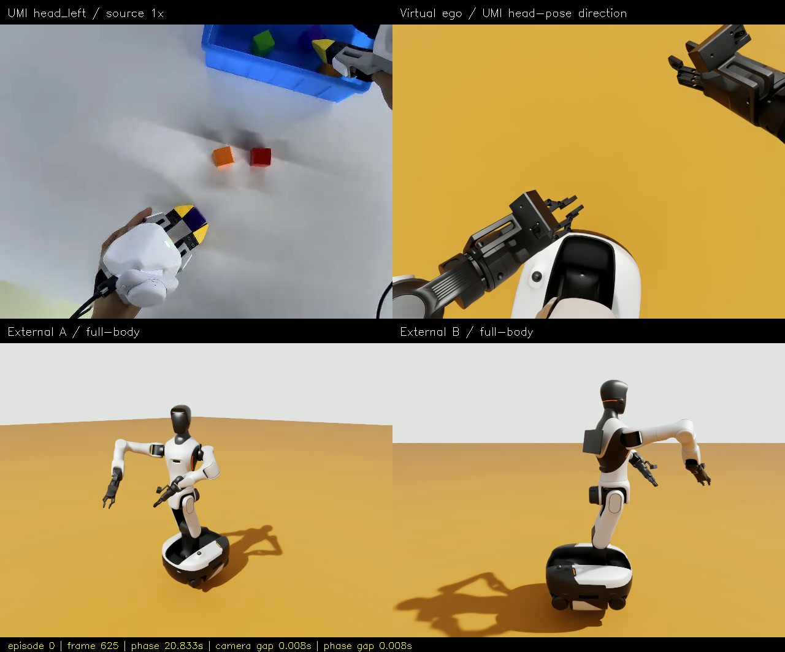

# 从 VLA 到全身 IK / WBC：图解、算法与 G2 实测解读

适合读者：已经会用 EEF 动作、UMI 或 VLA，但没系统学过机器人运动学的工程师。核查日期：2026-10-17。

**后续进展（2026-10-19）**：[在线模型 A/B 与同步误差诊断](ONLINE_AB_RESULTS_ZH.md)。本文保留 v5 和初始离线基准的历史口径；可选在线后端现已开发，但实测状态笛卡尔闭环仍未升级。

**先纠正最容易误解的一点：`1.913e-15 m` 是两个 FK 实现的计算结果差，不是机器人跟踪目标的误差。**
之前把“模型计算段提速”和“模型对照差异”紧挨着展示，容易让人误以为 Pinocchio 已经让机器人又快又准；这种理解不成立。
本教程把数学计算、优化求解和物理执行三件事拆开讲。

## 阅读路线

- **先解决当前疑问**：第 1、9～12 节，约 15～25 分钟。
- **从零理解 FK / Jacobian / IK**：第 2～8 节，建议边画图边运行二连杆例子。
- **选库与走向 WBC**：第 13～16 节；最后用第 17 节自测。
- 数学公式无法渲染时，公式旁有白话解释；所有核心图都是本仓库生成的 PNG，不依赖 Mermaid 插件或联网。

## 1. 先直接回答你的四个问题

### 1.1 “FK/Jacobian P95 从 2.614 降至 0.230 ms”是什么意思？

**对同样的 100 个已记录关节状态，计算两只手的 FK 和 Jacobian，模型计算耗时的第 95 百分位数，从约 2.614 ms 变成约 0.230 ms。**

- FK：Forward Kinematics，**正运动学**，有时称“正解”。
- Jacobian：**雅可比矩阵**，常简称“雅可比”；在本文里是关节速度到 EEF 速度的映射。
- P95：第 95 百分位数，约 95% 的样本不超过这个数；**不是平均值、最大值或成功率**。
- `ms` 是毫秒，`0.230 ms = 0.000230 s`。
- 两个 P95 的比约为 **11.37 倍**；此前说的 **12.4 倍**是两个**中位数**的比，不是同一个统计量。

**v5 本来就使用雅可比。** 它不是“BioIK 和 Jacobian 二选一”：

1. 首帧就位：MoveIt 2 + 本仓库已有 GenieBioIK 适配路径。
2. 正式原速回放：自写 Python URDF FK/Jacobian + 双手联合 OSQP 微分 IK。
3. Pinocchio：后续加入的**可选离线模型适配器**，并未替换 v5 在线控制器。

也请注意：2.614 ms 的基准来自**后续修复过 mimic 偏差处理的 Python 模型**对旧日志的离线计算，并不是直接从 v5 在线周期日志取出的耗时。

### 1.2 为什么 v5 实际误差有 1～2 cm？

因为那测的是“**运动中的源目标**”与“**实测关节经 FK 得到的手位置**”之间的差，里面混合了命令任务残差、运动限幅、执行器跟随、反馈时效等因素。
它不是只测 IK 求解器把一个静态点算得准不准。第 11 节有实际日志分析，也说明哪些原因目前还没有被对照实验独立证明。

**这组误差不应被包装成高精度操作。** 它可作为动作回放基线，不足以证明精密插接、接触操作已合格。

### 1.3 为什么 Pinocchio 的差异只有 `1e-15`？

因为是在相同 URDF、相同关节角、相同 TCP 和相同世界变换下，对比**两个软件计算器**的输出。
结果几乎相同，说明模型适配在被测状态下相容；并没有测“机器人离目标还有多远”。

类比：两款计算器算同一道题，结果只差最后一位；不代表拿着计算器的机械臂能以这个量级定位。

### 1.4 Pinocchio 是数值 IK 还是解析 IK？

**这个分类问题首先用错了对象。** Pinocchio 主要是运动学/动力学计算底座，提供 FK、Jacobian、刚体动力学等；
在它之上可以实现迭代 IK、QP 微分 IK、逆动力学控制等算法。官方也给出了迭代 IK 示例，并不是“自动生成任意机器人解析 IK”的服务。[官方项目](https://github.com/stack-of-tasks/pinocchio)、[官方迭代 IK 示例](https://gepetto.github.io/doc/pinocchio/doxygen-html/md_doc_b-examples_d-inverse-kinematics.html)。

## 2. 用“伸手拿杯子”建立最小概念

你想拿桌上的杯子，可以把问题拆成四问：

| 问题 | 机器人术语 | 输入 → 输出 |
|---|---|---|
| 我现在这样弯胳膊，手在哪？ | FK / 正运动学 | 关节角 → EEF 位姿 |
| 肩膀或手肘轻轻动一点，手会往哪动？ | Jacobian / 雅可比 | 关节小运动 → EEF 小运动 |
| 杯子在那里，我该怎么弯胳膊？ | IK / 逆运动学 | EEF 目标 → 关节解或关节速度 |
| 手伸过去时，怎样出力、抗住外载、不翻车？ | 动力学控制 / WBC | 任务、状态、模型 → 力矩/接触力等 |

**IK 不等于运动规划，也不等于控制器。** 一组关节角可以把手放到杯子处，但从当前位置走过去可能穿过桌子；
即使路径无碰撞，位置驱动器也可能因为惯性、负载和时延跟不上。

### 2.1 必须认识的变量

| 符号/缩写 | 意思 | 本项目对应 |
|---|---|---|
| `q` | 关节配置，转动关节通常用 rad | 腰、双臂、夹爪等关节状态 |
| `v` 或 `q̇` | 广义速度；普通固定基座转动关节可视作关节角速度 | QP 要决定的速度 |
| `p` | 三维位置，单位 m | 两指垫末端中点的位置 |
| `R` | 三维旋转矩阵 | 夹爪 EEF 朝向 |
| `T` | 包含位置与朝向的 4×4 刚体变换 | 某参考系中的 EEF 位姿 |
| TCP / EEF | 工具中心点 / 末端执行器参考系；实际使用前要明确两者的具体定义 | 这里不是法兰，而是动态指尖中点 |
| DOF | 自由度 | 固定底盘后，腰与双臂共 19 个运动变量 |
| seed | 数值求解的初始猜测 | 当前姿态或上一帧解 |
| residual | 残差，代入模型后任务还差多少 | 目标位置减 FK 位置等 |
| constraint | 约束 | 关节限位、机构耦合、速度/加速度边界 |
| QP | 二次规划 | 带线性约束的二次代价优化 |

1 rad 约等于 57.3°；不要把 URDF 的弧度与界面角度混用。
三维位姿有 6 个局部运动维度：位置 3 个、旋转 3 个；四元数虽有 4 个分量，单位约束使它不等于 4 个独立旋转自由度。

### 2.2 世界系、基座系、法兰系、EEF 系

```text
数据世界系 ──共享刚体变换──> 仿真 odom
                              │
                              └─> 机器人基座 ─> 腰 ─> 肩 ─> 肘 ─> 腕/法兰 ─> 夹爪 EEF
```

双手数据必须用**同一个**世界变换，不能各自旋转、缩放到“看起来舒服”的位置，否则相对几何关系变了。
EEF 位置要在哪个坐标系表达，雅可比速度也必须按兼容的参考系表达。

若工具偏移是固定的，`T_world_eef = T_world_flange × T_flange_eef`。
但本项目夹爪指尖中点会随开度变化，后半项实际上也依赖夹爪关节；不能永远拿一个固定法兰偏移糊过去。
更详细的项目定义见 [坐标说明](COORDINATES_ZH.md)、[夹爪 EEF 修正](GRIPPER_EEF_CORRECTION_ZH.md)。

## 3. FK：知道关节角，算手的位置



图是教学平面二连杆，不是 G2。上臂长 `l₁=0.5 m`、前臂长 `l₂=0.4 m`。
肩角 `q₁` 相对水平线，肘角 `q₂` 相对上臂：

```text
x = l₁ cos(q₁) + l₂ cos(q₁ + q₂)
y = l₁ sin(q₁) + l₂ sin(q₁ + q₂)
```

代入两个关节角，就能得到二维手位置。这就是 FK，不需要先“搜索一个解”。
三维机器人会连乘更多刚体变换，但本质仍是从已知配置向前算几何关系。

**FK 算得精确，不等于模型描述得真实。** 如果连杆长度写错、关节轴错、TCP 错，计算器可以极其准确地算出一个错误模型的答案。

## 4. 雅可比：手部运动的局部“换算表”

### 4.1 为什么 IK 需要它？

你正在拿杯子，手还差右移 1 cm。你不知道肩、肘各该改多少，但可以问：

- 肩关节多转一点，手向哪个方向移动？
- 肘关节多转一点，手向哪个方向移动？

把这些局部变化率排成矩阵，就是雅可比：

```text
Δp ≈ J(q) Δq
手部速度 = J(q) × 关节速度
```

对于刚才的二连杆，位置雅可比是：

```text
J = [ -l₁ sin(q₁)-l₂ sin(q₁+q₂)   -l₂ sin(q₁+q₂) ]
    [  l₁ cos(q₁)+l₂ cos(q₁+q₂)    l₂ cos(q₁+q₂) ]
```

第 1 列表示肩关节的影响，第 2 列表示肘关节的影响。
同一个关节转动，在不同姿态下对手的作用不同，所以 `J` 随 `q` 变化。
小位移近似不能无限外推：一次让肩膀转 90°，不能仍用原位置的雅可比当作全程精确映射。

### 4.2 三维转动关节的几何公式

把关节轴单位向量 `a`、轴上一点 `o`、EEF 点 `p` 都放在同一个世界坐标系：

```text
该关节的线速度列 = a × (p - o)
该关节的角速度列 = a
```

这里的 `×` 是叉乘，不是普通乘法。可以把它理解为“绕这根轴转动，在手的位置产生切向速度”。
线速度/转动关节速度的换算单位是 m/rad；角速度部分则是相应旋转轴。

本项目 v5 的腰和手臂雅可比主要就是按这个**几何公式**构造的，并不是把 21 个关节全部扰动一次再做有限差分。
原 Python 实现只对夹爪主关节引起的动态 TCP 平移做小步有限差分。

### 4.3 三种“求导方式”，不要与 IK 分类混淆

| 求 Jacobian 的方式 | 做法 | 主要注意事项 |
|---|---|---|
| 解析/几何求导 | 根据公式、几何关系或递推算法直接求导 | 高效，但轴、原点、参考系必须正确 |
| 数值差分 | 计算 `FK(q+ε)-FK(q)`，再除以 `ε` | 步长太大有截断误差，太小有浮点抵消；重复 FK 有成本 |
| 自动微分 AD | 对计算图按链式法则传播导数 | 不是有限差分；也不是自动得到闭式 IK |

**“使用解析雅可比的数值 IK”完全正常。** “雅可比怎么求”与“逆问题怎么解”是两个不同分类维度。
Pinocchio 提供高效导数和自动微分相关能力，但这不意味着本次基准使用了任意精度浮点、GPU 或神经网络。[官方功能说明](https://github.com/stack-of-tasks/pinocchio)

更严格的机器人教材还区分**几何雅可比**与针对某种姿态参数变化率的 **analytic Jacobian**。
这又是参考变量/速度表示的区别；不要把“用公式算导数”与该术语完全等同。本项目用的是线速度＋角速度的几何速度表示。

### 4.4 朝向误差，不是欧拉角逐项相减

位置差可以直接做向量减法；三维旋转应先形成相对旋转，再取对应的旋转向量，例如 `Log(R_target R_actualᵀ)`。
向量的方向是旋转轴，长度是旋转角。四元数 `quat` 与 `-quat` 表示同一个姿态，不能直接相减后当作物理旋转误差。
欧拉角有跳变和参数奇异性，也不能未经处理就逐项减。

本项目将线速度放在前 3 行、角速度放在后 3 行，使用与世界轴对齐、原点在 EEF 点的表示。
`LOCAL`、`WORLD`、`LOCAL_WORLD_ALIGNED` 等约定不能随便混用；有的空间速度还涉及不同参考原点。
对较大旋转残差做严格迭代时，还需正确处理旋转/位姿对数的微分，不是把任意角度误差都当成小角度。

## 5. 解析解：先推好公式，再代入目标

对于平面二连杆，只要求手到达 `(x,y)`，不额外要求手朝向，可以由余弦定理得到：

```text
c₂ = (x²+y²-l₁²-l₂²) / (2 l₁ l₂)
q₂ = ± arccos(c₂)
q₁ = atan2(y,x) - atan2(l₂ sin(q₂), l₁+l₂ cos(q₂))
```

这就是一组**解析 IK 公式**。这里的“解析”是给逆问题找到结构化的直接表达，不是说 CPU 在做没有误差的无限精度运算。

对目标 `(0.6,0.4) m`，本教程实际运行得到两支解：

| 分支 | 肩角 | 肘角 |
|---|---:|---:|
| A | 1.460472° | 74.037986° |
| B | 65.919663° | -74.037986° |

两个解代入 FK 都到同一点，区别是肘的位置；图 1 已画出。实际机器人还要筛掉关节越界、自碰撞或不连续的分支。

### 解析法的优势与限制

- 对合适的机构，运行时可以很快，并能显式列出一些解分支。
- 一套解析公式通常依赖具体机构结构；改连杆结构或关节布局，可能要重新推导/生成。
- “任意 19 自由度腰＋双臂＋约束，一次得到完整闭式解”不是普遍可用的事情。
- 连续冗余变量、双手共享腰、动态 TCP、额外姿态偏好，会让整体问题超出简单二连杆公式的范围。
- 解出合法终点，不保证中间路径无碰撞，也不保证速度/加速度可实现。

**IKFast** 是典型的解析代码生成路线：分析支持的链结构并生成 C++ 求解代码。官方 MoveIt 页面同时保留了较旧的生成工具链说明，
不能只因文档标题在 main 就假定对任意 ROS 2 / 高自由度双手链开箱即用。[官方教程](https://moveit.picknik.ai/main/doc/examples/ikfast/ikfast_tutorial.html)

## 6. 数值解：从猜测开始，反复修正

数值法不是先得到所有关节角的直接公式，而是：

```text
猜一个 q
  → FK 算手在哪
  → 与目标比较得到误差
  → 用 Jacobian / 优化方法求修正
  → 更新 q
  → 误差足够小则结束，否则继续
```



本教程用同一个目标 `(0.6,0.4) m`，从 `(-20°,80°)` 出发，实际做了 **6 次修正**，位置残差约 `5.404e-10 m`。
**这是没有碰撞、没有限位的二维教学例子，不是 G2 跟踪精度。** 横轴是迭代次数，也不是仿真运行秒数。

### 6.1 最简单的修正公式

```text
e = p_target - FK(q)
Δq = J⁺ e
q_next = q + α Δq
```

`J⁺` 是伪逆。雅可比不一定是方阵，也不一定可逆，所以不能总写成普通 `J⁻¹`。
`α` 是步长，用于避免迈得过大。数值法的 seed、步长、阻尼、容差和迭代预算都会影响结果。

常用的阻尼最小二乘（DLS）形式之一：

```text
Δq = Jᵀ (J Jᵀ + λ² I)⁻¹ e
```

`λ` 是阻尼，`I` 是单位矩阵。实现时通常解线性方程，而不是显式构造逆矩阵。
阻尼能抑制某些过大的关节修正，但会引入折中；它不是“所有奇异位形都可解”的保证。

### 6.2 为什么数值法会失败？

1. 目标本来不可达，例如二连杆总长 0.9 m，却要求手去 1.5 m 处。
2. 有解，但 seed 在不好的区域，局部方法走入局部极小。
3. 几何上可达，但关节限位或机构耦合使它不可行。
4. 雅可比接近奇异，某些任务方向无法产生足够运动。
5. 计算预算用完，尚未满足容差。
6. 坐标系、TCP 或单位错误，求解器在认真解决错误问题。

**数值求解失败，不等于数学上一定无解。** 应分别报告超时、不可行、残差未达标，而不是一律解释为“机器人够不到”。

### 6.3 解析法和数值法，谁更准？

没有不加条件的答案。
解析公式也受浮点误差与模型误差影响；数值法可以在合适条件下把模型残差降得很小。
比较时要统一目标、模型、限位、种子集合、容差、超时与硬件，统计成功率和尾部耗时。
不能拿无约束静态解析解，与带碰撞和加速度限制的在线全身控制直接比一个数字。

## 7. 为什么双手＋腰部更适合联合优化？

### 7.1 冗余：不是只有一种姿态能拿到杯子

保持手不动，你仍可能转动肘部、调整肩膀、改变腰的姿态。这叫冗余。
多出来的运动余量可用于直腰、避限位、避障、降低关节速度，但这些目标有时彼此冲突。

本项目固定底盘和头部后：

- 腰 5 + 左臂 7 + 右臂 7 = **19 个腰/臂变量**。
- 两个夹爪主关节再增加 2 个变量；mimic 从动关节不是各自独立下命令。
- 两只手完整位姿是 12 维局部任务；再考虑两个开度目标。
- “19−12=7”只能作为一般非奇异、任务独立时的局部直觉；真实可用余量还受约束、秩与耦合影响。

### 7.2 两个单臂 IK，为什么不够？

左手求解器可能说“腰向左一点”，右手求解器可能说“腰向右一点”。共享腰不是两份可以独立执行的关节。
因此应在同一变量向量里堆叠双手任务：

```text
[ J_left  ] v ≈ [ 左手期望速度 ]
[ J_right ]     [ 右手期望速度 ]
```

这样优化器才能整体分配腰、左臂和右臂的运动，而不是执行后再拼接两个互相矛盾的答案。

### 7.3 奇异性是什么？

把手臂完全伸直，此时可以很容易横向扫动，但不能靠无限小关节变化立即继续沿手臂方向伸长。
这是局部可运动方向减少的直觉。

用奇异值分解看，某些奇异值接近零；硬做伪逆会把对应关节速度放大。
处理方式包括阻尼、缩小任务速度、改变姿态、停止或重新规划；不能靠提高计算速度消除几何奇异性。

## 8. 微分 IK、QP 和当前 v5 到底做了什么？

### 8.1 静态数值 IK 与在线微分 IK

| | 静态目标数值 IK | 在线微分 IK |
|---|---|---|
| 问题 | 找到一组最终关节配置 | 本控制周期怎样小步运动 |
| 输出 | 通常是 `q_solution` | 通常是 `v`，再积分得到命令 |
| 目标 | 求解期间可保持不动 | 可能每周期都更新 |
| 终止方式 | 残差达标或预算用完 | 循环持续运行，每步都受周期预算限制 |

微分 IK 可以反复积分求一个静态目标，也可以跟踪流式目标。不能因为内部求了 QP，就认为每周期已经把非线性位姿误差完全清零。

### 8.2 本项目 QP 的概念结构

```text
min_v  ||W (J v - v_desired)||² + 速度/姿态正则

s.t.  q_min ≤ q + Δt v ≤ q_max
      -v_max ≤ v ≤ v_max
      -a_max Δt ≤ v - v_previous ≤ a_max Δt
      A (q + Δt v) ≤ b
```

`W` 用于位置/朝向任务缩放；`A,b` 表示已配置的线性机构约束。这里为讲解公式，不是可以直接发给机器人执行的代码。
v5 正式代码在 `differential_ik.py::DifferentialIK.step`，用 `OSQP` 求这个速度层面的优化问题。

当前 `v_desired` 由**上一条命令姿态**到目标的位姿差除以 `Δt` 构造；它不同于经过稳定性验证的“实测状态误差反馈＋前馈速度”闭环。
每步采用 1/30 s 的名义离散积分；不等于操作系统或真实执行器拥有严格 30 Hz 时序。

### 8.3 硬约束、软偏好和优先级

- **硬约束**：不能违反；如原生限位、机构耦合。无解时应拒绝/降级，而不是偷偷穿过去。
- **软偏好**：尽量做到；如直腰、靠近参考姿态。会与双手任务折中。
- **加权优化**：各项互相权衡；“权重大”不等于数学上绝对优先。
- **严格层级/HQP**：低优先级不能损害已满足的高优先级任务，是另一种方法设计。

`roll ±0.5°` 可以作为特定应用的硬限制或对照实验，但不是全身 IK 的普遍定义。
如果锁得太紧，就可能把本来可达的目标变成不可行；默认软直腰通常更适合先观察自然运动分配。

### 8.4 有碰撞检查，就能主动绕障吗？

不能。本项目每条命令做 MoveIt 中点/端点有效性检查，失败则拒绝。
它不是连续扫掠检测，也不是 QP 内的距离梯度避障，更不是全局路径规划。
这三层能力要分别实现和验收。

## 9. Pinocchio 为什么快？它到底替代哪一块？


### 9.1 本项目替换的是模型层，不是整个控制器

```text
旧：Python URDF 几何计算 ─┐
                        ├─> 同一组任务与约束 ─> 同一个 QP 思路 ─> 位置驱动
候选：Pinocchio 模型层 ──┘
```

v5 Python 版本对左右手分别遍历链，循环中发起很多小的 NumPy/SciPy 运算。
计算动态 TCP 时还会重复做局部几何计算。NumPy 底层虽然也有编译代码，但频繁的小操作仍有 Python 调度、临时数组和绑定开销。

Pinocchio 则把主要递推放到编译后的 C++ 模型算法中，使用预建的模型/数据结构，利用运动学树共享计算，提供高效 Jacobian。
从 Python 发起少量调用，不等于逐个关节都由 Python 解释执行。[官方对 C++、缓存与树结构优化的说明](https://github.com/stack-of-tasks/pinocchio)

**这些是代码和算法层面合理的机制解释，不是本次对每项优化做过独立消融后的性能占比。**
也不是“C++ 必然比 Python 快 12 倍”：优化过的 Python/NumPy、不同模型和不同调用方式会改变结果。

### 9.2 真实基准数字，要看统计对象



| 统计对象 | 原实现 | Pinocchio | 意义 |
|---|---:|---:|---|
| 离线 FK/Jacobian 中位数 | 1.149 ms | 0.092 ms | 两个中位数比约 12.4 |
| 离线 FK/Jacobian P95 | 2.614 ms | 0.230 ms | 两个 P95 比约 11.37 |
| v5 实际在线 IK P95 | 4.941 ms | **未测整段在线 A/B** | 还包括目标处理、QP 等 |
| v5 实际整条命令周期 P95 | 13.377 ms | **未测整段在线 A/B** | 还包括检查与发布等 |

模型基准取了 100 个真实反馈状态，每次同时算两手；Jacobian 差异图有 200 个手/状态比较点。
基准不是每次重新解析 URDF，也没有把质量矩阵计算包含进 FK/Jacobian 计时；包含冷启动样本。
模型耗时不能当成 IK 总耗时，更不能当成机器人响应时延或视频帧率。

### 9.3 为什么不是“整个系统快 11 倍”？

30 Hz 的名义周期是 33.33 ms。假设模型计算从约 2.6 ms 降至 0.23 ms，其他工作不会自动消失。
碰撞服务、QP、DDS、Python 调度、PhysX、位置驱动与反馈链路仍然存在。

不能把两个不同统计分布的 P95 简单相减，然后声称得到新的周期 P95；要真正运行相同目标的在线 A/B 才知道。
更快的模型可能给更高频闭环留出预算，但不会自动把驱动器带宽提高，也不会自动消除加速度约束造成的跟踪折中。

## 10. `1.913e-15 m` 为什么不是机器人的精度？

### 10.1 先写清楚两种完全不同的减法

```text
模型实现差异：|| FK_python(q_same) - FK_pinocchio(q_same) ||

实际跟踪误差：|| FK_model(q_measured(t)) - p_target(t) ||
```

第一行的两边输入是**同一组关节角**，第二行则比较“实际已经到的位置”与“此刻希望到的位置”。
软件等价验证与控制精度验证，不能混为一谈。
所以并不是“旧 Python FK 只有厘米精度，Pinocchio 才有 1e-15 精度”：旧 FK 同样算出了几乎相同的模型结果，厘米误差来自另一个比较问题。

| 指标 | 本轮/历史数字 | 证明了什么 | 没证明什么 |
|---|---|---|---|
| 两模型 FK 最大位置差 | `1.913e-15 m` | 被测状态下位置计算一致 | 实际手到了目标 |
| 两模型 FK 最大旋转差 | `1.302e-15 rad` | 被测状态下姿态计算一致 | 姿态绝对标定正确 |
| 两模型 Jacobian 最大元素差 | `2.410e-8` | 不同导数实现相容到设定容差 | 控制器抗扰/无碰撞 |
| v5 首帧 BioIK 模型位置残差 | 左约 `7.120e-7 m` | 一次静态求解模型残差很小 | 全程动态误差同样小 |
| v5 动态实测最大位置误差 | 左/右 `21.410 / 18.359 mm` | 这次回放的最差观测跟踪差 | 所有任务的普遍表现 |

### 10.2 为什么能差到浮点尾数？

两个实现都在计算同一套连杆变换乘积；不同计算顺序产生少量浮点舍入差。
双精度浮点在量级 1 附近的相对间隔约 `2.22e-16`，多步运算后出现 `1e-15` 量级的差并不奇怪。

这里没有用硬件测量去证实 `1e-15 m`。`1.913e-15 m` 虽然数值很小，但报告它的正确用途是**回归测试**，不是“超高精度定位”宣传。
旋转差使用旋转残差计算，不能把这个数当成传感器角度分辨率。
Jacobian 差没有同样小到 `1e-15`，也不奇怪：旧实现的夹爪列使用有限差分，与新的几何导数之间允许有差分截断/舍入差；它们通过的是预设导数对照容差。

### 10.3 两个模型也可能一起错

共同使用错误的 URDF、错误的 TCP 或共同错误的世界变换，两边仍可能高度一致。
因此还要与 MoveIt FK、PhysX 链路、真实标定或外部测量逐层交叉检查；它们分别检验不同合同。
当前模型对照在非单位基座变换和实际 mimic 偏差下通过，是必要的工程验证，但不是充分的真机精度证明。

## 11. 拆解 v5 的 21 mm：哪些已知，哪些还不能下结论？



### 11.1 先把“实测”两个字说严谨

这里的“实测 EEF”是 **PhysX 发布的关节位置，通过本模型 FK 换算出的 EEF**，不是用外部动捕或尺子直接测手的位置。
它包含物理执行反馈，但仍依赖模型与 TCP 定义。

本节只读原 v5 的 `umi-realtime-web-reliable-01/run-001`，不把后来的 run-003 数字混进来：

| 位置误差 | 左手 | 右手 |
|---|---:|---:|
| 中位数 P50 | 4.538 mm | 4.682 mm |
| P95 | 11.355 mm | 8.585 mm |
| 最大值 | 21.410 mm | 18.359 mm |
| 最大值出现的源相位 | 15.534 s | 10.533 s |

所以不是“全程都偏 21 mm”。但 P95 仍达厘米量级，不能只挑最终停住后的一帧证明全程精准。
本次 1250 条命令、零 deadline miss，说明没因控制超时丢目标，**不代表跟踪误差为零**。
实际命令周期 P95 13.377 ms 也小于 33.33 ms 预算；因此不能把厘米误差简单解释成“旧模型太慢，队列积压了”。

### 11.2 因素一：目标在动，误差包含时序效应

按 30 Hz 相邻源帧位移估算：

| 源目标平移速度 | 左手 | 右手 |
|---|---:|---:|
| P95 | 0.187 m/s | 0.161 m/s |
| 最大 | 0.401 m/s | 0.387 m/s |

最大帧间位移约 13 mm，这不是“源数据每步最多只有很小的一点”。
举一个**量级示例，不是已识别的实际时延**：手以 0.4 m/s 移动，若有效跟随滞后 50 ms，就可能相差约 20 mm。

```text
运动滞后造成的位置差量级 ≈ 目标速度 × 有效滞后
```

但不能用最大误差除以最大速度，就声称测出了本系统 50 ms 时延：两个最大值可能不是同一时刻，且还有其他误差因素。

原日志 `feedback_age_s` 的 P95 约 **11.149 ms**，最大 **17.168 ms**。
代码记录的是“从最近一次状态回调到当前采样的单调时钟年龄”，**不是从物理采样到动作产生的完整时延**。
它不能覆盖所有上游发布延迟、命令等待、驱动响应，也不是保存在消息里的原始采样时间戳。

### 11.3 因素二：加速度约束确实在起作用，速度饱和却没有证据

对已记录的关节命令重新计算：

```text
命令离散加速度 = (本帧命令速度 - 上帧命令速度) / (1/30 s)
```

- **23.52%** 的命令周期，至少一个关节的离散加速度达到配置限值的 **99%** 及以上。
- **0%** 的命令周期，任一关节速度达到配置限值的 **99%** 及以上。

这说明不能笼统地说“肯定是关节速度上限太小”。至少在这个判据下，速度没有贴边，加速度却经常贴边。
为了保持动作平滑、满足运动边界，QP 可能不能立即达到本帧全部任务要求。

**贴近边界不等于已经完成误差因果归因。** 没有用 KKT 乘子、同条件调参实验去证明其中多少毫米由这个约束造成；
这里也没有测真实物理加速度。为了把误差压小而直接取消限幅，是错误的验收方法。

### 11.4 因素三：上一条命令做 IK 热启动，不是实测状态闭环

v5 每周期在命令空间继续积分，实际反馈用于误差监测/停止，不是把所有实测偏差直接送回 IK 状态。
优点是命令连续；不足是驱动跟随落后、静态偏差或小扰动不一定被笛卡尔控制律主动纠正。
这不是说整套系统完全开环：PhysX 的关节位置驱动本身有反馈；这里缺的是上层以实测状态闭合的笛卡尔任务伺服环。

不能简单地把代码里的 `positions` 换成实测位置就宣布问题解决：这样会影响速度/加速度连续性、反馈噪声和延迟，需要重新设计增益与约束状态。
换成 Pinocchio 只换了计算 `FK/J` 的部分，不会自动完成这个闭环升级。

### 11.5 因素四：QP 的一小步、姿态折中和物理位置驱动

- 雅可比是局部线性化；积分后的真实非线性 FK 不一定正好等于目标。
- 双手位置、朝向、夹爪开度、参考姿态、直腰等目标共用变量；加权任务可能存在折中。
- PhysX 位置驱动不是瞬时把关节传送到目标；惯性、驱动增益、阻尼和限幅影响响应。
- 夹爪从动关节有实测偏差，动态指尖位置不能完全当作理想主关节函数。

这些是代码/接口中存在的机制；**尚未通过独立消融证明各自是误差主因**，更不能编造“其中 80% 来自 PD”之类的比例。

### 11.6 误差应该怎么分解，而不是互相甩锅？



在同一坐标系、同一时刻，并明确此时实际有效的关节命令后：

```text
p_target - p_actual
  = (p_target - FK(q_command)) + (FK(q_command) - FK(q_measured))
          命令/任务差                        执行/伺服差
```

这是**向量**分解；两项范数一般不能直接相加，也不能把两组 P95 相加得到总 P95。
第一项大，优先检查目标生成、QP、限幅和可达性；第二项大，优先检查执行器、闭环、时延和模型一致性。

当前 `realtime.csv` 在一轮中先观察实际误差，再求解/发布新命令，最后落盘；`joint_trace.csv` 又是独立回调日志。
没有在每个控制 tick 原子保存“实际使用的反馈消息时间戳、目标、当前有效命令和对应双手 FK”。
因此仅靠最近墙钟匹配去宣称完成了**精确误差占比**，证据不够。本轮没有这样做。

### 11.7 “passed” 到底表示什么？

这次保护门槛包括 50 mm 的位置停止阈值；没有超过阈值、未触发碰撞/限位保护且完成回放，会得到运行通过。
**50 mm 是这次仿真回放的停止保护阈值，不是高精度验收标准，更不是真机安全距离。**

面向精密操作，应另外定义任务精度、时间窗口、稳定保持时间、负载、接触条件、失败率与尾部误差门槛，不能沿用“能跑完”作为唯一标准。

## 12. 如何真正把误差降下来？推荐可证伪的实验顺序

| 顺序 | 实验 | 想区分什么 | 必须记录 |
|---|---|---|---|
| 1 | 同 tick 保存目标、命令 FK、实测 FK、反馈采样/到达时间 | 任务残差 vs 跟随残差 | 向量误差、两套时间戳、当前有效命令 ID |
| 2 | 静态点到达后保持，测运动结束后的收敛曲线 | 动态滞后 vs 静态偏差 | 到达瞬间与保持后的误差 |
| 3 | 相同路径离线变慢，仅作诊断 | 速度/加速度和时序影响 | 明确 time_scale，不能冒充 1× 结果 |
| 4 | 仅更换 FK/Jacobian 后端，其他不动 | 模型加速是否改善整周期 | 实际 A/B、相同目标和约束、完整耗时分布 |
| 5 | 实测状态闭环＋清楚的增益/前馈设计 | 能否主动消除跟随偏差 | 扰动恢复、命令连续性、噪声与稳定性 |
| 6 | 在约束和稳定性允许下提高伺服频率 | 时序离散影响 | deadline、抖动、反馈年龄，不只平均 Hz |
| 7 | 多 episode、不同开度/姿态和故障注入 | 改进是否泛化 | 所有失败，不逐段调坐标凑通过 |

上表是**下一步计划**，不是本轮已执行的性能改进。模型 A/B 通过后再评估 Pink 任务层，避免一次更换所有组件而无法归因。
真实 VLA 流没有已知未来一帧；当前文件回放的一帧前瞻必须保留标签，并单独做无前瞻实验。

## 13. 除了 Pinocchio，还有哪些库？先按职责分类

不要问一个笼统的“哪个 IK 库最好”。先问：我要 FK、静态关节解、流式伺服，还是力矩控制？
下面是截至核查日的官方资料整理；**不是所有库都已在本仓库安装或验证**，不能把官方案例当作 G2 已适配。

| 项目 | 主要层次/方法 | 适合什么 | 本 G2 场景的注意事项与来源 |
|---|---|---|---|
| Pinocchio | FK/Jacobian/动力学底座 | 统一机器人模型，供优化与控制调用 | 本仓库仅模型对照/单步 QP 测试通过；[官方](https://github.com/stack-of-tasks/pinocchio) |
| Orocos KDL / MoveIt KDL、LMA 插件 | 数值迭代 IK | 串联机械臂入门、传统 MoveIt 配置 | 官方插件为串联链，不能直接等同共享腰双手联合优化；[官方配置说明](https://moveit.picknik.ai/main/doc/examples/kinematics_configuration/kinematics_configuration_tutorial.html) |
| TRAC-IK | 两种数值求解并行：Newton 扩展与 SQP | 带关节限位的机械臂目标 IK | 当前官方 MoveIt 文档明确插件不支持 mimic；动态夹爪需独立处理/核查；[官方](https://moveit.picknik.ai/main/doc/how_to_guides/trac_ik/trac_ik_tutorial.html) |
| IKFast | 解析 IK 代码生成 | 支持结构的低维机械臂快速求解 | 不等于任意双手全身闭式解，生成/集成有模型与工具链门槛；[官方](https://moveit.picknik.ai/main/doc/examples/ikfast/ikfast_tutorial.html) |
| BioIK | 多目标数值优化，包含演化/局部方法 | 多末端、冗余和自定义目标的位姿求解 | 本仓库 GenieBioIK 是已有适配，不是 Pinocchio；v5 主要用于首帧；[上游](https://github.com/TAMS-Group/bio_ik) |
| pick_ik | BioIK 思路的 MoveIt 2 实现 | 可用于理解局部/全局搜索与代价设计 | **官方当前声明 deprecated，仅基本维护**，不作为本项目新主线首选；[官方状态](https://github.com/PickNikRobotics/pick_ik) |
| Pink | Pinocchio + QP 局部微分 IK | 流式双手/全身任务、限值组织 | 下一步候选，仍需适配 G2 耦合与动态 TCP；不保证全局收敛/严格优先级；[官方](https://github.com/pink-kinematics/pink) |
| Mink | MuJoCo 模型上的微分 IK | MuJoCo 下多任务、几何避碰、闭链研究 | 可借鉴架构，当前 PhysX 项目不必为用它而换仿真器；[官方](https://github.com/kevinzakka/mink) |
| PlaCo | C++/Python 的任务空间 QP IK 与逆动力学 | 更完整的任务/约束实验 | 基于 Pinocchio，仍需模型与接口适配；[官方](https://github.com/Rhoban/placo) |
| cuRobo | CUDA 运动学、优化 IK、碰撞与运动生成 | 大批量目标、多 seed、GPU 研究 | 官方旧文档与主线 API 有版本差异；不先假定单次 21 维 CPU 伺服换 GPU 就更快；[官方示例](https://curobo.org/get_started/2a_python_examples.html) |
| MoveIt Servo | 流式运动伺服系统 | 奇异性/碰撞/限位处理与命令接口 | 是系统能力，不是“另一个解析公式”；双手共享腰要联合设计；[官方](https://moveit.picknik.ai/main/doc/examples/realtime_servo/realtime_servo_tutorial.html) |
| TSID | 基于 Pinocchio 的任务空间逆动力学 | 加速度、力矩和接触任务 | 属于后续 WBC 候选，不是当前位置通道的直接替换；[官方](https://github.com/stack-of-tasks/TSID) |

以上没有做跨库公平速度排名，也没有声称选定某库就具备安全保证。ROS 2 发行版、二进制 ABI、模型特性和维护状态要实际核查。

### 13.1 MoveIt 2 + BioIK/GenieBioIK 到底是什么关系？

可以类比：**MoveIt 2 是工作台，IK 插件是装在工作台上的求解工具，GenieBioIK 是针对本机器人接入/约束需求的适配层。**

MoveIt 管机器人模型、规划组、状态有效性、规划等；插件通过指定接口求解 IK。
不能因为工作台用了某插件，就把整个物理驱动控制、避障能力、闭环稳定性都算作插件自身的功能。
也不能因为我们增加 Pinocchio 适配，就说“现在正式回放全部由 Pinocchio 官方算法完成”。

### 13.2 对这个项目的选择原则

1. **先保持模型/坐标合同**：EEF 不回退到法兰，双手共用世界变换，mimic 与机构耦合不能丢。
2. **先做单因素 A/B**：Pinocchio 换 FK/Jacobian，QP 和驱动暂不换。
3. **连续跟踪优先评估局部微分 IK**：Pink 是候选，但保留自定义硬约束与故障语义。
4. **首帧或大跨度目标保留合适的位姿求解/规划途径**：局部微分方法不负责所有全局换姿态问题。
5. **动力学需要时再引入 TSID/PlaCo**：不是为了项目名好听而同时堆三套框架。

## 14. 从 IK 到 WBC，究竟还缺什么？

WBC 即 Whole-Body Control，**全身控制**。社区也会使用“运动学 WBC”等表述，因此 WBC 不一定专指力矩控制；必须看决策变量与执行接口。

| 层次 | 决策/输出 | 解决什么 | 不能自动保证什么 |
|---|---|---|---|
| 全身运动学 IK | 关节位置/速度 | 腰与双臂协调达到几何任务 | 动力学、负载、接触稳定 |
| 轮式运动学协调 | 再加入底盘/转向/轮速变量 | 移动操作任务分配 | 摩擦、力矩和防倾覆 |
| 逆动力学 WBC | 加速度、力矩、接触力 | 在动力学和接触限制下完成任务 | 模型/接口错误时仍可靠 |

动力学层的核心约束之一是：

```text
M(q) a + h(q,v) = Sᵀ τ + J_contact(q)ᵀ λ
```

- `M`：质量矩阵；`a`：广义加速度。
- `h`：重力和速度相关项。
- `τ`：驱动关节力矩；`S`：选择可驱动坐标。
- `λ`：接触力；`J_contact`：接触雅可比。

还需要力矩界、摩擦/法向力条件、接触运动学、轮子滚动关系，以及与位置驱动不打架的执行接口。
当前回放器只走位置命令，**即使 Pinocchio 算出了质量矩阵，也没有自动变成力矩 WBC**。

轮式平台不能仅把根位姿当成可随意改变的变量；必须核对具体底盘的转向、滚动、不可侧滑和驱动速率。
固定焊接底盘的动作演示也不能证明真实轮式平台不会倾覆。
项目分阶段实现与验收见 [WBC 技术路线](WBC_NEXT_STAGE_ZH.md)。

## 15. 你可以马上运行的小练习

### 15.1 不启动机器人，自己验证解析解和数值解

从仓库根目录执行；不需要安装 Pinocchio，不启动 ROS、不发送动作：

```bash
mamba activate xense-wbc
PYTHONPATH=wbc_demo python - <<'PY'
import numpy as np
from umi_replay.learning_materials import planar_analytic, planar_fk, planar_iterative

target = np.array([0.6, 0.4])
for solution in planar_analytic(target):
    print("analytic degrees:", np.degrees(solution), "FK:", planar_fk(solution))
history = planar_iterative(target, np.radians([-20.0, 80.0]))
print("numeric iterations:", len(history) - 1)
print("numeric degrees:", np.degrees(history[-1]))
print("numeric residual m:", np.linalg.norm(planar_fk(history[-1]) - target))
PY
```

建议再做三件事：把目标改成 `(1.5,0)` 看解析法拒绝；换数值 seed 观察分支和收敛；把 seed 设成完全伸直，再理解局部雅可比为什么可能走不出去。
这个例子只有**二维位置任务**，没有目标朝向、关节限位和碰撞，不应直接当作完整机械臂 IK 实现。

### 15.2 复生成本教程的图和 v5 统计

需要本机已有的原始日志，输出目录必须不存在，避免覆盖历史证据：

```bash
PYTHONPATH=wbc_demo OPENBLAS_NUM_THREADS=1 python -m umi_replay.learning_materials \
  --reference-run wbc_demo/logs/umi-realtime-web-reliable-01/run-001 \
  --output wbc_demo/logs/my-ik-learning
```

结果包括 5 张图、`metrics.json` 和输入 SHA256。该命令只读日志，不运行新一轮仿真。
生成中文图需要本机 Noto CJK 字体；版本库中已经附上图，不要求读者重新生成才能阅读。

### 15.3 与真实视频对照，不把教学图当实验



这张是**已有 v5 真实回放**的中间帧，不是本轮 Pinocchio 在线实验。
观看 [v5 四分屏视频与原始验收页](media/episode-000-v5/index.html)，或直接打开 [MP4](media/episode-000-v5/head_left.mp4)。
视频里能看到动作协调，但毫米级误差要结合时间同步日志/曲线判断，不能只凭“看起来到位”。

## 16. 项目代码导航与证据边界

| 文件/目录 | 读它能回答什么 |
|---|---|
| `differential_ik.py` | v5 几何 Jacobian、QP 目标与约束、名义积分 |
| `realtime_execution.py` | 目标采样、前瞻、碰撞截止时间、反馈误差保护与日志顺序 |
| `gripper_eef.py` | 指尖 EEF、动态 TCP、夹爪归一化与 mimic |
| `pinocchio_backend.py` | Pinocchio 按关节名映射、指尖点 frame、mimic 速度映射 |
| `kinematics_benchmark.py` | 100 状态对照怎么计时、差异怎么算 |
| `learning_materials.py` | 本文二连杆可运行例子、教学图、v5 附加统计 |
| `media/ik-learning-v1/metrics.json` | 本轮只读诊断与教学例子的真实输出、输入哈希 |
| `media/pinocchio-study-v1/metrics.json` | Pinocchio 模型比较原始指标 |
| `media/episode-000-v5/metrics.json` | 原 v5 跟踪、浏览器和视频验收指标 |

**本轮已做**：官方资料核查、旧日志重读、教学算法运行、配图和文档；没有移动机器人，没有更换在线控制后端，没有重写 v5 历史结果。
此前 bug 修复与剩余限制见 [代码审计](CODE_AUDIT_ZH.md)，不要把所有毫米级误差都归咎于已修的某个 bug。

## 17. 读完后，试着回答这十道题

1. FK 与 IK 的输入输出各是什么？
2. “解析 Jacobian + 数值 IK”矛盾吗？
3. 两个 FK 实现差 `1e-15 m`，能证明机器人定位误差小于 1 mm 吗？
4. 单帧 IK 残差很小，为什么 1× 动态轨迹仍有厘米级误差？
5. P95 与平均值、最大值有什么区别？
6. 为什么双手各自单臂求解可能争抢腰部？
7. 本轮数据支持“关节速度饱和是主因”这个结论吗？
8. 碰撞拒绝、主动避障、全局路径规划是不是同一种能力？
9. Pinocchio 换模型后，实际闭环、力矩通道会自动出现吗？
10. 把总位置误差分成任务差和伺服差，需要哪些同时间、同坐标数据？

简答：①关节→位姿、目标→配置/速度。②不矛盾。③不能。④任务限幅/局部求解、执行与时序等必须分开测。
⑤分位、算术均值、最差样本不同。⑥共享变量不能独立拼接。⑦不支持这个武断结论；本判据速度未贴边，加速度经常贴边。
⑧不是。⑨不会。⑩同 tick 的目标、有效命令、反馈配置及各自时间戳、共同 FK/坐标合同。

## 18. 一页速记

> **FK**：关节这样弯，手在哪。  
> **Jacobian / 雅可比**：关节微动，手怎样微动。  
> **解析 IK**：利用特定机构结构直接求逆解公式/分支。  
> **数值 IK**：从 seed 出发，反复减小残差。  
> **微分 IK**：这个周期该怎样小步运动。  
> **QP**：在约束下分配动作、折中任务的一种优化工具。  
> **Pinocchio**：高效算模型；不自动完成任务、避障、闭环和力控。  
> **模型一致性 ≠ IK 残差 ≠ 动态跟踪误差 ≠ 真机绝对精度。**  
> **下一步先测清误差，再换模型/控制；不要靠漂亮视频或极小浮点差证明精密控制。**
