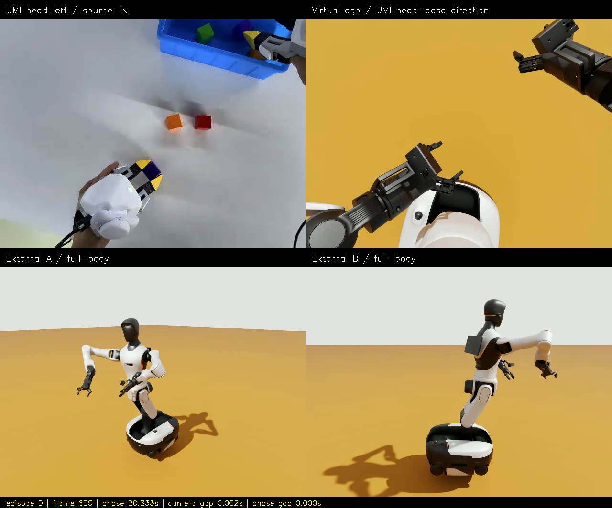
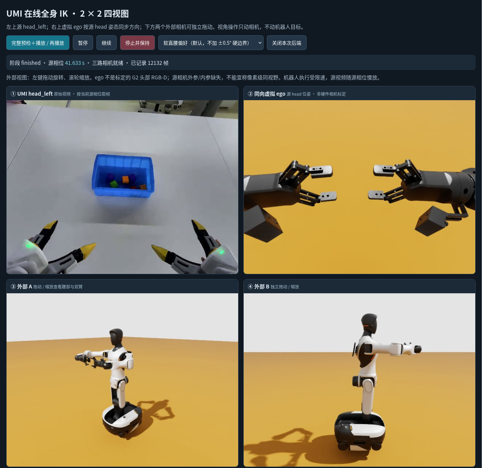
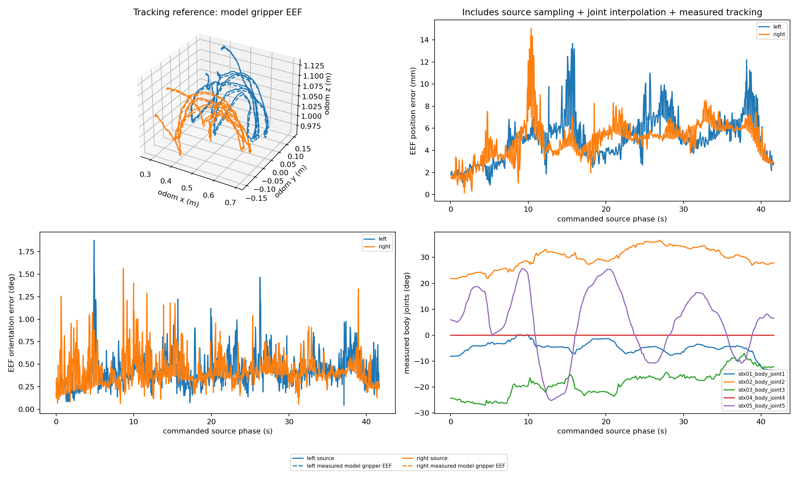

# 第 0 段 Web 四视角回放验收（v3）

## 先看视频与图片

**浏览器打开 [四视角图文/视频验收页](media/episode-000-v3/index.html)**。
也可以直接播放 [2×2 `head_left.mp4`](../logs/umi-web-head-left-v3/head_left.mp4)。
视频已实际编码核查：H.264、1280×1064、30 fps、1,250 帧、41.666667 秒，四栏在同一个视频文件中。
左上 UMI 原视频、右上同向虚拟头部镜头、左下外部 A、右下外部 B；没有翻转左右手画面。

右上与左上现在都从操作者一侧向前/向下观察，不再拿外部侧面镜头冒充第一视角。
手在画面中的相对位置与动作顺序可以对照；但光学内外参缺失、夹爪形状不同、空场景没有桌子和盒子，
**不承诺像素投影、视野范围或背景完全重合**。

这张浏览器截图是在 `finished` 阶段拍摄，机器人已经回家；源栏停在最后一帧。
它用于验收界面和四路显示，**不是用回家后的姿态对齐源最后一帧**。同步运动对照请看上面的四分屏视频。

## 本次实际结果

运行时间：**2026-10-14 23:01:46–23:08:57，Asia/Shanghai**。
有效目录：`wbc_demo/logs/umi-web-session-04/run-001`。
底盘固定、腰部与双臂参与 IK、EEF 相机侧轴向仍为 `camera_side_up_v2`。

| 项目 | 测量结果 |
|---|---|
| 策略 | `soft`：roll 零位软偏好 5.0，**没有额外 ±0.5° 硬边界** |
| 双手目标预检、执行、回家 | 215/215，全部通过 |
| 原始源时长 / 实际执行段 | 41.633335 s / 394.059465 s（含暂停，不含首帧靠近与回家） |
| 原始 EEF 位置误差最大值，左 / 右 | 13.683 / 15.072 mm |
| 原始 EEF 位置误差 P95，左 / 右 | 8.548 / 7.247 mm |
| 原始 EEF 朝向误差最大值，左 / 右 | 1.875° / 1.567° |
| 计划 / 实测绝对 roll 最大值 | 0.04334° / 0.04380° |
| 实测 yaw 使用范围 | 50.885° |
| 底盘最大平移 / 旋转漂移 | 1.379 μm / 0 rad |
| 四分屏最大相机时间差 / 最大源相位差 | 262.212 ms / 41.098 ms |
| 四分屏相机时间差 / 源相位差 P95 | 114.865 ms / 15.120 ms |

误差是实际关节反馈经模型 FK 得到的夹爪 EEF，与完整原始 30 Hz 轨迹按命令源相位插值后比较；
包含源采样、关节插值及动力学跟踪影响，不是只测关键帧 IK 残差，也不是硬件测量。

这次证明：**本段可以不加半度硬约束，依靠正确生效的软偏好得到近直腰的可行解**。
不能推广成所有轨迹都无需侧倾，也不是与旧 v2 解的随机种子相同的严格单变量实验。
这是新增 `soft` 实验，历史 `upright` 实验仍保留，不覆盖旧数字。

## Web 交互验收

- 在真实运行的回放阶段发送暂停；1.5 秒观察窗口内源相位保持 **1.399999976 s**，变化 **0 s**。
- 暂停期间转动外部 A 相机；前后图像平均绝对像素差 **10.497/255**，随后恢复视角与播放。
- 运行继续完成 215 个目标并回家；控制器报告包含实际收到的 pause/resume 事件。
- 54 个 UMI 单元测试 + 10 个既有实验台测试通过；其中新增相机轴向、固定根偏置、四栏布局、姿态策略、HTTP 命令/跨源限制测试。
- Firefox 实际打开本地 Web 并截取四路正常显示页面；早期即时截图未等待图片加载，保留在日志中，未作为最终证据。
- 完整解码 1,250 帧，逐栏检查没有近全黑帧；这只排除黑屏，不意味着所有关节在所有视角都没有遮挡。
- 页面没有 PyQt/PySide；本地 HTML/JS + Python HTTP/ROS，原生 OVRTX 渲染，不新增 Web 3D/FK 替身。

复跑命令及 IK/约束解释见 [在线回放教程](ONLINE_IK_AND_VIEWS_ZH.md)。
当前会话已经正常关闭，避免后台占用 GPU；按教程启动后打开 `http://127.0.0.1:8765`。

## 时间对齐与审计

三路仿真相机必须有相同 ROS 图像时间戳才组成录制帧，重复帧允许但有记录。
输出再根据 `command_phase.csv` 和逐帧图像时间重采样到源的 1,250 帧。
最大允许相机差 0.4 s、源相位差 0.1 s；本次未放宽默认阈值。
实际最大源相位差约 41 ms，因此不是完全同时，也不是标定了传感器延迟。
虚拟头部镜头由收到的源相位驱动，还存在 ROS 通信/渲染延迟；没有独立硬件相机位姿测量来证明像素同步。

- [逐帧视频匹配 CSV](../logs/umi-web-head-left-v3/frame_alignment.csv)、[视频 manifest](../logs/umi-web-head-left-v3/manifest.json)。
- [原始执行报告](../logs/umi-web-session-04/run-001/report.json)、[实测 EEF 指标](../logs/umi-web-session-04/run-001/eef-metrics.json)。
- [暂停/镜头变化验证](../logs/umi-multiview-work/web-v3-pause-orbit-validation.json)、[会话事件](../logs/umi-web-session-04/session.json)。
- [三路原始录像](../logs/umi-web-session-04/recording-001/views.mp4)、[逐帧时间](../logs/umi-web-session-04/recording-001/frames.csv)。
- [本机日志](../logs/umi-multiview-work/)、[文档图片来源与哈希](media/episode-000-v3/manifest.json)。

`report.json` SHA256：`c9929c2290db4011e3653501f0e4fdb26da73bcfe7b312ec3f75c9721286634f`。
源数据来自 TacVerse，revision `8ad651578fda4724514387e2d3d3551c3c9631f9`，衍生 UMI 图片/视频遵循 CC-BY-SA-4.0。
日志与大视频在 `.gitignore` 中，只存在本机；文档图片与 manifest 可随代码版本管理。

## 未完成或不应误读的部分

- 这不是动力学 WBC、在线逐周期重新解 IK、真实头部传感器标定或真实抓取任务。
- 只有 episode 0 实际整段验收，其他 10 段虽然已转换，不据此宣称全数据集机器人回放通过。
- 夹爪保持参考开度，未做开合映射或物体接触；机器人身体/手臂尺度与采集者不同。
- 浏览器实时四栏独立刷新，不保证浏览器同一次重绘的四张 JPEG 严格同时间；验收视频三路使用同时间戳 bundle。
- 早期 `umi-web-session-01` 为排查第一视角而主动停止；02 只测试画面，03 因旧相机审计文件缺少根位姿失败。
  它们不是有效整段回放，均保留原始记录，最终以 04 为准。
