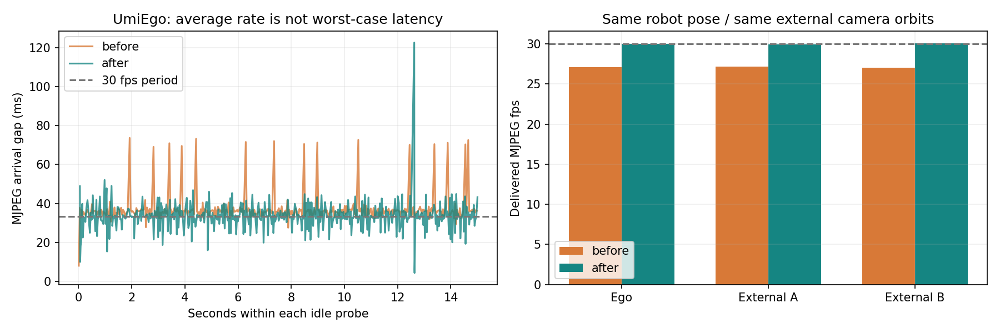
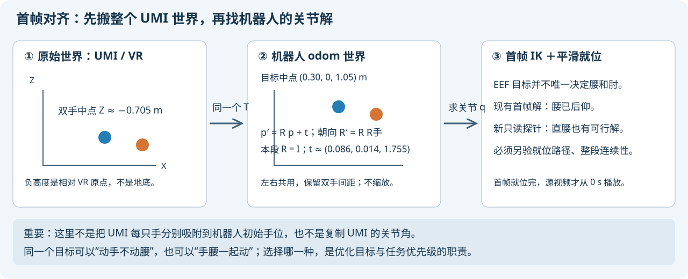
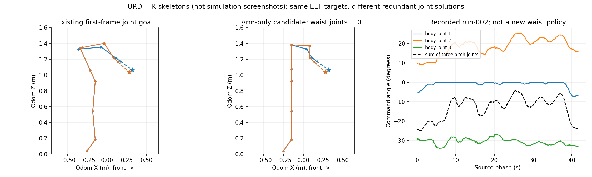

# 在线卡顿、首帧对齐、为什么会后仰，以及怎样让手臂优先

本次核查针对 episode-000、固定底盘、夹爪 EEF、Pinocchio 在线运动学后端。
**结论不是“全部修好了”：已修复一处画面重复限帧，但控制长尾和严格腰臂优先级还没有解决。**

## 先回答你的三个问题

1. **原速不等于流畅。** 已完成的 run-002，扣除暂停后用 41.668 s 回放 41.667 s 数据，
   但机器人图像还要经过渲染、ROS、JPEG、HTTP、浏览器，任何一层停顿都会“卡一下”。
   本次还捕获到一次 875.830 ms 控制周期；不能把全部卡顿归咎于前端。
2. **首帧不是分别吸附到机器人原来的两只手。** 我们给整个 UMI 世界应用一个共同的刚体变换，
   将首帧双手中点放在选定的机器人工作区，再求双手目标的关节解，平滑就位后开始源视频。
3. **当前并没有“先手臂、够不到才动腰”的规则。** 当前是手腰一起参与的加权 QP，
   额外抑制的是侧倾关节，不是前后俯仰。首帧还继承了一个已经后仰的冗余解。
   新的只读实验已经证明：**同一个首帧目标，五个腰关节全部固定为零，也能找到通过模型碰撞检查的双臂解。**

## 1. 为什么在线播放一卡一卡？

### 1.1 三种“速度”不能混为一谈

```text
源时钟：原数据过去 1 秒，现实也过去 1 秒？                  → 倍速 / 时长
控制：能否每约 33.3 ms 计算、验证、发布下一条关节命令？      → 控制频率 / 长尾
显示：新的画面何时真正到达、解码、呈现在屏幕上？            → 帧率 / 帧间隔 / 延迟
```

例如 1 秒内只显示 10 张画面，每次跳过中间两帧，视频仍然可以是原速，但视觉上只有 10 fps。
相反，30 张图片全部慢慢显示 3 秒，动作顺滑一些，却变成了三分之一速。

当前的两条视频路径并不相同：

```text
左上：HF 原 MP4 → HTTP Range → 浏览器原生 H.264 解码 → 屏幕
其余：物理状态 → 独立渲染进程 → ROS RGB 图像 → Web 进程 JPEG 编码
      → 三条 MJPEG HTTP 连接 → 浏览器图像解码 → 屏幕
控制：源时钟 → 双手目标 → Pinocchio FK/雅可比 → OSQP → 碰撞检查 → 位置命令 → PhysX
```

**Pinocchio 只加速中间的模型计算，不负责视频、网络、碰撞服务或物理调度。**
页面的“目标 30 Hz”以前是配置目标，不是已经测到的浏览器显示帧率。

### 1.2 本次实际测到了什么？

原始日志在 `wbc_demo/logs/playback-waist-review/`，可随仓库携带的精简证据在
[playback-waist-v1](media/playback-waist-v1/README.md)。以下不是凭截图猜测。

| 检查对象 | 实测结果 | 能说明什么 |
|---|---|---|
| 用户已完成的 run-002 | 墙钟 116.546 s，暂停 74.878 s，活动 41.668 s | 不能拿含暂停的总墙钟判断变慢 |
| 该段数据 | 1250 帧 / 30 fps，完整视频 41.667 s | 最后一帧时间戳 41.633 s 不是视频完整时长 |
| 修复前 Chromium 源视频短窗 | 呈现约 30.09 fps，采样相位差最大 4.15 ms | 这次本地测量中，左上解码不是主要瓶颈 |
| 首次机器人 MJPEG 探针 | 三路约 16.7 / 18.2 / 17.7 fps，最大间隔约 321 / 350 / 350 ms | 存在明显显示停顿；这一次没有同步采集 ROS 接收计数，不能精确定位上游 |
| 后续同步修复前探针，15 s、机器人静止 | ROS 约 30.04 fps；三路 HTTP 到达约 27.10 / 27.17 / 27.02 fps | 原始帧足够，显示交付层又丢掉了一部分 |
| 去掉重复限帧后，同姿态、同外部镜头，15 s | ROS 约 30.05 fps；HTTP 到达约 30.00 / 29.92 / 30.09 fps | 这一个交付层问题得到改善 |
| 同一修复后窗口 | ego 最大到达间隔仍有 122.61 ms；束帧龄 P95 66.69 ms | 平均接近 30 fps，仍不能宣称无卡顿 |



注意图中修复后平均帧率上升，但 ego 的极大间隔并没有消失，P95 间隔也未整体下降。
这是两个有限的静止窗口，不是“全程动作稳定 30 fps”的验收结果，更不是浏览器机器人画面呈现帧率。
两次窗口外部镜头轨道匹配；Web 重启使 ego 头部轨迹相位归零，ego 内容并非严格相同。
实际浏览器交互截图的接收/编码 fps 也会低于静止窗口，不应只挑约 30 fps 的窗口汇报。
最大间隔包含渲染、ROS、Web 调度和 HTTP 到达等影响；目前不能只归因于其中一个。

### 1.3 已修复的具体机制

旧逻辑是：相机本来以约 30 Hz 产生帧，Web 又用 `距离上次编码 >= 1/30 s` 限一次速。
两个时钟并不同步，而且每轮还有消息处理、录制和调度时间。例如编码循环间隔变成 36 ms，
即使相机每 33.3 ms 都有新帧，输出也最多约 27.8 fps，还会周期性跳过一帧。

现在改为：**只在 ROS 帧版本变化时编码，不对已经限速的相机再套一个独立的 30 Hz 门槛。**
没有新帧就不重复编码；如果积压则只拿最新画面，不建立历史图像播放队列。
JPEG 与版本号在同一个锁内更新/读取，避免二者错配；MJPEG 帧带 `X-Frame-Version` 供核查。

Web 新增实测信息：源视频的浏览器呈现 fps，以及三路 ROS 接收 / JPEG 编码 fps。
明确写了“不是浏览器机器人画面的呈现帧率”，避免再把后台数字当显示验收。

**本次没有把源视频改成慢放，也没有关闭碰撞、限速或跟踪保护来换流畅。**
这次源视频仅发生进入正在播放片段所需的就位 seek；未测到持续 seek 循环，故没有凭猜测改同步算法。

### 1.4 控制端也确实捕获到故障，不能隐瞒

本次新执行保留了两次失败：

- 修复前 `wbc-online-web-20261019-02/run-003`：在源相位约 39.402 s，夹爪归一化跟踪误差
  0.1071 超过现有 0.1 门限，保护停机；不是完整成功回放。
- 修复后 `wbc-online-web-playback-review/run-001`：源相位约 9.200 s，某周期达到 **875.830 ms**，
  其中 IK 求解仅 **1.843 ms**；该周期没有发布新目标。随后跳过 26 个源 tick，
  到约 10.081 s 时夹爪跟踪误差 0.1832，触发保护停机。

这说明后一次长停顿**不在已记录的 IK 求解段内**，但旧日志不能继续区分它发生于
碰撞服务、ROS 执行器、发布、日志写入还是进程被操作系统挂起。
“肯定是 Pinocchio 太慢 / 浏览器太慢 / GPU 太慢”都不符合当前证据。

新增后续日志列 `observation_ms / collision_ms / publication_ms`，供下一轮进一步定位。
这些列是墙钟耗时，仍会包含线程被调度出去的时间，不能单凭一列就指认底层模块的 CPU 耗时。
另外修正失败进度信息：携带实际超时数与错误，不再在失败时把超时数显示为零。

**本次没有拿部分短窗的流畅，冒充整段回放验收通过。** 当前暂停在等待操作状态，
并保留失败记录；未自动反复重跑，也未放宽保护阈值。

## 2. 机器人怎样对齐 UMI 首帧？



### 2.1 先统一世界，不是先复制关节

UMI 给的是双手 EEF 位姿，不是 G2 的关节角。
本数据已经导出为共同 world 坐标系：X 前、Y 左、Z 上，米制；tracker→EEF 外参已应用，
不能再乘一次。原点来自 VR 系统，不是机器人的底座，所以手在桌面而 Z 为负并不奇怪。
原始定义与证据见 [COORDINATES_ZH.md](COORDINATES_ZH.md)。

设第一帧双手位置为 `pL0 / pR0`，先求中点：

```text
m0 = (pL0 + pR0) / 2
选定机器人工作区中点 c = [0.30, 0, 1.05] m，位于 odom 中
选定统一的水平朝向 R = Rz(yaw)，当前 yaw = 0°
t = c − R m0

所有时刻、左右手都用：p_robot = R p_UMI + t
所有手朝向都用：     R_robot_hand = R R_UMI_hand
```

两只手使用同一个 `R,t`，因此保留双手之间的距离和相对朝向；不缩放，不分别移动两只手，
也不把每一帧重新对齐到机器人当前测量位置。

### 2.2 本段真实数值

```text
原始首帧双手中点       [ 0.213688, −0.013737, −0.704932] m
统一平移 t            [ 0.086312,  0.013737,  1.754932] m
映射后左手 EEF        [ 0.320198,  0.120068,  1.064040] m
映射后右手 EEF        [ 0.279802, −0.120068,  1.035960] m
映射后双手中点        [ 0.300000,  0.000000,  1.050000] m
```

**这里的 0.30 m 是 odom 的 X，不是“距离底座向前 30 cm”。**
记录的 `base_link` 在 odom 约 `[-0.25,0,0.04] m`，因此目标中点在底座前方约 55 cm、上方 101 cm。
选择工作区时必须同时看底座坐标和手的目标，不能混用。

当前在线配置采用 `mode=calibrated` 的冻结矩阵，数值来自此前上述中点映射，
不是每次启动重新测量。这里的字段名仅表示显式给定变换，**不代表做过硬件标定**。

### 2.3 再求首帧关节解，最后启动源时钟

```text
仿真测量初始关节 q_home
  → 固定映射后的双手 EEF 目标、夹爪开度
  → 求解 / 读取首帧关节候选 q0
  → 验证目标 FK、限位、机械耦合、碰撞及就位路径
  → 按就位速度/加速度限制平滑移动到 q0
  → 源相位归零，开始 1× 视频与在线微分 IK
```

以前求首帧用已有的 MoveIt 2 + GenieBioIK 适配插件。为了后续对照公平，当前启动命令带
`--approach-reference`，读取以前通过检查的**首帧关节目标**并重新验证；不是本次重新调用
BioIK 选择姿态。在线运动阶段则是**仓库自己的微分 IK + OSQP，Pinocchio 算 FK/雅可比**。

EEF 是模型夹爪指尖面的中点，开合时重新计算，不能拿手腕法兰直接冒充。
EEF→法兰的转换属于工具几何；world→odom 属于世界对齐，这是两件事。

首帧就位和末尾回零不计入源视频的 41.667 s；等待、暂停也不应该算作原速回放变慢。

## 3. 为什么腰会后仰？

### 3.1 先辨认这台机器人的“腰”

本模型有五个 body 关节，不是只有一个前后弯腰轴：

| 关节 | URDF 局部轴 | 主要作用 |
|---|---|---|
| `idx01_body_joint1` | Y | 下部前后俯仰 |
| `idx02_body_joint2` | Y | 中部前后俯仰 |
| `idx03_body_joint3` | Y | 上部前后俯仰 |
| `idx04_body_joint4` | X | 侧倾关节 |
| `idx05_body_joint5` | Z | 上身转向 |

轴是父关节运动之后的局部轴，不能把每个值都直接当作世界欧拉角。
本 URDF 前三个关节零位旋转相同、连续绕 Y，俯仰和 `q1+q2+q3` 可以辅助观察矢状面后仰；
它不是任意机器人通用的“腰角”。完整躯干朝向应从 FK 的躯干坐标系计算。

### 3.2 当前代价函数到底偏好什么？

当前微分 IK 可以概括成：

```text
同时寻找手臂、腰、夹爪的关节速度 v：

尽量让 J v 跟上双手目标速度 / 误差修正
＋ 尽量让夹爪开度跟上目标
＋ 小的关节速度 / 参考姿态正则项

服从关节位置、速度、离散加速度、机械耦合等边界；发布前另查碰撞。
```

核查 `differential_ik.py` 后的具体事实：

- 大部分关节的正则系数都是 `2e-5`，腰部前三个俯仰轴没有特殊“最后才动”的优先级。
- 只有侧倾关节 `idx04` 额外提高到 `0.04`，并给它向零回正的速度偏好。
- 通用参考姿态取的是**首帧就位后的姿态**，不是启动时直立的 home。
- `upright` 选项只给 `idx04` 加 ±0.5° 关节边界，不限制前三个俯仰轴，也不等于世界系躯干 roll。
- 上线前没有“先尝试锁腰，只在手臂无解时解锁”的状态机，也没有严格分层 QP。

因此，以前把选项写成“软直腰偏好 / 直腰对照”容易让你误以为控制了前后弯腰，
**这个命名不准确，已经更正为“全身协同＋抑制侧倾”和“只限制侧倾关节”。**

### 3.3 首帧已经后仰，后面的求解又围绕它保持连续

run-002 首帧关节目标，前三个俯仰角约为：

```text
q1 = −4.967°，q2 = +9.788°，q3 = −29.215°
合计 = −24.394°
```

该段命令的俯仰和约在 −25.008°～−4.280° 变化。
也就是说，后仰不仅是播放中临时“伸不到了”，**起点就已选择一个后仰解**。
仅凭它能到达目标，不能证明这个解在姿态上最合理。



左、中为 URDF FK 骨架图，不是实时仿真截图；虚线到星号是法兰到目标 EEF 的工具长度。
右边是原 run-002 的真实命令日志，不是新策略回放。

### 3.4 新做的“完全不弯腰”探针

我固定全部五个腰关节为 0，只优化 14 个机械臂关节，保持同一首帧的双手位置、朝向和夹爪开度：

- 使用同一 URDF、同一世界变换、同一动态夹爪 EEF。
- 有限位的局部最小二乘求解，得到双手模型残差远小于 0.01 mm / 0.01°。
- 原生关节限位、机械耦合和 MoveIt 状态有效性检查通过。
- **没有向机器人发布这个候选，没有验证到它的就位路径，也没有验证后续整段轨迹。**

因此你说“看起来不用后仰也能做到”，对**这个首帧**现在有模型证据支持。
上述小残差是模型内数值拟合，不是真机定位精度，不代表跟踪误差达到微米级。
反过来，一次局部求解失败也不能证明手臂全局不可达。

## 4. 如何真正做到“手臂优先，必要时腰帮忙”？

### 4.1 你直觉中的规则很合理，但它不是 IK 自动附赠的

把身体想成“坐着拿桌上的杯子”：杯子近时动肩、肘、腕；杯子远时上身前倾；
拿回杯子后尽量回到舒服的坐姿。IK 只知道“手到杯子”，不知道你更喜欢哪种坐姿，
除非我们把偏好写进优化问题。

双手各 6 维位姿，共 12 维任务；腰 5 + 双臂 14，共 19 个构型自由度。
在局部雅可比满任务秩、约束未激活的简化条件下，通常有冗余空间可以选择肘姿、腰姿。
**19−12 不代表任何姿态下都恰好有 7 个可自由运动的方向**：奇异点、限位、耦合与碰撞会改变可行集合。

一个一维类比：手的前移量 = 手臂贡献 + 腰部贡献。要前移 10 cm，
均匀惩罚两者时，优化器可能各分 5 cm；即使手臂单独能完成，也不会自动等到它“用尽”。
给腰加大权重可以让腰少动，但**有限权重的折中不是严格优先级保证**。

### 4.2 先区分两个目标：腰动得少，与腰保持直立

- **少动**：惩罚腰速度、加速度，避免录像里不停摇摆。
- **直立**：惩罚躯干偏离指定中立姿态；已经后仰 25° 时，单纯少动会让它一直后仰。

应先找到合理中立首帧，再兼顾这两个目标，而不是让求解器忠实维持一个不理想的初始姿态。
G2 有三个俯仰轴，即使三个角相加为零，也可能腰部折成 S 形；只限制角度和还不够，
还应约束各轴偏离中立、躯干位置/高度、模型耦合等。

### 4.3 推荐的分层逻辑——这是下一阶段设计，不是现有功能

| 层次 | 内容 | 不能做的事 |
|---|---|---|
| 硬安全集合 | 底盘锁定、原生限位、耦合、速度/加速度、碰撞检查 | 为了保住视频原速而关闭保护 |
| 第一级 | 在可行集合中达到双手 EEF 与夹爪任务，明确位置/朝向容差 | 不区分单位地把所有误差随意相加 |
| 第二级 | 不明显损伤第一级最优结果，最小化腰参与 | 单靠一个很大的权重就声称严格优先 |
| 第三级 | 在保留前两级结果的空间里优化肘姿、避限位与平滑 | 让低优先任务把手拉离目标 |

对于“腰不动也能完成当前任务且满足所有约束”的情况，严格最小化腰参与可以选择零腰速度。
若当前腰已偏离中立，再加入缓慢回正的低优先任务；回正本身是必要运动，应单独统计，
不要把“恢复健康姿态”也误当成不该发生的腰运动。

也可以用更容易理解的两阶段诊断：

```text
A：腰保持中立，求双臂解；检查位置、朝向、限位、碰撞、速度与加速度裕量。
   满足要求 → 用双臂。
B：A 的局部求解不能在规定容差/裕量内完成 → 在安全边界内允许最小腰参与。
   B 也不满足 → 报告不可跟踪 / 安全停止，而不是硬追目标。
```

这里 A 失败的准确表述是“当前局部方法未找到满足要求的解”，不应声称已经数学证明机械臂不可达。
手臂“帮不上忙”还可能是朝向受限、奇异点、碰撞或速度不足，不只与手臂长度有关。

### 4.4 在线控制还需要防抖与提前介入

不能每一帧因为误差跨过一个阈值，就把腰“锁死 / 解锁”反复切换。
应有进入/退出不同阈值、持续时间、腰速度连续过渡、接近关节边界时的制动裕量。
腰正在运动时突然要求其速度为零，可能与加速度限制冲突；这也是直接加硬锁的风险。

对于 UMI 离线数据的在线回放，可以提前看未来几十/几百毫秒目标来规划舒适姿态，
这叫利用已知轨迹的预瞄，不等于实时遥操作也有未来数据。
当前仅有 1/30 s 已知数据前瞻，没有完成上述严格分层/解锁控制。

## 5. 下一步怎样验收，而不是只看视频觉得不错？

按顺序做，不把本轮探针冒充已完成的生产控制器：

1. **先定位并处理控制长尾 / HOLD 连续性。** 新增分段计时，压力下统计控制周期 P95/P99/最大值、
   跳帧、超时、夹爪误差，失败就保留记录；处理已知的一步限位缺少制动裕量与 HOLD 加速度跳变。
2. **直腰首帧。** 对当前新候选验证整个安全就位路径；若失败，规划安全路径，而不是直接发终点。
3. **手臂优先策略。** 加独立、明确命名的策略开关，保留现在的协同策略作为基线。
   先做局部锁腰可行性 / 分层 QP 单元测试，再上仿真；不是换一个库名字就算完成。
4. **同目标对照。** 近目标要求腰参与接近零；远目标能最小幅度辅助；不可达目标正确退出。
   记录五个腰关节与躯干倾角、累计腰运动量、EEF 误差、关节裕量、碰撞、控制长尾和原速倍率。
5. **整段 UMI 回归。** 再跑 episode-000 与更多轨迹；录像和日志同时验收，而非仅挑一帧直立画面。

当前代码仍是固定底盘的运动学 IK + 仿真关节位置跟踪，不是带平衡、接触力、力矩分配的动力学 WBC。
[Pink 官方项目](https://github.com/pink-kinematics/pink)提供 Pinocchio + QP 的微分 IK；
[TSID 官方项目](https://github.com/stack-of-tasks/TSID)是基于 Pinocchio 的优化逆动力学。
这两类能力不能混淆；本仓库没有接入它们作为当前控制器。
首帧插件的上游背景可查 [BioIK 官方项目](https://github.com/TAMS-Group/bio_ik)，
但本次优先级问题来自我们当前目标设计，不能甩给某一个库。

## 6. 文件与复查命令

实现入口：

- `execution.py:alignment`：共同世界变换；`posture_config`：侧倾边界策略。
- `approach_reference.py`：检查冻结首帧目标与来源。
- `differential_ik.py:DifferentialIK.step`：实际在线目标与约束。
- `live_view.py:LiveSession.update_previews`：新帧驱动 JPEG；`tests/stream_probe.py`：只读交付测量。
- `waist_probe.py`：只读固定腰首帧求解；`playback_review.py`：由真实记录生成本页图表。

从仓库根目录，激活环境后：

```bash
mamba activate xense-wbc
source devel/setup.bash
export ROS_DOMAIN_ID=42
export PYTHONPATH="$PWD/wbc_demo:$PYTHONPATH"
export OPENBLAS_NUM_THREADS=1

# 不控制机器人，仅测当前 Web 交付；输出目录和 URL 显式指定。
python wbc_demo/umi_replay/tests/stream_probe.py \
  --url http://127.0.0.1:8780 --seconds 15 \
  --output /tmp/umi-stream-check.json

# 不发布关节命令；--validate-moveit 只调用状态检查服务。
# 默认 URDF 后端也能使用，不强制在 xense-wbc 安装 Pinocchio。
python -m umi_replay.waist_probe \
  --reference wbc_demo/logs/wbc-online-web-20261019-02/run-002 \
  --output /tmp/umi-arm-only-check.json --validate-moveit

# 重建图表需要本机保存的原始探针和原始回放日志。
python -m umi_replay.playback_review \
  --reference wbc_demo/logs/wbc-online-web-20261019-02/run-002 \
  --probes wbc_demo/logs/playback-waist-review \
  --arm-only wbc_demo/logs/playback-waist-review/arm-only-first-frame-readonly.json \
  --output /tmp/umi-playback-review
```

源码和精简证据进 Git；原始数据、较大日志和录制留在本机 `wbc_demo/logs/`，不虚称已上传所有日志。
完整 IK 入门可继续读 [IK_LEARNING_GUIDE_ZH.md](IK_LEARNING_GUIDE_ZH.md)。
