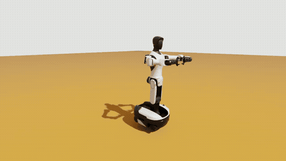
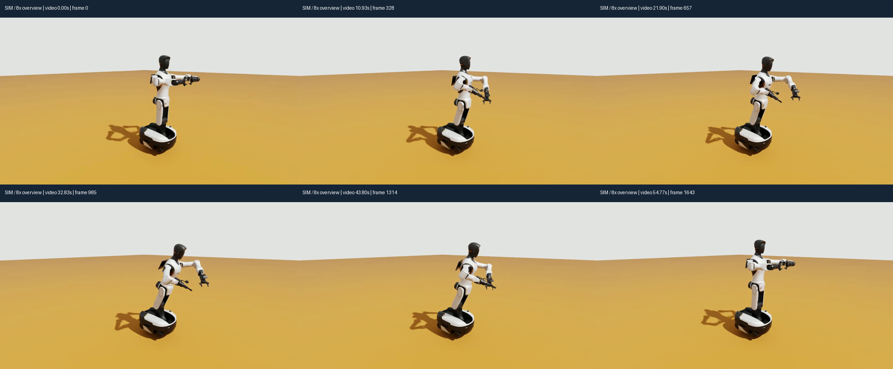
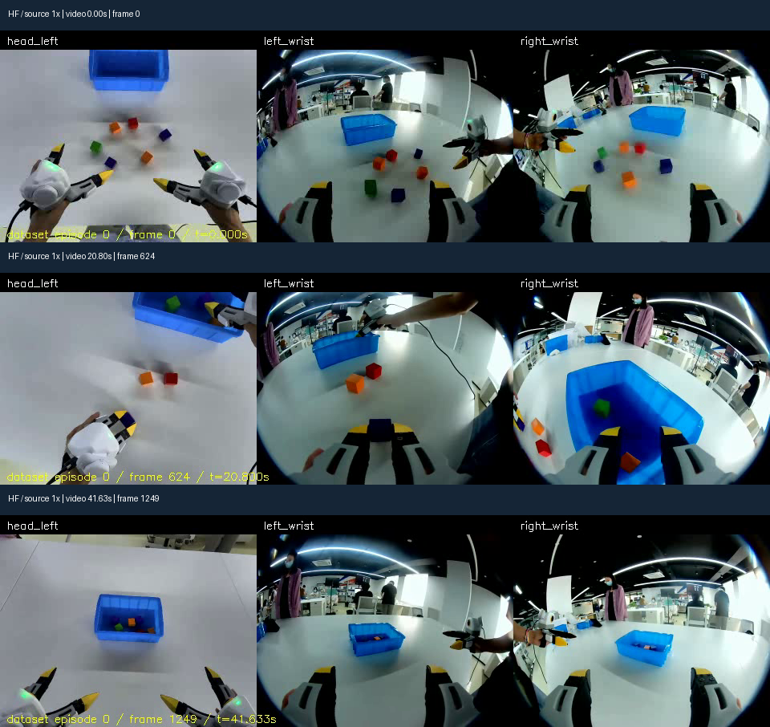
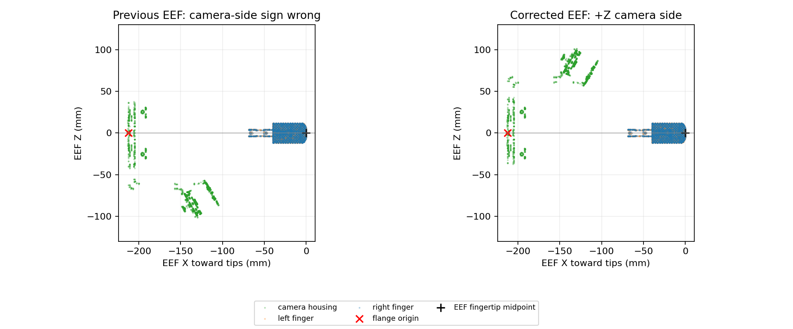
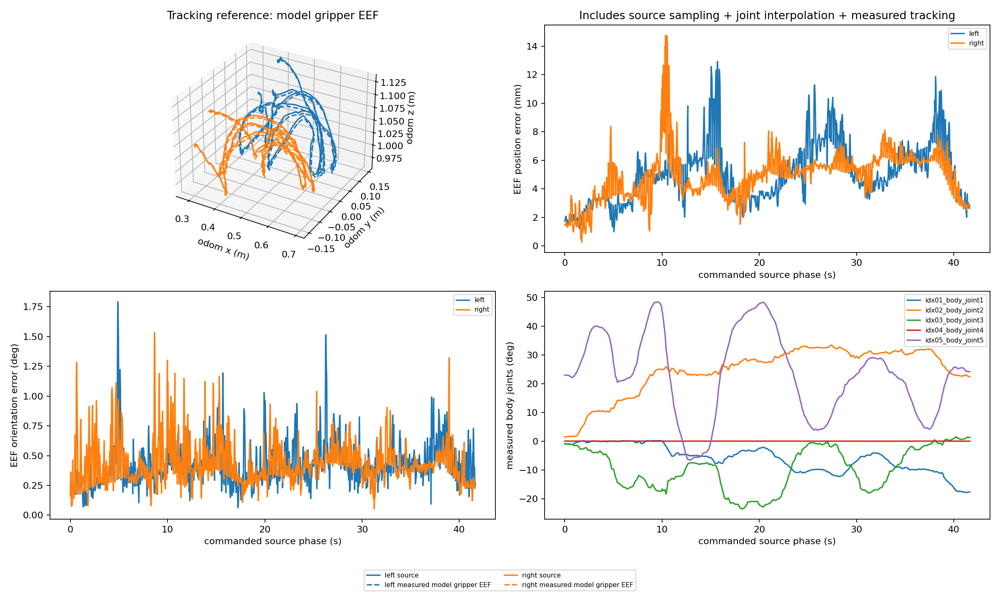

# 给 VLA 工程师的 UMI → 夹爪 EEF → 全身 IK 入门与工作记录

**最新功能：[v4 夹爪开合与 Web 交互](GRIPPER_AND_WEB_FIX_ZH.md)**。
旧 v2/v3 中“夹爪保持开启”的限制已解除；现在 0 闭合 / 1 开启，按实际开度重算指尖 TCP。

**新增：[Web 四视角与 IK/腰部约束讲解](ONLINE_IK_AND_VIEWS_ZH.md)**，
以及 [最新四视角图片/视频验收](MULTIVIEW_RESULTS_ZH.md)。
下文 v2 数字与两栏视频是保留的历史运行；Web 默认采用软直腰，不默认强制 roll ±0.5°。

> 更新时间：2026-10-14，晚上按用户反馈修复腰部侧倾与相机侧 EEF，并重新执行/录制。
> 最新有效运动实验：2026-10-14 19:10:52–19:18:09，Asia/Shanghai。
> 阅读对象：熟悉双臂 VLA，但刚接触腰部自由度、全身 IK 和机器人坐标变换的工程师。

**先看 [用户反馈四项核查与最新结果](USER_FEEDBACK_REVIEW_ZH.md)**：
旧直腰参数未生效、旧模型 EEF 的相机侧轴向反了，均已纠正；旧证据保留，不与最新结果混用。

## 0. 先看图和视频，再看知识与数字

**推荐直接打开 [最新版离线图文/视频验收页](../logs/umi-evidence-episode-000-v2/index.html)**。
页面最前面有 [UMI head_left / 实际全身 IK 同长度分屏](../logs/umi-upright-head-left/head_left.mp4)，
两栏共 1,250 帧 / 30 fps / 41.666667 秒；按命令源相位近邻匹配，最大源相位差 73.704 ms，不能宣称完全同时。
它把源采集视频、机器人实测录像、TCP 模型图、误差曲线、原始 JSON/CSV 和验收表放在同一页，
不需要 ROS、仿真后端或联网。浏览器打开该 HTML 即可，Markdown 阅读器不支持 HTML 时可按下方命令打开。

### 0.1 机器人实测动态预览



这是 **2026-10-14 晚上重新执行的真实仿真相机画面**，不是 AI 生成图或纯 FK 规划动画。
GIF 从 8 倍速概览抽样为 4 fps，仅用于快速观察；清晰度和帧率不足以做毫米级验收。
完整清晰版见 [机器人 8 倍速 MP4](../logs/umi-evidence-episode-000-v2/robot-8x.mp4)。
观察：固定底盘上，躯干前倾/转动与双臂联合改变位姿，末端工具保持装配在臂上。

### 0.2 机器人六帧与源数据三帧



按左上 → 右上 → 左下 → 右下阅读。六帧来自机器人概览视频的均匀取样，首末还包含靠近/返回阶段；
**不是挑选六个 IK 成功目标代替全程验收，也没有把视频时刻假装成源相位**。



源图来自 TacVerse 的 `xtac-umi-g1-block-to-box` 第 0 段，许可 CC-BY-SA-4.0；
这份衍生三联图经过缩放、拼接和标题标注，仍按该许可共享。可看见原始任务中的方块与盒子，
**这些物体没有在机器人空场景中复现**。[原始采集 1 倍速视频](../logs/umi-evidence-episode-000-v2/source-1x.mp4)。

> 两路独立概览 **不是同步对照**：源视频约 41.67 秒，机器人概览约 54.8 秒，是慢速运动的加速播放。
> 新录制器保存逐帧 ROS 时间，无录制器切换，但有渲染停顿/重复帧；单独的 head_left 分屏据这些时间对齐。
> 概览截图标的是各自视频时间；完整轨迹覆盖与误差仍需查曲线/CSV。

### 0.3 怎么一起验收，而不是只看热闹？

| 要核查的结论 | 图/视频入口 | 数值证据与边界 |
|---|---|---|
| 机器人确实运动，腰部不是固定的 | 动图、六帧图、清晰 MP4 | 第 10 节实际腰部关节曲线；不是力矩级 WBC |
| 控制参考是夹爪 EEF，不是法兰 | 第 3 节模型 TCP 图 | 运行报告 `tracking_pose_frame` / `gripper_eef_model`；不是实机 TCP 标定 |
| 实际 EEF 跟踪源轨迹 | 第 10 节轨迹叠加与位置/姿态误差图 | 完整 30 Hz 源轨迹比较；不能从视频目测毫米误差 |
| 底盘锁定 | 视频中的底盘与地面位置 | `report.replay` 的底盘漂移；不推断实机定位精度 |
| 全段完成并回家 | 概览末段、运行报告与 CSV | 源相位覆盖到 41.633335 s；相机有渲染停顿/重复帧 |
| block-to-box 抓放任务 | 原采集视频有方块与盒子 | **尚未复现**，机器人视频只证明空场景轨迹回放 |

本机在仓库根目录打开验收页：

```bash
xdg-open wbc_demo/logs/umi-evidence-episode-000-v2/index.html
```

本文最新 PNG/GIF 存在 `umi_replay/media/episode-000-v2/`，旧素材保留在 `media/episode-000/`；
后续正常提交这些媒体文件后，文档和图片可以一起同步。当前没有自动 commit/push。
视频验收页是独立精简包：把整个 `wbc_demo/logs/umi-evidence-episode-000-v2/` 目录复制到另一台机器即可；
不能只复制 `index.html`。包内不含原始慢速录像或完整数据集，它们保留在原路径，见第 13 节。
也可整体保存 [最新验收包压缩文件](../logs/umi-evidence-episode-000-v2.tar.gz)，解压后打开目录中的 `index.html`。
素材来源、抽帧时刻和 SHA256 见 [媒体清单](media/episode-000-v2/manifest.json)；哈希证明文件一致性，不是第三方认证。

## 1. 先回答：现在的结果怎么样？

**固定底盘、腰部与双臂参与的夹爪 EEF 轨迹回放已经跑通；尚未复现真实抓放任务。**

不是“看起来在动”就算成功：这次检查了全部关键帧、实际关节反馈、夹爪 EEF 误差和底盘漂移，
第 0 段完整执行后回到初始关节姿态。

| 项目 | 最新有效结果 |
|---|---:|
| 下载与转换范围 | 11 段，13,500 帧，全部完成 |
| 实际运动验证范围 | **只验证 episode 0**，不是全部 11 段 |
| 机器人 | G2 + crsB 双臂 + Swiftpicker 夹爪 |
| 参与 IK 的关节 | 腰/躯干 5 + 左臂 7 + 右臂 7 = 19 |
| 底盘 / 头部 / 夹爪开合 | 底盘固定，头部不回放，夹爪保持初始开度 |
| 原始数据 / 执行关键帧 | 1,250 帧 / 215 个双手联合目标 |
| 预检、实际回放、回家 | 全部通过 |
| 原始轨迹时长 | 41.633335 s |
| 实际轨迹阶段耗时 | 399.952 s，约 6.7 分钟 |
| 左 / 右 EEF 最大位置误差 | 12.932 / 14.771 mm |
| 左 / 右 EEF 位置误差 P95 | 8.684 / 7.116 mm |
| EEF 最大姿态误差 | 1.792° |
| 单个腰部 yaw 关节最大变化范围 | 55.129° |
| 实际最大绝对腰部侧倾 roll | 0.084299°，IK 约束为 ±0.5° |
| 底盘最大平移 / 旋转漂移 | 1.313 微米 / 0 rad，仿真 TF 数值内 |
| 代码测试 | 40 个 UMI/EEF/媒体测试 + 10 个原有实验台测试通过 |

这里的“误差”是**模型夹爪 EEF 对完整 30 Hz 源轨迹的误差**，不是只挑几个好看的截图。
底盘微米级漂移只是固定底盘仿真的数值记录，**不是实机具有微米定位精度**。

我的判断：

- 作为学习坐标变换、双手任务空间和全身 IK 的可复核 demo，链路已经成立。
- 作为“VLA 输出 EEF → 机器人运动”的后端原型，已有可用基础，但未接入策略闭环。
- 不能据此宣称抓取、方块入盒或精密插装成功；原采集场景、物体接触和夹爪开合均未复现。
- 这次是保守慢速回放，不能宣称已经达到原始 30 Hz 人类动作的实时复现能力。

## 2. 整条链路：我们到底做了什么？

```text
HF 上的 UMI 数据
  ↓ 下载固定版本，核对文件哈希
LeRobot parquet 中的双手 EEF 位姿
  ↓ 检查时间、旋转编码、置信度与逐段元数据
采集世界中的双手 EEF 轨迹
  ↓ 左右共用一个世界变换
仿真 odom 中的双手夹爪 EEF 目标
  ↓ 使用机器人模型确定的固定 TCP 关系
MoveIt / BioIK 全身 IK
  ↓ 得到腰部与双臂关节角，检查路径与约束
速度/加速度约束下重定时
  ↓ 发布关节位置指令
PhysX 仿真中的机器人运动
  ↓ 读取实际关节反馈，再做夹爪 EEF FK
与完整源轨迹比较，保存报告、CSV、图和录像
```

**我们没有训练 VLA，没有运行某个新策略，也没有重写 IK 核心求解器。**
本次新增的是下载、数据适配、正确夹爪 EEF 接口、回放控制和审计流程。

## 3. 四个容易混淆的词：法兰、夹爪、EEF、TCP

### 3.1 用“拿笔写字”理解

把机械臂想成你的手臂：

- **法兰**：手腕上用来安装工具的接口。
- **夹爪**：装到手腕上的整支笔，不是一个点。
- **EEF 坐标系**：你给工具末端定义的位置和朝向，例如笔尖所在的坐标系。
- **TCP**：Tool Center Point，工具中心点；实际控制通常还需要它的完整坐标系姿态。

你希望“笔尖落在纸上某点”，不是希望“手腕落在纸上某点”。
同样，UMI 数据记录夹爪 EEF 时，机器人也必须以夹爪 EEF 对齐，不能直接让法兰追踪这些位姿。

### 3.2 本次机器人 EEF 在哪里？

现有 Swiftpicker URDF 已移除旧的夹爪中心辅助 link，不能照着旧名字假定它还存在。
我们从 URDF 安装链和 STL 指尖网格计算当前参考姿态下的模型 TCP：

- 原点：**两只夹指最前端面的中心点的中点**。
- 参考姿态：夹爪关节零位，目前对应开夹状态。
- 轴向：+X 朝指尖，+Z 朝腕部相机侧，+Y = +Z × +X（本模型 URDF 的 right_support 一侧）。

相对左右臂末端法兰，得到：

```text
平移 ≈ [-0.0000172504, 0, 0.2120057335] m
旋转 ≈ Ry(-90°) × Rx(180°)
```

也就是夹爪 EEF 距法兰约 **212 mm**，显然不是同一个点。
约 17 微米的横向量来自网格几何，不应误读为硬件标定精度。



先前仅按 URDF 夹指命名确定 +Y，导致相机侧的 +Z 符号反了；最新按源设备约定与相机几何共同核对。
TCP 位置和相机安装 joint 没改，改变的是机器人 EEF 轴定义及据此求解的法兰朝向。

这是一份**可复算的模型定义**，不是厂家提供的实测 TCP 标定。
夹爪开度改变后，指尖几何可能改变；当前回放不驱动开合，并检查关节是否偏离参考姿态。
不能以后随便打开/关闭夹爪，却仍宣称这个参考几何点完全不变。

## 4. 坐标系：一个位姿必须回答“相对于谁？”

### 4.1 世界坐标系不是宇宙中的统一坐标系

“手在 `[0.3, 0.1, 0.8]`”没有说完整。你还需要知道：

- 原点在哪里？
- 哪个方向是 X、Y、Z？
- 单位是米还是毫米？
- 这个数描述 tracker、相机、法兰，还是夹爪 EEF？

原版 Stanford UMI 与本次 XTac 数据的定位链不同，不能照搬一套世界定义：

| 系统 | 本次核查到的机制 |
|---|---|
| 原版 Stanford UMI | SLAM 相机轨迹，经桌面标签变换和相机→TCP 变换得到末端轨迹 |
| 本次 XTac-UMI-G1 | PICO 跟踪链，经轴映射和 tracker→EEF 外参得到末端轨迹 |

XTac 导出代码定义的 world 为 X 前、Y 左、Z 上，单位米。
邻近驱动文档说明原点与 Unity VR app 启动时的头显位置有关，不是每一帧都跟着头移动。
**HF 没有提供这批数据的 world→G2 底座标定，也没有给出精确历史导出程序 commit。**
所以我们能核查代码契约，但不能把驱动说明冒充对该采集现场的一次实测标定。

例如，原点在头部附近，桌上的夹爪 Z 为 -0.7 m 很正常：它只是低于原点 70 cm，
不意味着夹爪在仿真地板下。

### 4.2 本数据已经是 EEF，不能重复做 tracker 外参

逐段 `meta/taccap_extrinsics.json` 确认：

```text
poses_are_ee = true
legacy_world_pose = false
```

因此读出来的 `left_tcp/right_tcp` 已是导出的 EEF 位姿。
**不能再次应用 PICO→world 映射，也不能再次乘 tracker→EEF 外参。**
这像一个文件已经从毫米换成米，你又除一次 1000；数学操作本身合法，语义却错了。

数据名里的 G1 是 XTac 手持夹爪型号，不是本次在仿真中回放的机器人型号。

### 4.3 为什么左右手只能共用一个世界变换？

把两个人一起抬的箱子整体搬到另一张桌上，左右手的距离不应该改变。
如果为了方便 IK，把左手往左挪 20 cm、右手往右挪 20 cm，箱子就被“拉宽”了。

本次左右手共用同一个刚体变换，不缩放轨迹。
默认把第一帧双手中点摆到 odom 的 `[0.30, 0, 1.05]` m，世界 yaw 为零。
实际保存的共享平移约为：

```text
采集世界 → odom：
Δx = 0.0863118574 m
Δy = 0.0137374438 m
Δz = 1.7549315274 m
```

例如左手第一帧的源 Z 约 -0.690892 m，变换后约为 1.064040 m。
这只是**整体摆放/重定向**，不是实测现场注册；原桌子、箱子与机器人之间的绝对关系尚未建立。

## 5. 位姿变换：为什么法兰内部换算仍然必要？

### 5.1 先统一符号

`T_A_B` 表示 B 坐标系在 A 中的位姿，也可以把 B 中的点变到 A 中。
它通常写成 4×4 齐次矩阵：

```text
T_A_B = [ R_A_B  p_A_B ]
        [ 0 0 0    1   ]
```

`R` 描述朝向，`p` 描述 B 原点在 A 中的位置。
连续坐标变换按链相乘：`T_A_C = T_A_B × T_B_C`，顺序不能随意交换。

### 5.2 本次最重要的三个公式

```text
夹爪 EEF 目标：
T_odom_eef_target = T_odom_dataset × T_dataset_umi_eef

求解器内部法兰目标：
T_odom_flange_target = T_odom_eef_target × inverse(T_flange_eef)

实际夹爪 EEF：
T_odom_eef_actual = FK_flange(q_actual) × T_flange_eef
```

第一行决定“夹爪要去哪儿”，第二行是求解器接口需要的内部换算，第三行检验“夹爪实际去了哪儿”。
左右乘、正变换和逆变换必须一致。

### 5.3 一个具体例子：同一个笔尖位置，手腕位置却不同

忽略很小的横向几何量，假设法兰距 EEF 沿工具轴约 0.212 m：

- 目标 EEF 位于 `[0.5, 0.1, 0.8]`，工具朝世界 +X，法兰约在 `[0.288, 0.1, 0.8]`。
- EEF 原点不动，工具改朝世界 +Y，法兰约在 `[0.5, -0.112, 0.8]`。

所以“扣除工具偏置”不是每一帧都从世界 Z 减去 0.212。
**工具偏置必须跟着工具朝向旋转**；转手腕但保持笔尖不动时，手腕本来就需要沿圆弧移动。

本次 MoveIt 后端仍接收 `arm_l_end_link/arm_r_end_link`，但已先按第二行换算。
这不等于把任务目标定义在法兰上。
`GripperEEFLab` 对外的 IK 目标、FK 返回、误差和可视化都统一为夹爪 EEF。
报告同时写明 `tracking_pose_frame: gripper_eef` 与 `solver_internal_links`，方便你核查。

## 6. 旋转表示：r1…r6 到底是什么？

本数据每只手包含 10 个量：

```text
x, y, z, r1, r2, r3, r4, r5, r6, gripper.pos
```

其中 `r1…r6` 是旋转矩阵的**前两列分组存储**，不是 6 个欧拉角，也不是四元数：

```text
a = [r1, r2, r3]
b = [r4, r5, r6]
u = normalize(a)
v = normalize(b - dot(u, b) × u)
w = cross(u, v)
R = column_stack(u, v, w)
```

这样用 Gram-Schmidt 正交化重建完整旋转矩阵。
例如绕 Z 转 90°，两列为 `[0,1,0]` 与 `[-1,0,0]`。
错误地按两行解释，得到的就是另一种朝向。

还需要记住三个陷阱：

- 本回放和 ROS 消息用四元数 `xyzw`，外参 JSON 中有 `wxyz`；顺序错了也可能仍是单位四元数。
- `q` 与 `-q` 表示同一个旋转，不能把符号变化直接当作腕部翻转。
- 朝向插值使用 Slerp；不能随意对欧拉角或四元数分量做直线插值。

本次 29 维状态 = 左手 10 + 右手 10 + 头显位姿 9；头显位姿没有参与当前回放。
真实数据检查还确认，非末帧的 `action[t]` 等于 `observation.state[t+1]`，不是增量。
因此默认回放观测状态，不能把 action 一帧帧累加。

## 7. 从固定双臂到全身 IK：增加腰部意味着什么？

### 7.1 FK 与 IK

- FK：给定关节角 `q`，计算夹爪 EEF 在哪里，即 `T_eef = FK(q)`。
- IK：给定 EEF 目标，寻找满足目标和约束的关节角 `q`。

只动双臂时，每只手的位置主要由对应机械臂决定。
放开腰部后，身体前倾、侧弯或转动会同时影响两只手，两个目标必须联合求解。

像你坐着从桌子远端拿杯子：只伸手够不到时，身体前倾就可能够到。
但如果另一只手正端着一碗汤，前倾身体也会带动它，你必须同时调整另一条手臂保持碗的位置。

**这就是双手全身 IK 与“分别给两条机械臂各做一次 IK”的关键区别。**

### 7.2 19 个关节并不意味着只有一个答案

本次关节向量包括腰/躯干 5、左右手臂各 7，共 19 维。
19 是主动求解的关节数，不是 URDF 的全部关节数；FK 仍需要底盘 TF、头部、夹爪参考姿态等完整状态。
底盘锁住不意味着它在世界坐标中的位姿就是单位阵；这里也没有做双足行走的腿部控制。
两只手各有 3 个位置 + 3 个朝向约束，直觉上是 12 维任务。
`19 - 12 = 7` 可以帮助理解冗余，但不是处处都能自由使用的 7 个方向：
奇异位形、机械耦合、关节限位和碰撞都会限制它们。

因此同一个双手目标可能对应多套身体姿态，例如：

- 腰部少动、手臂伸得更直；
- 腰部前倾、手臂保持弯曲；
- 腰部转动、左右肘采取不同姿态。

求解器会受初始种子、姿态偏好、限位与碰撞影响。
本次复用了仓库 `genie_sim_moveit_plugins/BioIKPlugin`，没有重写它的搜索算法。
顺序求解时使用上一帧解作种子，以帮助关节运动保持连续；这不是唯一解或全局最优的保证。

### 7.3 再进一步：Jacobian 的直觉

小范围运动可以近似写成：`任务空间小变化 ≈ Jacobian × 关节小变化`。
对双手来说，Jacobian 同时包含两个手的变化。
腰部关节对应的列通常会同时影响左右手，体现了“身体是共享资源”。
这为理解微分 IK、零空间姿态调节提供了入口，但不要因此误认为当前 BioIK 就等于某个特定伪逆公式。

## 8. 全身 IK 与 WBC 的关系：先学谁？

不是两个完全不相干的领域，更像控制系统的不同层次：

| 层次 | 主要回答的问题 | 本次是否实现 |
|---|---|---|
| 全身 IK | 哪些关节角能让双手到达目标？ | 是 |
| 路径与重定时 | 如何沿安全检查过的路径移动，速度多快？ | 是，保守实现 |
| 仿真位置控制 | 关节是否跟随给定位置指令？ | 使用现有仿真驱动 |
| 动力学 WBC | 如何分配关节力矩/接触力，同时满足任务、动力学和接触约束？ | 否 |

动力学层常要考虑形如 `M(q)q̈ + h(q,q̇) = τ + J_contactᵀ f_contact` 的关系。
理解公式的重点是：电机力矩、惯性、重力和接触力必须共同解释运动，不能只关注几何位置。

**用了物理仿真不代表自己已经实现动力学 WBC。**
本次是“全身运动学 IK + 路径检查/重定时 + 仿真位置控制”。
对你当前的固定底盘问题，先搞清 EEF、坐标变换、FK/IK 和跟踪误差是合理的学习路线；
等涉及明显接触力控制、快速运动或浮动底座平衡，再进入动力学 WBC。

## 9. 为什么 41.6 秒的数据要回放 8 分钟？

原始 30 Hz EEF 轨迹不是可以直接发给关节的 30 Hz 位置指令。
即使两帧 EEF 只差 1 cm，接近奇异位形时，也可能需要较大的关节变化。

当前流程：

1. 保留全部源 EEF 帧。
2. 初始关键帧间隔最多 0.2 s；若源轨迹的线性位置/Slerp 朝向近似超出 5 mm / .03 rad，再加关键帧。
3. 全部关键帧先求解 IK，并检查相邻关节路径。
4. 每段关节采用三次平滑插值，关键帧处停速。
5. 取最严格片段要求的时间伸缩，统一放慢整段。

三次插值为 `blend(s) = 3s² - 2s³`。单关节变化量为 `Δq`、段时长为 `T` 时：

```text
峰值速度 = 1.5 × |Δq| / T
峰值加速度 = 6 × |Δq| / T²
```

本次使用 0.3 rad/s、0.5 rad/s² 的配置上限，并结合模型原生速度限位重定时。
`--speed 0.5` 只是申请的速度上限，并不保证最终只慢两倍。
最新实际伸缩系数为 9.4478，名义轨迹阶段约 393.34 s，实际 wall time 为 399.95 s。

关键帧处停速、全段服从最慢片段都比较保守；段内三次插值还改变了局部源相位的推进速度。
所以这是**保守轨迹回放**，不是严格原速、原始时间分布的人类运动复现。
提高速度需要改进连续轨迹与时间参数化，不能简单去掉加速度保护。

## 10. 三类误差：为什么“微米级 IK”不等于“微米级回放”？

### A. 关键帧 IK 残差

比较目标 EEF 与“求解关节角的 FK”。本次最大约 **7.159 微米**。
它是模型内的几何求解残差，没有包含物理跟踪、硬件误差或真实 TCP 标定误差。

### B. 运行时跟踪误差

比较实际反馈 FK 与当前关键帧段插值产生的 EEF 目标。
本次 `report.json → replay.max_position_error_m` 为 **13.561 mm**。

### C. 对完整源轨迹的误差

在当前命令对应的源相位上，用全部 30 Hz 原始 EEF 帧插值，比较实际模型 EEF。
本次 `eef-metrics.json` 中左右最大误差为 **12.932 / 14.771 mm**。
它同时反映源关键帧近似、关节插值与实际跟踪的影响。

**评价本次回放时应优先看 C，而不是拿 A 宣称机器人已经达到微米精度。**
控制保护阈值 5 cm / 10° 也不是实测精度，只是“超过就停止”的门槛。

P95 的意思是约 95% 的采样位置误差不超过该值，不是任务成功率。
它按这次记录的采样点统计，不代表所有 episode 的误差分布。
腰部 yaw 的 55.129° 是轨迹内最大值减最小值；各腰部关节最大相对初始 home 偏移约 48.525°。
侧倾 roll 则几乎保持零位，实际最大绝对值 0.084299°；不要把 yaw 范围误认为身体侧倾。



时间也要区分：`tracking.csv` 的 wall time、反馈 ROS 时间、命令源相位是三种不同时间。
当前比较的是命令源相位上的跟踪误差，不是完整延迟标定后的高精度时间同步评估。

## 11. 安全检查做到了什么，没做到什么？

已做：

- 原始数据有限值、旋转、时间连续性、逐段语义、置信度和文件哈希检查。
- IK 原生关节范围、机械耦合约束与目标残差检查。
- 相邻关节路径的离散自碰撞采样，以及任务空间中点偏差检查。
- 整段预检通过后才开始运动，不跳过失败帧、不暗中缩小动作。
- 检查控制权租约、多个命令发布者、反馈过期、命令变化和底盘漂移。
- 软件停止后保持测量关节位置；夹爪偏离参考关节姿态时拒绝继续使用该参考 TCP。

未做：

- 原采集桌面、方块和盒子的环境注册与碰撞世界同步。
- 连续碰撞的数学保证；离散采样通过不等于连续时间无碰撞证明。
- 物体接触、夹爪开合、触觉闭环、力矩控制或浮动底座平衡。
- 实机部署认证、硬件急停与真实 TCP/相机/世界坐标标定。

底盘“不参加 IK”与物理底盘“被固定”也是两件事：
本次规划组排除了底盘自由度，场景又通过 `pin_base_to_world: true` 固定物理底盘，并用 TF 检查漂移。
不能只关闭规划自由度，就假定物理世界中的底盘一定不会滑动。

## 12. 工作记录：有哪些步骤，哪里做错了？

### 阶段一：下载与数据核查

- 在原 `xense-genie_sim` 目录和 `xense-wbc` 环境工作，没有回到旧 demo worktree。
- 固定 HF revision：`8ad651578fda4724514387e2d3d3551c3c9631f9`。
- 数据集为 `TacVerse/xtac-umi-g1-block-to-box`，数据卡标注 CC-BY-SA-4.0；来源与许可写入下载清单。
- 先枚举大小，再完整下载 21 个文件、284,999,394 bytes，包含 8 路视频。
- 确认 LeRobot v3、11 段/13,500 帧、30 Hz、29 维状态与已经应用的 EEF 外参。
- 全部 11 段完成转换；保留原始数据，未把数据下载完成写成全部机器人运动成功。

### 阶段二：第一版运动与语义错误

- 最初忽略工具偏置的目标在首帧被拒绝；只在诊断中关闭碰撞检查，检出左右夹爪互撞。
- 随后用共享世界摆放与首帧拟合的虚拟工具旋转，实现了一段能执行的轨迹。
- 但“能执行”不证明实际夹爪 EEF 朝向正确。用户指出机器人也必须使用夹爪 EEF，这个问题成立。
- 该方案已停用；旧 15.46 mm 等结果明确标为历史虚拟 EEF 结果，不与新结果混用。

### 阶段三：按模型夹爪 EEF 修正

- 新增 `gripper_eef.py`，从安装链和指尖网格确定固定 TCP，不用数据首帧拟合工具旋转。
- 新增 `robot.py`，同时覆盖任务空间 IK 与 FK，避免只改目标却忘记改误差计算。
- 目标箭头、误差、轨迹中点检查和回家检查全部使用模型夹爪 EEF。
- 广播两个夹爪 EEF 的静态 TF，没有向物理模型添加虚假的带质量 TCP 刚体。
- 初版夹爪 EEF 预检 215/215 通过，随后执行并回家；该轮后来发现相机侧轴符号需继续纠正，保留为历史记录。

### 阶段四：测试与证据整理

- 新增模型几何、旋转后的工具偏置、EEF→法兰→EEF 闭环、IK/FK 适配器与开度保护测试。
- 一次测试错误假定横向几何量严格为零；按实际网格的 17 微米偏置修正测试期望，未修改模型迎合测试。
- 最终 26 + 10 测试通过，另检查 Python 格式/编译、shell 语法与依赖。
- 原生仿真相机录制避免桌面遮挡；图例压住坐标标签后，移到图外重新生成。
- 两段录像有录制器切换缺口，文档如实披露，不把拼接录像当连续完整证据。
- 运行后清理自己启动的后端；本次上午只复核证据、撰写教程，没有重新跑性能实验。

### 阶段五：用户指出侧倾与相机在下方，继续核查（晚上）

- 实测旧直腰先验为零，修复 BioIK 按规划组读取 ROS 2 参数并重新构建。
- 根据源设备与机器人相机几何修正 EEF +Z 相机侧，不改相机安装或 TCP 位置。
- 加强 roll 零位偏好与 ±0.5° IK 约束，保留其他腰部自由度；预检和实际 215/215 回放/回家通过。
- 实际最大绝对 roll 降为 0.084299°，最大源 EEF 误差 14.771 mm / 1.792°；不宣称误差全面变好。
- 重新录制逐帧 ROS 时间，生成同长度 head_left 分屏；渲染停顿导致最大源相位差 73.704 ms，公开索引与限制。
- 40 + 10 测试通过；完整四项核查、失败尝试与新旧对照见 [用户反馈复核](USER_FEEDBACK_REVIEW_ZH.md)。

这是本地新增流程，不是原封不动的官方 demo。现成能力与新增工作区分如下：

| 来源 | 内容 |
|---|---|
| 仓库已有 | G2 模型、ROS/MoveIt、BioIK 插件、仿真和渲染链 |
| HF 发布 | 原始轨迹、视频、逐段外参和设备元数据 |
| 本次新增 | 数据适配、模型夹爪 EEF、预检/回放、误差分析、测试与审计文档 |
| 调研但未执行其采集流水线 | Stanford 原版 UMI 的 SLAM/标签/TCP 机制 |

## 13. 代码和证据去哪儿找？

### 13.1 代码索引

| 文件 | 你可以核查什么 |
|---|---|
| [download.py](download.py) | 数据 revision、下载预算、SHA256 |
| [dataset.py](dataset.py) | 逐段 EEF 语义、时间/置信度和 schema 检查 |
| [geometry.py](geometry.py) | 6D 旋转、四元数、SE(3) 与插值 |
| [conversion.py](conversion.py) | 完整源帧、关键帧选择、共享世界映射 |
| [gripper_eef.py](gripper_eef.py) | 模型 TCP 原点、轴向、安装矩阵和网格证据 |
| [robot.py](robot.py) | EEF 任务空间到法兰内部接口的双向适配 |
| [execution.py](execution.py) | IK、路径预检、重定时、实际执行与记录 |
| [analysis.py](analysis.py) | 实际 EEF 对完整源轨迹的误差，避免重复加 TCP |
| [evidence.py](evidence.py) / [evidence_template.html](evidence_template.html) | 核对指标与 CSV，生成真实抽帧、GIF 和离线验收包 |
| [synchronized_video.py](synchronized_video.py) / [review.py](review.py) | head_left 同源相位近邻分屏与腰部/相机轴审计 |
| [configs/g2_shared_world.json](configs/g2_shared_world.json) | 共享世界摆放和安全限制，不再配置拟合工具旋转 |

### 13.2 最新有效证据

以下相对仓库根目录：

| 文件/目录 | 含义 |
|---|---|
| `wbc_demo/logs/umi-upright-execute-02/report.json` | 最新实际运行状态、矩阵、模型证据、预检、执行和回家 |
| 同目录 `eef-metrics.json` | 对完整源轨迹的 EEF 最大误差与 P95 |
| 同目录 `tracking.csv` / `eef_tracking.csv` | 实际 EEF、时间、误差与腰部反馈 |
| 同目录 `mapped_targets.json` / `joint_plan.json` | 目标与 IK 后的关节计划 |
| `wbc_demo/logs/umi-upright-preflight-02/` | 新轴定义/近零侧倾，独立无运动命令的完整预检 |
| `wbc_demo/logs/umi-feedback-review/` | 最新运动的仿真、MoveIt、参数、构建与控制端日志 |
| `wbc_demo/logs/umi-upright-head-left/` | 同长度分屏、每帧时间/源相位差值与输入哈希 |
| `wbc_demo/logs/gripper-eef-correction/` | 模型审计、源码/测试证据、校验清单与补丁快照 |
| `wbc_demo/data/xtac-umi-g1-block-to-box/download-manifest.json` | 原始下载来源、大小和哈希 |

[新 8 倍速运动概览](../logs/umi-upright-summary-8x.mp4) 便于快速观看。
它是加速播放，不是原速控制，也不能代替 CSV；旧 `umi-gripper-eef-*` 资料仍保留，但不再是最新轴定义的验收证据。

注意：`data/` 和 `logs/` 被 Git 忽略；本文内嵌图片/GIF 已单独放进可版本管理的 `umi_replay/media/`。
仅复制代码仓库仍不会包含运行 CSV、清晰 MP4 和离线验收页；需整体保存验收包或重新生成。
本次代码仍在工作区，尚未自动提交或推送。

## 14. 你如何自己复跑、自己核查？

所有命令都在 `xense-genie_sim` 仓库根目录执行，适用于当前已配置机器。
已有转换文件，不必重复下载或覆盖转换产物。

### 14.1 只预检，不运动

先关闭其他实验台和仿真后端，避免重复控制同一个 ROS domain。

```bash
mamba activate xense-wbc
export OMNI_KIT_ACCEPT_EULA=YES
bash wbc_demo/run.sh umi-all \
  --input wbc_demo/data/converted/episode-000.json \
  --output wbc_demo/logs/umi-my-eef-preflight
```

### 14.2 完整执行

输出目录必须是新的，程序不会覆盖旧证据。

```bash
bash wbc_demo/run.sh umi-all \
  --input wbc_demo/data/converted/episode-000.json \
  --output wbc_demo/logs/umi-my-eef-execution \
  --execute --speed 0.5
```

它会重新完整预检，再靠近首帧、回放、回家并清理本次后端。
根据关节解和调度情况，运行耗时可能不同；一次成功不能替代每次预检。

### 14.3 分析你这次的实际误差

```bash
python wbc_demo/umi_demo.py analyze \
  --input wbc_demo/data/converted/episode-000.json \
  --run-directory wbc_demo/logs/umi-my-eef-execution
```

核查清单：

- `report.status` 是否为 `passed`，靠近首帧和回家是否也通过？
- `tracking_pose_frame` 是否为 `gripper_eef`？不要把旧虚拟工具报告拿来比较。
- 模型工具矩阵是否来自 URDF/STL，而不是每只手按首帧拟合？
- 两只手是否共用一个世界变换，比例是否仍为 1:1？
- 源相位是否覆盖到最后 41.633335 s，而不只是执行了一个成功前缀？
- 误差是否看了完整源轨迹指标，而不只看微米级 IK 残差？
- 底盘、腰部曲线、夹爪参考开度和中止原因是否都有记录？

## 15. 下一步的顺序

1. **先人工核对 TCP 与轴向**：看模型图、源 CAD 定义和实际运动，明确模型约定与尚缺失的硬件标定。
2. **同一夹爪 EEF 轨迹做锁腰/解锁对照**：比较可达率、误差、关节限位余量和身体运动；本次未完成这条 UMI 轨迹的该项 A/B。
3. **批量验证剩余 10 段**：记录各段成功/失败与原因，不能沿用第 0 段结论宣称它们全通过。
4. **提高回放效率**：研究更连续的关节路径与时间参数化，减少关键帧停速，不牺牲保护与可复核性。
5. **再增加夹爪开合、场景和接触**：此时才能讨论 block-to-box 任务成功率。
6. **最后接 VLA 闭环与动力学 WBC**：先把“策略动作到底对应哪个 EEF、哪个世界系、哪个时间”写成明确接口契约。

如果只记住一句话：**先让“数据 EEF”和“机器人实际控制的 EEF”在位置、轴向、单位和时间上说同一种语言，再讨论更强的控制算法。**

## 相关材料

- [EEF 纠错细节与最新实测](GRIPPER_EEF_CORRECTION_ZH.md)
- [坐标系研究与历史记录](COORDINATES_ZH.md)
- [完整操作入口](README.md)
- [过程日志](WORK_LOG.md)
- [更一般的全身 IK 入门](../WHOLE_BODY_IK_GUIDE_ZH.md)
- [此前目录迁移记录](../MIGRATION.md)

本文关于实际结果的来源是本机保存的 JSON/CSV/日志，不是外部资料中的性能数字。
数据世界系、源 EEF 轴约定的证据与未确认项，分别保存在坐标说明和 EEF 修正说明中；
HF 未提供的实测现场标定与精确导出 commit，本文也没有补造。
