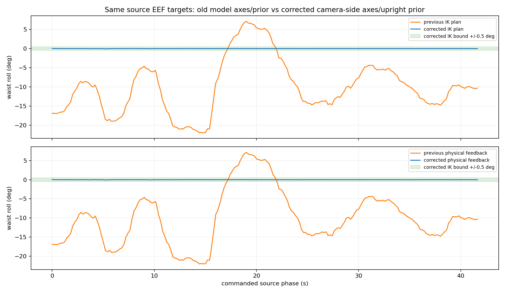
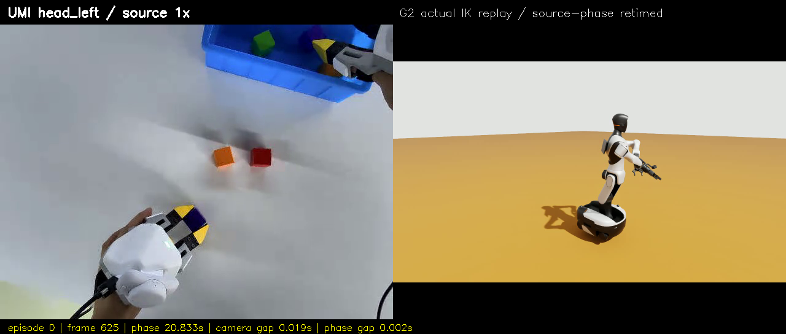

# 用户反馈核查：腰部侧倾、腕部相机、同相位分屏和 IK 来源

**后续更新：[Web 四视角与软/硬约束说明](ONLINE_IK_AND_VIEWS_ZH.md)，[最新四视角验收](MULTIVIEW_RESULTS_ZH.md)。**
下文“最新”指本页记录的 v2 历史运行；Web 默认已改为软直腰，不再把 ±0.5° 当作通用要求。

> 2026-10-14。旧资料不覆盖；本次重新执行正确相机侧 EEF、近零侧倾的第 0 段，并重新录制带逐帧时间戳的原生仿真画面。
> 最新有效实际运行：2026-10-14 19:10:52–19:18:09（Asia/Shanghai），回放与回家通过。

## 1. 腰为什么侧倾？是不是必须？

你指出的问题成立：原解确实存在较大的腰部 roll，不能用“全身 IK 就该这样动”解释。
旧计划的 `idx04_body_joint4` 是绕局部 X 轴的侧倾关节，范围约 **-22.022° 至 +7.150°**。
截图里的屏幕左/右受观察视角影响；这里使用模型关节 roll 和实际反馈，不凭二维画面猜方向。
其余 3 个屈伸关节和 1 个 yaw 关节并不等价于侧倾。

### 核查出的根因

旧 YAML 虽写了 `posture_weight: 0.3`，**旧实际初始化日志却是 `posture=0.00 x0`**。
不是模型必须侧倾，也不是底盘需要动态平衡：底盘已经焊接固定。

本仓库 vendored BioIK 的 ROS 2 参数辅助函数读的是裸参数名，例如：

```text
错误读取：posture_weight
实际配置：robot_description_kinematics.wbc_fixed_headless.posture_weight
```

因此直腰偏好没有生效。IK 主要在满足双手位姿、关节范围、耦合约束及接近 seed 的候选解中选解；
这些条件并不自动等于“身体姿态自然”。19 自由度解决双手 12 维位姿任务，冗余解并不唯一。

### 本次修正

1. 在 BioIK 基类修复按规划组读取参数的命名空间，重新构建，并核查运行时实际值。
2. 对 `wbc_fixed_headless` 只给 roll 零位偏好，权重 5.0；**yaw 仍然可以自由使用**。
3. UMI IK 请求另外带 roll **±0.5°** 的位置约束，返回解还要再检查；不是先求解再把 roll 强行改成零。
4. 215 个联合目标全部重新预检，保留原来的自碰撞、限位、耦合及路径中点误差检查。

预检记录：

| 实验 | 结果 | 含义 |
|---|---|---|
| 修复参数、原 0.3 软偏好，正确相机侧 EEF | 215/215；计划 roll 约 -2.372° 至 +3.243° | 软偏好比旧解自然，但不等于硬约束 |
| 加 ±0.5°，仍用 0.3 软偏好 | 在源帧 144 失败，未发送回放指令 | 当前搜索失败不能当成数学上的不可达证明 |
| roll 专用 5.0 偏好 + ±0.5° 约束 | 215/215；计划 roll 约 -0.0083° 至 +0.0134° | 已找到全段近零侧倾的可行解，腰部其他自由度未锁死 |

这验证的是“存在满足当前模型检查的近零侧倾解”，不是全局最优或任意摆放都不用侧倾。
本次还修正了工具轴约定，所以最终新旧姿态图不是只改变权重的单变量消融实验。



## 2. 腕部相机为什么在下面？

截图中的部件来自 Swiftpicker 原模型 `gripper_l_camera_link` / `gripper_r_camera_link`。
**本次没有单独移动相机、改相机安装 joint，也没有旋转画面掩盖问题**。

查几何后发现，上一版机器人 EEF 虽然把原点放对了，但把两夹指的 URDF 命名当成跨设备轴语义：
取 +Y 朝 `left_support` 后，叉乘得到的 +Z 恰好是 **离开腕部相机的一侧**。
相机外壳包围盒中心在该旧 EEF 中的 Z 约 **-31.979 mm**。

XTac 旧本体/EEF 约定是 +X 朝指尖、+Z 朝壳体上方/相机侧；不能仅因机器人网格叫“left”
就断言它与 UMI 的 +Y 是同一面。对轴约定的先前核查不完整，这是本次需要纠正的地方。

现在统一为：

```text
EEF +X：朝指尖
EEF +Z：朝腕部相机一侧
EEF +Y：+Z × +X，对应此机器人 URDF 的 right_support 一侧
```

相机包围盒中心在新 EEF 中的 Z 为 **+31.979 mm**。TCP 原点仍是两指尖中点，位置偏置未改变；
固定工具旋转相对上一版增加绕工具 X 的 180°，由模型的相机侧与源设备轴约定确定，**不是按轨迹首帧拟合**。
IK 因而以不同的法兰朝向实现同一数值的源 EEF 朝向，整个工具组件随之转到正确面。


注意两点：

- “相机侧为 +Z”不等于每帧相机都在世界系的最高处；源轨迹如果滚转/倒置工具，机器人也会跟随。
- 当前空场景配置 `cameras: []`，只启用了全身观察相机；腕部相机目前是模型部件，**未采集它的 RGB-D 图像**。
  这次分屏右侧也不是机器人腕部相机或机器人 head_left，而是全身观察视角。

这仍是模型轴定义，不是厂家相机光心/光轴/内外参标定。G2 产品规格确实列出两路腕部 RGB-D，
但规格表不能替代具体硬件版本的安装外参：[AGIBOT G2 规格](https://cdn.robotshop.com/media/A/Agb/RB-Agb-09/pdf/AgiBot-G2-Specification.pdf)。

## 3. head_left 分屏：同长度还不够，必须同源相位

新文件：[head_left.mp4](../logs/umi-upright-head-left/head_left.mp4)。

- 左：HF 中第 0 段 **原始 `observation.images.head_left`**，不是从之前三联视频中裁切的低分辨率左栏。
- 右：新一轮 PhysX **实际执行**的原生全身相机画面，不是纯 FK 规划动画。
- 两栏在同一个编码帧里，因此时长必然一致：**1,250 帧 / 30 fps = 41.666667 秒**。
- 机器人实际执行仍是慢速；右栏按命令源相位重采样，不能据此宣称控制端已经实时完成。

旧录像没有逐帧时间戳且有切换缺口，因此**不能拿旧录像随便压缩时长，声称精确同步**。
本次重新录制，保存每个编码帧对应的相机 ROS 时间，并另存每个运动指令对应的源相位与 ROS 时间。

```text
源帧的 source_time
  → command_phase.csv 插值出执行命令的 ROS 时间
  → camera frames.csv 找最近的实际图像 ROS 时间
  → 同一个输出帧显示该源 head_left 帧和该机器人录像帧
```

分屏底部标源帧、源相位及相机时间差；完整索引见
[frame_alignment.csv](../logs/umi-upright-head-left/frame_alignment.csv)，
数据/模型/视频输入哈希和最大时间差见 [分屏清单](../logs/umi-upright-head-left/manifest.json)。
遇到时间戳缺失、源相位不完整或相机缺口超过限值时脚本直接拒绝，不补造运动画面。

本次 3 个输出帧的相机 ROS 时间差超过初始 0.4 s 阈值；渲染发生过短暂停顿，
因此第一次生成被拒绝。公开核查后，显式用 **0.75 s 相机时间差 / 0.1 s 源相位差** 的审阅限值生成：
实测相机时间差最大 **609.037 ms**，对应源相位差最大 **73.704 ms**，源相位差 P95 为 **17.826 ms**。
输出索引保存每帧两种差值，**不能宣称两栏每帧完全同时**。有停顿时用最邻近的真实图像，不插造新机器人帧。

这是**命令源相位对齐**，并非标定过所有传感器延迟的严格硬件同步；左右观察位置、物体和机器人外形也不同。



## 4. 当前到底用什么 IK？

**MoveIt 2 + BioIK / GenieBioIK 派生插件；不是 Pinocchio，也不是调用智元实机的闭源 IK SDK。**

实际调用链：

```text
UMI EEF 目标
 → 模型固定 TCP 适配为内部法兰目标
 → ROS /compute_ik（moveit_msgs/GetPositionIK）
 → MoveIt 的 wbc_fixed_headless 规划组
 → genie_sim_moveit_plugins/BioIKPlugin
 → vendored BioIK 中的 GenieBioIK 派生实现
 → 19 个腰部/双臂关节解
```

运行时已核查：

```text
kinematics_solver = genie_sim_moveit_plugins/BioIKPlugin
posture_joints = [idx04_body_joint4]
posture_weight = 5.0
threads = 8
实际加载库：devel/lib/libbio_ik.so
```

不能只看仓库中还存在 KDL/Relaxed-IK 插件，就说当前用了它们。
BioIK 核心是第三方开源求解器，支持位姿目标与其他优化目标：[TAMS-Group/bio_ik](https://github.com/TAMS-Group/bio_ik)。
GenieSim 仓库在它上面加了 G2 耦合约束、姿态偏好等适配；本次修的是当前 vendored ROS 2 参数读取，
并增加 EEF 数据适配、roll 约束、时间记录与视频对齐，没有从零重写 IK 核心。
FK/碰撞检查仍通过 MoveIt 模型服务；PhysX 执行位置指令。这仍不是力矩级动力学 WBC。

## 5. 新一轮实际结果

| 指标 | 本次实际结果 |
|---|---:|
| 预检 / 靠近 / 全段回放 / 回家 | 均通过，215 个双手联合目标 |
| IK 计划最大绝对 roll | 0.083150°，在 ±0.5° 边界内 |
| 实际最大绝对 roll | **0.084299°**；旧实测为 22.036575° |
| 左 / 右最大源 EEF 位置误差 | 12.932 / 14.771 mm |
| 左 / 右位置误差 P95 | 8.684 / 7.116 mm |
| 最大源 EEF 姿态误差 | 1.792° |
| 源相位范围 / 实际回放耗时 | 0–41.633335 s / 399.952 s |
| 底盘最大平移 / 旋转漂移 | 1.313 微米 / 0 rad，固定仿真 TF 数值 |
| 单个腰部 yaw 关节轨迹内变化范围 | 55.129°，没有锁死整个腰部 |
| 同长度分屏 | 1,250 帧 / 30 fps / 41.666667 s |

腰部侧倾明显减少，EEF 跟踪仍满足当前保护与最终到位检查；**没有宣称 EEF 误差全面优于旧结果**。
左右最大位置误差略增；姿态自然度与位姿跟踪都应一起验收，不只挑一项更好看的数字。
这仍只验证 episode 0、固定底盘空场景、不回放夹爪开合，不代表 block-to-box 抓放完成。

推荐打开 [最新版离线验收页](../logs/umi-evidence-episode-000-v2/index.html)，
内含 head_left 同长度分屏、新旧腰部对照、相机轴图、原始数值与时间差索引。

## 6. 过程记录与复现入口

所有命令在仓库根目录、`xense-wbc` 环境执行。

```bash
python wbc_demo/umi_demo.py sync-video \
  --input wbc_demo/data/converted/episode-000.json \
  --run-directory wbc_demo/logs/umi-upright-execute-02 \
  --robot-video wbc_demo/logs/umi-upright-physical-02.mp4 \
  --camera-trace wbc_demo/logs/umi-upright-physical-02-frames.csv \
  --max-camera-gap 0.75 --max-source-phase-gap 0.1 \
  --output wbc_demo/logs/umi-upright-head-left-new
```

源视频路径和 episode 起始帧由 LeRobot 元数据确定；输出目录必须新建，不覆盖旧证据。
需要重新运行时，先正常构建 BioIK 修改，再沿用 `umi-all --execute`，同时录制 `record_camera.py`。
必须有新的 `command_phase.csv` 与对应原速录像的 `*-frames.csv`，不能传 8 倍速剪辑当带时间戳原始录像。

| 证据 | 位置（相对仓库根目录） |
|---|---|
| 旧姿态先验没启用 | `wbc_demo/logs/umi-backend-20261014-020537/moveit.log` |
| 新构建、参数和加载库 | `wbc_demo/logs/umi-feedback-review/` |
| 新全段预检 | `wbc_demo/logs/umi-upright-preflight-02/` |
| 新实际关节/EEF/源相位 | `wbc_demo/logs/umi-upright-execute-02/` |
| 新连续原生录像/逐帧时间 | `wbc_demo/logs/umi-upright-physical-02.mp4` / `umi-upright-physical-02-frames.csv` |
| 模型与腰部新旧比较 | `wbc_demo/logs/umi-upright-review/` |
| 同源相位视频与索引 | `wbc_demo/logs/umi-upright-head-left/` |

试验中保留了失败证据：第一次相机几何检查误把相机当作夹爪 base 的子节点，按实际 sibling 安装链修正；
弱偏好加窄边界的预检在源帧 144 拒绝；一次执行启动遇到 launch 的 `bool/write_indicator` 异常，
在发送运动前取消，重新启动独立后端后才执行。没有删除失败记录或把失败前缀拼成成功全段。
代码与文档未自动 commit/push。
