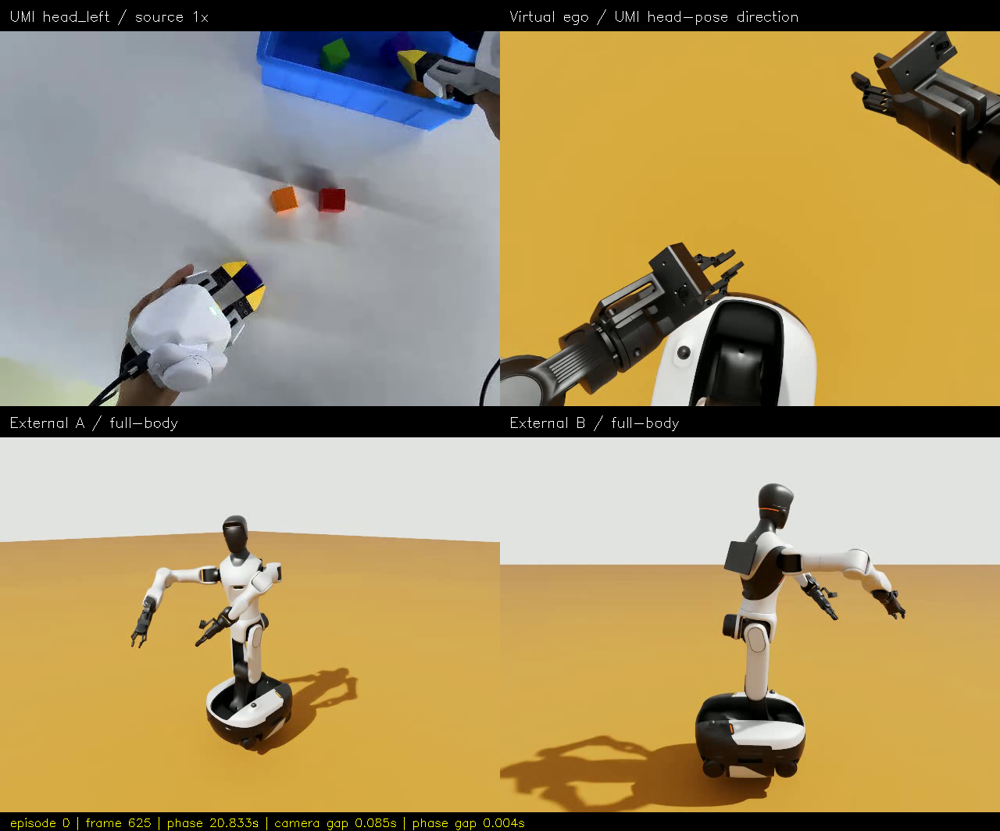
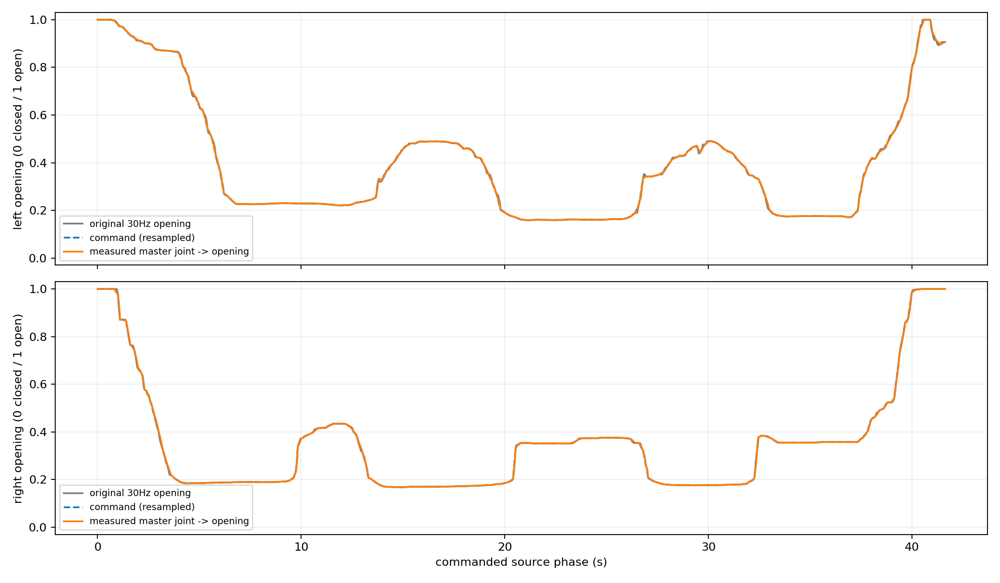
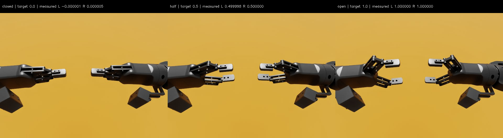
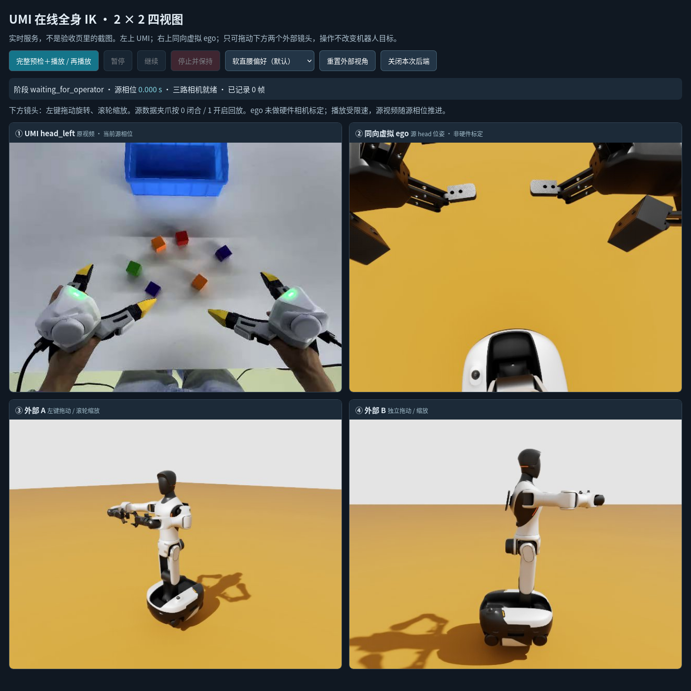
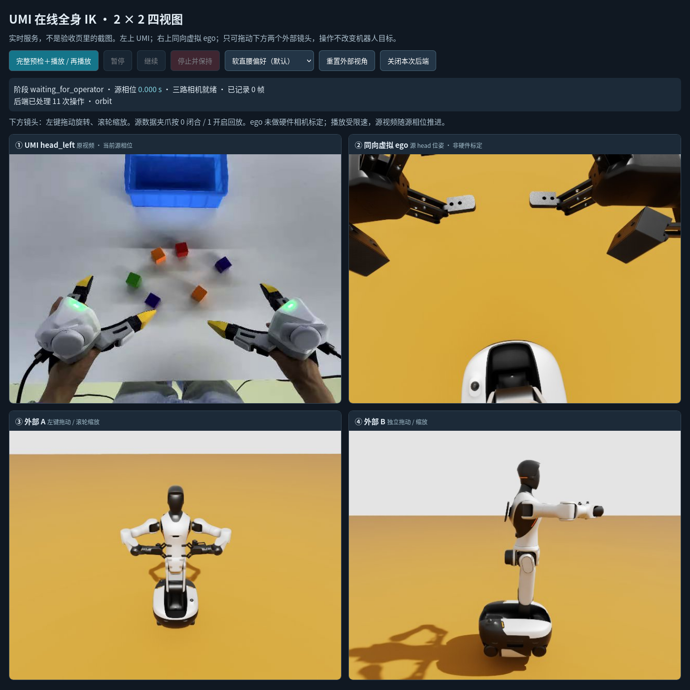

# episode 000 · v4：夹爪开合与 Web 交互验收

**[打开图文/视频验收页](index.html)** · [四分屏 MP4](head_left.mp4) · [实现与启动说明](../../GRIPPER_AND_WEB_FIX_ZH.md)

本目录保持平铺结构，MP4、PNG 和来源 manifest 放在一起；复制/克隆这个目录即可离线观看。
`index.html` 是验收资料，不是仿真控制台。在线控制需启动后端并打开 `http://127.0.0.1:8765`。

## 实际运行

2026-10-15 **09:41:08–09:57:26（Asia/Shanghai）**，`soft` 策略，底盘固定、腰部＋双臂＋夹爪。
**228/228 目标预检、回放、回家通过**。回放段 933.970 s；按源相位重采样的视频为 1,250 帧 / 30 fps / 41.666667 s。

| 检查 | 左 / 右 |
|---|---|
| 原始 EEF 位置误差最大值 | 10.895 / 10.845 mm |
| 原始 EEF 位置误差 P95 | 7.146 / 6.259 mm |
| 原始 EEF 朝向误差最大值 | 1.451° / 1.568° |
| 归一化开度实测范围 | 0.15918–0.99998 / 0.16823–0.99966 |
| 开度对原始数据最大误差 | 0.01824 / 0.02094，即 1.824 / 2.094 个百分点 |
| 开度对原始数据 P95 误差 | 0.00649 / 0.00502 |

最大实测 roll **0.01876°**，底盘平移漂移 **1.228 μm**。
四分屏最大图像时间差 **313.952 ms**、最大源相位差 **21.035 ms**；不是严格硬件同步。

EEF 数字来自实测关节 FK，使用随开度变化的两指尖中点 TCP；不是只统计 IK 残差。
归一化开度按 URDF 关节行程映射，不宣称两种夹爪物理毫米开口已标定。

## 0、0.5、1 端点补测

全闭原生关节 q=-0.91 时，指垫碰撞网格约有 0.195 mm 交叠。旧检查拒绝该预期接触。
SRDF 仅新增同一夹爪两指垫这两对允许接触，其他碰撞检查不关闭。
整段源轨迹最小开度约 0.16，先在未放开这两对时通过；之后单独补测全闭端点，二者不混用。

三个目标开度 **0、0.5、1** 都实际执行通过，目标指尖 EEF 保持不变，最大实测位置误差约 **4.404 mm**。
全闭实测开度左 **-0.00000119**、右 **0.00000518**；微小越界是实测误差，未通过裁剪伪造精确零。

## 真实浏览器交互

- Firefox 157.0.1、四路 640×480 图像加载正常。
- **真实鼠标**拖动外部 A：方位角变化 -0.8 rad，图像平均绝对像素差 **24.182/255**。
- **真实滚轮**缩放 B：距离 **1.9 → 1.443 m**。
- **真实按钮**点击：重置、播放、暂停、继续均通过；暂停 1.5 s 后源相位变化 **0 s**，恢复后整段完成。
- 63 个 UMI 单元测试＋10 个既有实验台测试通过。浏览器测试不是 curl/合成 DOM 点击。

上图是验收截图，不能在 Markdown/图片里拖动；真正的在线入口和命令见实现说明。

## 来源与边界

`manifest.json` 保存报告/媒体哈希、EEF/开度指标、浏览器操作结果、端点实测结果和数据来源。
原始运行在 `wbc_demo/logs/umi-web-20261015-093806-993509/`；日志与完整慢速录像不入 Git。
报告 SHA256：`fc6d8b8e75ada434d2076d7fd1f382d07ab3601a3931e0f8e86273f16e192f60`。

UMI 来源：TacVerse/xtac-umi-g1-block-to-box，revision `8ad651578fda4724514387e2d3d3551c3c9631f9`。
含源画面的衍生图片/视频按 **CC-BY-SA-4.0** 共享，进行了缩放、标注、拼接和源相位重采样。
虚拟 ego 与源头部同向，但没有公开光学内外参，不是标定后的 G2 头部相机。
场景未复现物体、接触或抓取；在线执行仍先预检，不是逐周期重新求解 IK。
